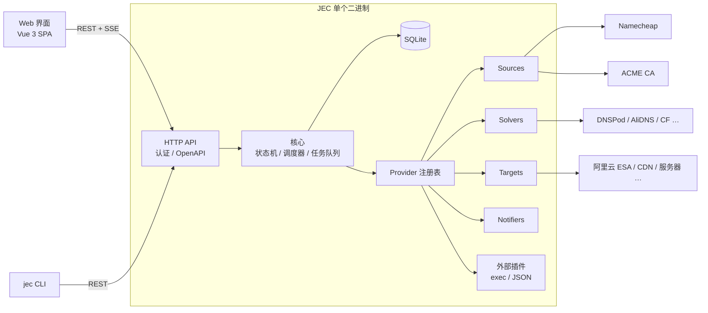
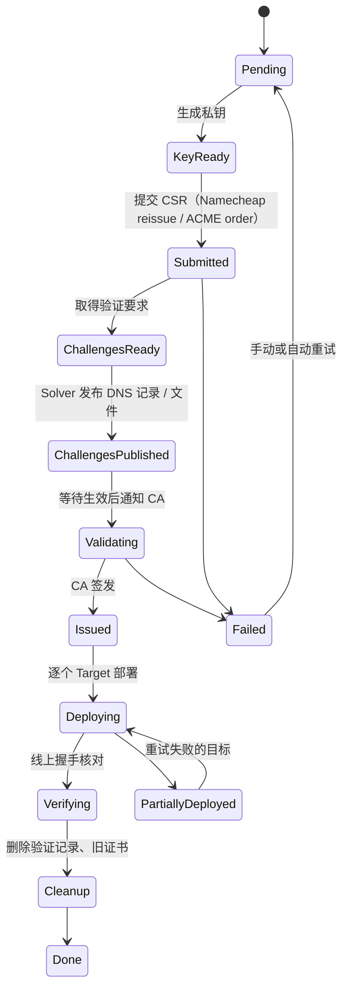

# Just Enough Certs（JEC）规划

> Just enough certs to keep your site green.

自托管的 SSL/TLS 证书管理面板：从各种来源**获取**证书，自动完成**域名验证**，**部署**到 CDN / 服务器 / 云产品，并在到期前**自动续期**。名字致敬 Minecraft 的 JEI（Just Enough Items）。

- 仓库：`github.com/XMZO/JustEnoughCerts`
- 程序 / 命令：`jec`
- 镜像：`ghcr.io/xmzo/justenoughcerts`（GHCR 要求全小写）
- 协议：MIT

---

## 1. 背景

CA/Browser Forum 的 SC-081 提案把证书最长有效期逐年缩短：2026-03-15 起 **200 天**，2027-03-15 起 **100 天**，2029-03-15 起 **47 天**，域名验证结果的复用期也同步缩短。手动换证书会越来越不现实。

现有工具的空白：

- acme.sh、certbot、Certimate 等只支持 **ACME** 免费证书，处理不了 Namecheap 这类**付费证书**按 200 天周期的重签。
- Namecheap 自带的自动化（SSL Proxy、SSL Manager）要么要求用它家 DNS，要么只能装到本机的 nginx/apache，**推不到阿里云 ESA 这类 CDN**。

JEC 要把“证书从哪来”“怎么验证域名”“部署到哪去”三件事拆开，每一块都能自由组合。

**第一个验收场景**（作者自己的环境）：

> Namecheap 付费证书 → 通过 DNSPod 自动加 CNAME 完成验证 → 上传到阿里云 ESA（国内站）→ 确认生效后删除旧证书 → 每个 200 天周期自动重复。

## 2. 目标与非目标

**目标**

- 来源、验证、部署、通知四类都做成**可插拔的 Provider**，新增一种来源或目标不需要改核心代码，也不需要改前端。
- **好看、能在各种屏幕上用**的 Web 界面：手机、平板、桌面都能顺畅操作，支持深色模式和中英文。
- **一个 `docker-compose.yml` 就能部署**，也提供各平台原生二进制文件。
- 打 tag 后**自动构建发布**：Linux x86_64/ARM64 原生二进制，以及 ghcr.io 多架构镜像。
- 流程**可中断、可恢复**：任何一步失败或程序重启，都能从断点继续，不会重复扣费或重复签发。
- **安全默认**：密钥加密存储，首次初始化需要令牌，不收集任何遥测数据。

**非目标（至少 1.0 之前不做）**

- 不做 CA。私有 CA、内网证书留到以后再考虑。
- 不做多租户 SaaS，定位是单个用户或小团队自己部署。
- 不替代 DNS 托管面板，只增删验证需要的记录。

## 3. 核心概念

| 概念 | 说明 | 例子 |
|---|---|---|
| **Certificate**（证书） | 一张逻辑证书：域名列表、密钥类型、来源、部署目标、续期策略。对应一份 Namecheap 订阅或一组 ACME 域名 | `example.com, www.example.com` |
| **Issuance**（签发记录） | 某一次签发或重签的完整过程，有自己的状态和日志 | 2026-10 那次 200 天重签 |
| **Source**（证书来源） | 从哪里拿证书 | Namecheap API、ACME、手动上传 |
| **Solver**（验证执行器） | 完成域名验证（DCV） | DNSPod、阿里云 DNS、Cloudflare DNS、HTTP 文件 |
| **Target**（部署目标） | 证书装到哪里 | 阿里云 ESA、本地文件 + 重载命令、SSH、Webhook |
| **Credential**（凭据） | 各家平台的访问密钥，加密存储，可被多个 Provider 引用 | 阿里云 RAM 子账号 AK |
| **Notifier**（通知渠道） | 成功、失败、即将过期时发通知 | Telegram、邮件、Webhook、Server酱、Bark、钉钉/飞书/企业微信 |
| **Policy**（策略） | 什么时候续期、失败后怎么重试、部署顺序 | 到期前 30 天续期，指数退避重试 |
| **Monitor**（巡检） | 定期连到线上地址做 TLS 握手，核对实际返回的证书 | 发现 CDN 还在用旧证书就告警 |

## 4. 总体架构



### 4.1 技术选型

| 部分 | 选择 | 理由 |
|---|---|---|
| 后端语言 | **Go** | lego（ACME + 180 多家 DNS）、Namecheap 官方 SDK、阿里云/腾讯云官方 SDK 都是 Go；标准库自带 x509；单个静态二进制，交叉编译方便 |
| HTTP | `chi` 路由 + `huma` | huma 能从 Go 代码直接生成 OpenAPI 文档，前端类型和 CLI 都可以由此生成 |
| 数据库 | **SQLite**（`modernc.org/sqlite`，纯 Go） | 不需要 CGO，所有目标平台都能交叉编译；数据访问层留接口，以后可以加 PostgreSQL |
| 迁移 | `goose` | 启动时自动迁移，迁移文件随二进制嵌入 |
| ACME | `go-acme/lego` | 支持 EAB 和自定义 CA，DNS 服务商最全 |
| 日志 | 标准库 `log/slog` | 结构化日志；每次签发的日志单独存库，界面上可以实时看 |
| 前端 | **Vue 3 + TypeScript + Vite + Tailwind CSS + shadcn-vue** | 见第 6 节；构建产物通过 `go:embed` 打进二进制 |
| 打包发布 | GoReleaser + Docker Buildx | 见第 8 节 |

### 4.2 签发状态机

每次签发都是一条持久化在数据库里的状态机。每一步都设计成**幂等**的：外部接口调用前先记录意图，调用后记录结果，重启后能判断该重试还是该跳过。



### 4.3 调度

- 内置调度器，不依赖系统 cron。默认每小时扫描一次，找出需要续期、需要重试、需要巡检的证书。
- 每张证书一把锁，避免并发签发同一张证书；全局并发数可以配置。
- 重试使用指数退避加随机抖动，并尊重对方返回的 `Retry-After`。
- 会产生费用或不可逆的操作（购买、续费、吊销）**永远不自动重试**，只发通知等人工确认。

## 5. 可插拔 Provider 设计（自定义能力的核心）

### 5.1 接口草图

```go
// 每个 Provider 都能描述自己：名字、图标、配置项的 JSON Schema。
// 前端根据 Schema 自动生成表单，所以新增 Provider 不需要写前端代码。
type Descriptor struct {
    ID          string          // "namecheap-api"
    Kind        Kind            // Source / Solver / Target / Notifier
    Name        I18nText
    Icon        string
    ConfigSchema json.RawMessage // 由 Go 结构体 + 标签生成
    Experimental bool
}

type Source interface {
    Describe() Descriptor
    // 提交 CSR，返回来源侧的订单/证书引用
    Submit(ctx context.Context, req SubmitRequest) (OrderRef, error)
    // 取得需要完成的域名验证（DNS / HTTP / Email）
    Challenges(ctx context.Context, ref OrderRef) ([]Challenge, error)
    // 通知来源“验证已就绪”
    ConfirmChallenge(ctx context.Context, ref OrderRef, ch Challenge) error
    // 查询状态；签发后返回证书链
    Poll(ctx context.Context, ref OrderRef) (OrderStatus, *Bundle, error)
}

type Solver interface {
    Describe() Descriptor
    Present(ctx context.Context, ch Challenge) (Cleanup, error)
    // 从公共 DNS 或外网确认已生效，避免过早通知 CA
    Verify(ctx context.Context, ch Challenge) error
}

type Target interface {
    Describe() Descriptor
    // 先上传新证书（不删旧的），返回目标侧的证书 ID
    Deploy(ctx context.Context, b Bundle, opt DeployOptions) (DeployedRef, error)
    // 确认线上已生效
    Verify(ctx context.Context, ref DeployedRef) error
    // 生效后清理旧证书；目标有数量上限时，由核心决定先删还是先传
    Prune(ctx context.Context, keep DeployedRef) error
    Capacity(ctx context.Context) (used, limit int, err error)
}
```

### 5.2 三层扩展方式

1. **内置 Provider**：用 Go 写，编译进二进制，覆盖常用平台。
2. **外部插件（exec 协议）**：任何语言写的可执行文件，通过 stdin/stdout 交换带版本号的 JSON。`describe` 动作返回 Schema，界面就能出现对应表单。不用重新编译 JEC，就能接入自家内部系统。
3. **钩子（Hooks）**：在 `before_issue`、`after_issue`、`after_deploy`、`on_failure` 等节点执行 Shell 命令或调用 Webhook。证书文件路径、域名等通过环境变量传入，模板语法是 Go 的 `text/template`。

### 5.3 首批 Provider 清单

| 类型 | 1.0 前 | 以后 |
|---|---|---|
| Source | 手动上传 / 导入；ACME（Let's Encrypt、ZeroSSL、Google Trust Services、自定义 CA + EAB，Namecheap 的 ACME 上线后直接可用）；**Namecheap 官方 API**（`ssl.reissue` / `ssl.getInfo` / `ssl.activate`） | **Namecheap SSL Manager 后端（实验性，默认关闭，非官方接口）**；其他付费 CA 的 API |
| Solver | DNSPod / 腾讯云 DNS、阿里云 DNS、Cloudflare（以上包装 lego 的 DNS 实现，其余 lego 支持的服务商逐步开放）；HTTP 文件（写入 webroot）；Email（只发通知，人工处理） | CNAME 委派验证（把 `_acme-challenge` 指向一个专用的区） |
| Target | **阿里云 ESA**；本地文件 + 重载命令（nginx、caddy 等）；SSH 上传 + 远程命令；Webhook | 阿里云 CDN / CAS、腾讯云 EdgeOne / CDN、Cloudflare 自定义证书、Kubernetes Secret、1Panel / 宝塔等面板 |
| Notifier | Telegram、SMTP 邮件、通用 Webhook | Server酱、Bark、钉钉、飞书、企业微信、ntfy、Gotify |

### 5.4 阿里云 ESA 目标的注意点（来自实际调研）

- 国内站接入点是 `esa.cn-hangzhou.aliyuncs.com`，国际站是 `esa.ap-southeast-1.aliyuncs.com`，配置里可选。
- 免费版每个站点最多只能放 **2 张**自定义证书。部署前先查容量：有空位就“先传后删”；满了就先删最旧的那张不在用的。
- 同一域名有多张证书能匹配时，ESA 优先返回**最后配置**的那张，所以上传后通常立刻生效，但仍要握手验证一次。
- 文档里给出所需 RAM 权限的最小模板（`esa:ListSites`、`esa:ListCertificates`、`esa:SetCertificate`、`esa:DeleteCertificate`），DNSPod 同理。

## 6. Web 界面

### 6.1 页面

- **总览**：即将过期、续期中、失败的数量；未来 90 天的到期时间线；最近的签发动态。
- **证书**：列表（搜索、按状态和来源筛选）→ 详情（证书链、SAN、指纹、有效期、签发历史、各部署目标状态、下载）。
- **签发记录**：每一次签发的状态机进度和实时日志（通过 SSE 推送）。
- **来源 / 验证 / 部署 / 通知**：Provider 实例的配置，表单由 Schema 自动生成，带“测试连接”按钮。
- **凭据**：集中管理，显示被哪些 Provider 引用；保存后不再明文显示。
- **设置**：账号、两步验证、API 令牌、备份与恢复、外观、检查更新（可关闭）。

### 6.2 美观与适配

- **断点**：小于 640px 用底部标签栏，侧边栏收进抽屉；640–1024px 用可折叠侧栏；大于 1024px 用常驻侧栏。
- **表格在手机上变成卡片**，关键信息（域名、剩余天数、状态）始终可见。
- 点击区域不小于 44px；支持深色、浅色、跟随系统；主题色可自定义。
- 字体：系统字体栈，中文依次回退到 PingFang SC、Microsoft YaHei、Noto Sans SC；图标用 Lucide。
- 剩余天数用颜色区分（绿 / 黄 / 红），同时配文字和图标，不只靠颜色传达信息。
- 国际化：简体中文和英文，文案集中管理，方便社区补充其他语言。
- 可选 PWA：能添加到手机桌面。
- 小彩蛋：像素风的锁形 Logo；可选的“方块风”主题，向 JEI 致敬。

### 6.3 前端技术栈

Vue 3 + TypeScript + Vite + Tailwind CSS + shadcn-vue（基于 Reka UI 的无样式组件，样式完全可控），数据请求用 TanStack Query，API 类型由后端 OpenAPI 文档自动生成。React + shadcn/ui 也可以，这一项在开工前最终确定（见第 13 节）。

## 7. 部署

### 7.1 单文件 docker-compose.yml

```yaml
services:
  jec:
    image: ghcr.io/xmzo/justenoughcerts:latest
    container_name: jec
    restart: unless-stopped
    ports:
      - "8080:8080"
    environment:
      TZ: Asia/Shanghai
      # 可选：不填时首次启动自动生成并保存到 /data/secret.key
      # JEC_SECRET_KEY: "换成 32 字节以上的随机字符串"
      # 可选：放在反向代理后面、或挂在子路径下时设置
      # JEC_BASE_URL: "https://certs.example.com"
    volumes:
      - ./data:/data
    healthcheck:
      test: ["CMD", "jec", "healthcheck"]
      interval: 30s
      timeout: 5s
      retries: 3
```

启动：`docker compose up -d`。首次打开网页会进入初始化向导，需要输入日志里打印的**一次性初始化令牌**（`docker logs jec` 可见），防止服务刚暴露在公网时被别人抢先注册管理员。

### 7.2 镜像

- 基于 Alpine，内置 CA 证书、时区数据和 `sh`（钩子脚本需要）。另外提供 `-slim` 变体（distroless，无 shell），给不用钩子、追求最小体积的用户。
- 默认以非 root 用户运行，可通过 `PUID` / `PGID` 调整，方便挂载目录的权限匹配。
- 所有数据都在 `/data`：数据库、加密密钥、日志。备份这一个目录就够了。

### 7.3 原生二进制

- `jec serve` 启动服务；`jec service install` 注册为 systemd 服务。
- 数据目录、端口、Base URL 都可以用命令行参数、环境变量（`JEC_*`）或 `config.yaml` 配置。优先级：命令行参数 > 环境变量 > 配置文件 > 默认值。

## 8. CI/CD（GitHub Actions）

### 8.1 `ci.yml`：每次推送和 PR

- Go：`golangci-lint`、`go test -race`、`govulncheck`。
- 前端：类型检查、ESLint、单元测试、构建。
- 用 `ubuntu-24.04-arm` 原生 ARM 运行器（公开仓库免费）再跑一遍测试，确保 ARM 上行为一致。

### 8.2 `release.yml`：推送 `v*.*.*` 标签时

1. 构建一次前端，作为产物传给后续步骤。
2. **GoReleaser** 交叉编译原生二进制（`CGO_ENABLED=0`、`-trimpath`，通过 ldflags 注入版本号）：

   | 系统 | x86_64 | ARM64 | 其他 |
   |---|---|---|---|
   | Linux | ✅ | ✅ | armv7（树莓派等，可选） |
   | macOS | ✅ | ✅ | 顺手附带 |

   打包格式：`.tar.gz`，另附 `checksums.txt`、SBOM（syft 生成），并用 cosign 无密钥签名。
3. **ghcr.io 多架构镜像**：Dockerfile 直接复制上一步编译好的对应架构二进制，不在 QEMU 模拟环境里编译，所以快且稳定。
   - 平台：`linux/amd64`、`linux/arm64`（armv7 可选）。
   - 标签：`1.2.3`、`1.2`、`1`、`latest`。预发布版本（如 `v1.3.0-beta.1`）只打 `beta` 和完整版本号，不动 `latest`。
   - 附带构建来源证明（provenance attestation）。
4. 根据 Conventional Commits 自动生成更新日志，创建 GitHub Release。

### 8.3 其他

- Renovate 或 Dependabot 自动更新依赖。
- 版本号遵循 SemVer；`jec version` 显示版本号、提交哈希和构建时间。

## 9. 安全

- **凭据和私钥加密存储**：AES-256-GCM，主密钥来自 `JEC_SECRET_KEY` 或数据目录里的密钥文件。界面上不回显已保存的密钥，下载私钥前需要重新输入密码。
- **登录**：本地账号，密码用 argon2id 哈希，支持 TOTP 两步验证；以后支持 OIDC 单点登录。Cookie 设 `HttpOnly`、`Secure`、`SameSite`，带 CSRF 防护；登录接口限速。
- **API 令牌**：可以按权限范围生成，用于 CLI 和自动化。
- **审计日志**：谁在什么时候改了什么、下载了哪个私钥。
- **安全响应头**：CSP、HSTS（由用户选择是否开启）等。
- **Webhook 防 SSRF**：默认禁止请求内网地址，可配置白名单。
- **最小权限**：文档里给每个云平台提供最小权限策略模板。
- **不收集遥测**；检查更新可以关闭。
- **非官方接口隔离**：Namecheap SSL Manager 后端这类非公开接口，放在实验性模块里，默认关闭，界面上明确标注“可能随时失效”。

## 10. 兼容性与自定义清单

- **配置三选一或混用**：网页界面、环境变量、`config.yaml`；证书和 Provider 配置可以导出导入为 YAML，方便迁移和用 Git 管理。
- **密钥类型**：RSA 2048/3072/4096，ECDSA P-256/P-384；可以每张证书单独设置。
- **证书格式**：PEM（证书 / 完整链 / 私钥分开或合并）、PFX/PKCS#12、JKS。
- **文件部署**：路径、文件名模板、属主、权限、写入后执行的命令都可配置，因此兼容 nginx、caddy、haproxy 等任何读文件的程序。
- **导入现有证书**：支持手动上传，也支持扫描 acme.sh、certbot 的目录导入（只读，避免冲突）。
- **命名模板**：部署到 CDN 时的证书名可自定义，例如 `jec-{{.Domain}}-{{.NotAfter | date "20060102"}}`。
- **网络**：每个 Provider 可以单独设置 HTTP 代理；验证 DNS 是否生效时可以指定公共解析服务器；支持 IPv6。
- **反向代理**：支持挂在子路径下（`JEC_BASE_URL`），支持信任代理头（可配置）。
- **平台**：Linux、macOS 各自的 x86_64 和 ARM64。
- **时区与语言**：都可以设置，日志统一使用 UTC 时间戳。

## 11. 仓库结构

```text
JustEnoughCerts/
├── cmd/jec/                  # 程序入口（serve / healthcheck / service / version …）
├── internal/
│   ├── app/                  # 组装各模块
│   ├── server/               # HTTP、认证、OpenAPI、SSE
│   ├── core/                 # 领域模型、状态机、调度器、任务队列
│   ├── store/                # SQLite 访问层与迁移
│   ├── cryptox/              # 私钥、CSR、PEM/PFX 处理，加密存储
│   ├── plugin/               # exec 外部插件协议
│   └── providers/
│       ├── source/           # manual, acme, namecheap, namecheap_sslmanager(实验)
│       ├── solver/           # lego 适配层、http、email
│       ├── target/           # aliyun_esa, local, ssh, webhook …
│       └── notify/           # telegram, smtp, webhook …
├── web/                      # Vue 前端
├── deploy/
│   ├── docker-compose.yml
│   └── systemd/jec.service
├── docs/                     # 使用文档、Provider 开发指南、最小权限模板
├── .github/workflows/        # ci.yml, release.yml
├── .goreleaser.yaml
├── Dockerfile
├── Makefile
├── LICENSE                   # MIT
└── README.md
```

## 12. 路线图

| 阶段 | 内容 | 完成标准 |
|---|---|---|
| **M0 骨架** | 仓库、CI、发布流水线、Docker 镜像、空的前端、登录和初始化向导、SQLite | 打一个 `v0.0.1` 标签，能自动产出全部二进制和镜像，`docker compose up` 能打开登录页 |
| **M1 最小可用** | 证书模型、状态机、调度器；手动上传来源；ACME + DNSPod；阿里云 ESA 目标；Telegram 和 Webhook 通知；总览和证书页 | 用免费证书完整跑通“签发 → 部署到 ESA → 删除旧证书 → 到期自动续” |
| **M2 Namecheap** | Namecheap 官方 API 来源（重签 + CNAME 验证）；导入已有的 Namecheap 证书；Namecheap ACME 上线后验证兼容性 | 第 1 节的验收场景全自动跑通一个周期 |
| **M3 扩展** | exec 外部插件、钩子、YAML 导入导出；更多部署目标和通知渠道；线上巡检 | 不改核心代码，写一个外部插件接入新平台 |
| **M4 打磨** | 两步验证、OIDC、审计日志、PWA、文档站、多语言 | 发布 `v1.0.0` |
| **以后** | Namecheap SSL Manager 后端（实验性）、多用户和角色、PostgreSQL、私有 CA | 按需求排期 |

先做 M0，是为了尽早把“打标签 → 自动发布”这条链路跑通，之后每个功能都能随时发版试用。

## 13. 待定事项

- [ ] 前端最终用 Vue 还是 React（目前倾向 Vue）。
- [ ] 除 SQLite 外，何时支持 PostgreSQL。
- [ ] 界面和文档默认语言（倾向界面跟随浏览器，文档中英双语）。
- [ ] Namecheap 官方 API 需要满足开通条件（20 个域名，或账户余额 / 近两年消费达 $50）并设置 IP 白名单：在 README 里写清楚，并提供不需要 API 的替代路径（ACME 或手动上传）。
