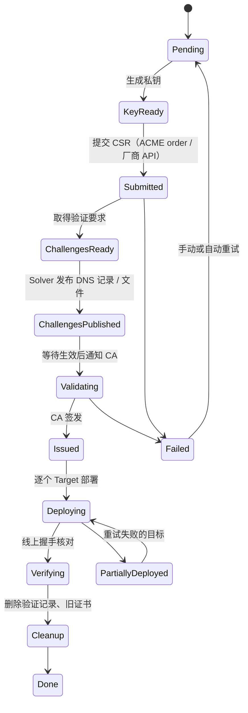

# Just Enough Certs（JEC）规划

> Just enough certs to keep your site green.

自托管的 SSL/TLS 证书管理面板：从各种来源**获取**证书，自动完成**域名验证**，**部署**到 CDN / 服务器 / 云产品，并在到期前**自动续期**。名字致敬 Minecraft 的 JEI（Just Enough Items）。

- 仓库：`github.com/XMZO/JustEnoughCerts`
- 程序 / 命令：`jec`
- 镜像：`ghcr.io/xmzo/justenoughcerts`（GHCR 要求全小写）
- 协议：MIT

---

## 1. 背景

CA/Browser Forum 的 SC-081 提案把证书最长有效期逐年缩短：2026-03-15 起 **200 天**，2027-03-15 起 **100 天**，2029-03-15 起 **47 天**，域名验证结果的复用期也同步缩短。手动换证书会越来越不现实。

现有工具的空白：

- acme.sh、certbot、Certimate 等基本只管 **ACME** 证书。付费证书如果要走 CA 或经销商的专有 API 重签，就没有现成工具。
- 各家 CA 和经销商的自动化工具（例如 Namecheap 的 SSL Manager、SSL.com 的 SSL Manager）都是私有的，只服务自家证书，而且大多只能装到本机的 nginx/apache，**推不到 CDN 这类云产品**。

业界真正通用的自动化标准是 **ACME（RFC 8555）+ EAB**：CA 给出 ACME 地址、Key ID 和 HMAC 密钥，任何 ACME 客户端都能用。免费 CA 和越来越多的商业 CA 都已支持。

所以 JEC 的定位是**通用**的证书管理面板：

- 证书来源以 **ACME + EAB** 和**手动上传 / 导入**为主，覆盖绝大多数 CA；
- 各家的专有 API 和自动化工具只是可选模块，彼此地位相同；没有公开 API、只有自家工具的，由 JEC 扮演那个工具的客户端，把证书推到 CDN（如 Namecheap SSL Manager，见 5.6）；
- “证书从哪来”“怎么验证域名”“部署到哪去”三件事拆开，每一块都能自由组合。

**第一个验收场景**：

> 付费证书 → 自动重签并完成域名验证 → 部署到 CDN → 确认生效后删除旧证书 → 每个有效期周期自动重复。

首个测试环境是作者自己的：Namecheap 的 PositiveSSL（经 SSL Manager 重签，HTTP 文件验证）+ DNS 在 DNSPod + 阿里云 ESA（国内站）。

## 2. 目标与非目标

**目标**

- **所有功能模块化、可插拔**（见 4.2）：内核只保留最基础的部分，其余功能都是独立模块，增加或删除一个功能不影响其他部分。
- 来源、验证、部署、通知四类都做成**可插拔的 Provider**，新增一种来源或目标不需要改核心代码，也不需要改前端。
- **尽量覆盖市面上的证书和 DNS 服务商**（见 5.3）：证书来源以通用的 ACME + EAB 为主，支持 ACME 的 CA 都能直接用；DNS 服务商借助 lego 一次覆盖 221 家（lego v5.5.2 共 223 家，去掉 `manual` 和 `exec`）。
- **国际化严格独立**（见第 7 节）：每种语言一个文件，代码里不写死任何界面文字；先实现简体中文和英文；测试设 i18n 门禁。
- **好看、能在各种屏幕上用**的 Web 界面：手机、平板、桌面都能顺畅操作，支持深色模式。
- **一个 `docker-compose.yml` 就能部署**，也提供原生二进制文件。
- **镜像尽可能小**，但不阉割功能，也不用 UPX 这类牺牲运行性能的压缩（见 8.3）。
- 打 tag 后**自动构建发布**：Linux x86_64/ARM64 原生二进制，以及 ghcr.io 多架构镜像。
- 流程**可中断、可恢复**：任何一步失败或程序重启，都能从断点继续，不会重复扣费或重复签发。
- **安全默认**：密钥加密存储，首次初始化需要令牌，不收集任何遥测数据。

**非目标（至少 1.0 之前不做）**

- 不做 CA。私有 CA、内网证书留到以后再考虑。
- 不做多租户 SaaS，定位是单个用户或小团队自己部署。
- 不替代 DNS 托管面板，只增删验证需要的记录。

## 3. 核心概念

| 概念 | 说明 | 例子 |
|---|---|---|
| **Module**（模块） | 一个可以独立启用、停用、删除的功能单元 | 证书管理、巡检、审计日志、阿里云 ESA 部署 |
| **Certificate**（证书） | 一张逻辑证书：域名列表、密钥类型、来源、部署目标、续期策略。对应一份付费证书订阅或一组 ACME 域名 | `example.com, www.example.com` |
| **Issuance**（签发记录） | 某一次签发或重签的完整过程，有自己的状态和日志 | 2026-10 那次 200 天重签 |
| **Source**（证书来源） | 从哪里拿证书 | ACME（含 EAB）、手动上传、厂商专有 API 或自动化工具（如 Namecheap SSL Manager） |
| **Solver**（验证执行器） | 完成域名验证（DCV） | DNSPod、阿里云 DNS、Cloudflare DNS、HTTP 文件 |
| **Target**（部署目标） | 证书装到哪里 | 阿里云 ESA、本地文件 + 重载命令、SSH、Webhook |
| **Credential**（凭据） | 各家平台的访问密钥，加密存储，可被多个 Provider 引用 | 阿里云 RAM 子账号 AK |
| **Notifier**（通知渠道） | 成功、失败、即将过期时发通知 | Telegram、邮件、Webhook、Server酱、Bark、钉钉/飞书/企业微信 |
| **Policy**（策略） | 什么时候续期、失败后怎么重试、部署顺序 | 到期前 30 天续期，指数退避重试 |
| **Monitor**（巡检） | 定期连到线上地址做 TLS 握手，核对实际返回的证书 | 发现 CDN 还在用旧证书就告警 |

## 4. 总体架构


### 4.1 技术选型

| 部分 | 选择 | 理由 |
|---|---|---|
| 后端语言 | **Go** | lego（ACME + 221 家 DNS）和各家云平台的 SDK 都是 Go；标准库自带 x509；单个静态二进制，交叉编译方便 |
| HTTP | `chi` 路由 + `huma` | huma 能从 Go 代码直接生成 OpenAPI 文档，前端类型和 CLI 都可以由此生成 |
| 数据库 | **SQLite** | 不需要额外服务；数据访问层留接口，以后可以加 PostgreSQL。驱动用纯 Go 的 `ncruces/go-sqlite3`（M0 实测后选定，见 8.3） |
| 迁移 | `goose` | 启动时自动迁移；每个模块带自己的迁移文件，随二进制嵌入 |
| ACME | `go-acme/lego` v5 | 支持 EAB 和自定义 CA，DNS 服务商最全 |
| 通用 DNS 记录增删 | 自己实现，用 lego 已带的各家 SDK | lego 只会加 ACME 用的 TXT 记录；付费证书要加任意 CNAME/TXT，需要单独一层（见 5.3.2） |
| 国际化 | 独立的 `i18n` 模块 + 每种语言一个 JSON 文件 | 前后端共用同一份翻译文件，见第 7 节 |
| 日志 | 标准库 `log/slog` | 结构化日志；每次签发的日志单独存库，界面上可以实时看 |
| 前端 | **Vue 3**（已定）+ TypeScript + Vite + Tailwind CSS + shadcn-vue + vue-i18n | 见第 6 节；构建产物通过 `go:embed` 打进二进制 |
| 打包发布 | GoReleaser + Docker Buildx | 见第 9 节 |

### 4.2 功能模块化（可插拔）

**原则：内核尽量小，其余一切都是模块。**

- **内核只包含**：配置、存储与迁移框架、认证与权限、事件总线、调度器、模块注册表、i18n、HTTP 框架。
- **其余都是模块**：证书管理、每一个 Provider（阿里云 ESA、DNSPod、Namecheap……各自是一个模块）、通知、巡检、钩子、外部插件、导入导出、API 令牌、两步验证、OIDC、审计日志、备份恢复等。

**每个模块是一个自包含的目录**，自带：

- 后端代码和数据库迁移；
- API 路由和权限点；
- 设置项的 Schema（界面自动生成设置表单）；
- 前端页面、菜单项、总览卡片；
- 自己的翻译 key 命名空间（翻译文字本身仍集中在语言文件里，见第 7 节）；
- 测试和文档。

**模块接口草图**：

```go
type Module interface {
    // ID、版本、依赖哪些模块、权限点、菜单项、设置项 Schema
    Manifest() Manifest
    // 本模块的数据库迁移
    Migrations() fs.FS
    // 注册 API 路由、Provider、事件订阅、定时任务
    Register(r *Registry) error
}
```

**模块之间不直接互相调用**，只通过内核提供的接口和事件总线通信，例如证书模块发出 `certificate.issued` 事件，通知模块订阅。部署由证书模块按证书选定的部署目标完成，目标本身是 Provider 模块（如阿里云 ESA）：部署要用私钥，私钥只在证书模块里，不随事件传出。`internal/modules` 里的架构测试（`go test`，不另装工具）禁止模块之间互相 import，也禁止内核 import 模块，保证删掉任何一个模块，其他模块都还能编译。

**三种增删方式**：

1. **编译时**：每个模块在 `internal/modules/all/<id>.go` 有一个注册文件，带 build tag `!no_<id>`。`go build -tags no_<id>` 不编译它；删除模块就是删掉它的目录和这个文件。官方发布的版本包含全部模块。
2. **运行时**：在设置页里启用或停用模块。停用后它的 API、菜单、定时任务都不再加载，数据保留，重新启用就能恢复。
3. **前端按需加载**：后端的 `/api/v1/manifest` 返回已启用的模块清单，前端据此动态加载页面。每个模块单独打包，没启用的模块不会被下载。

**模块脚手架**：`make new-module id=xxx category=source`（Windows 上 `go run ./tools/new-module -id xxx -category source`）生成模块目录 `internal/modules/<id>/`（`module.go` 和测试）、注册文件、两个翻译 key（`<id>.module.name` / `<id>.module.description`）。翻译 key 先写成 `TODO:` 开头的占位文字，i18n 检查不放行占位文字，所以模块作者必须写好名称和简介才能合并。CI 每次都在仓库副本里生成一个模块，检查它能编译、测试通过、只有占位文字被 i18n 检查拦下，再逐个用 build tag 去掉每个模块，检查程序仍能编译（`scripts/check-modules.sh`）。

Provider 也是模块，和功能模块一样放在 `internal/modules/<id>/`，类别（来源、验证、部署目标、通知、功能）写在 Manifest 里。模块 ID 在全局唯一（它是模块启用状态表的主键，也是 `/api/v1/<id>` 的路径），所以一个 ID 一个目录，不再按类别分目录。

### 4.3 签发状态机

每次签发都是一条持久化在数据库里的状态机。每一步都设计成**幂等**的：外部接口调用前先记录意图，调用后记录结果，重启后能判断该重试还是该跳过。



**实现**（`internal/modules/certs` 的 `issue.go`，M1）：

- **签发记录**存在 `certs_issuances`：原因（`first` 新加的证书或还没有版本、`renewal` 续期、`manual` 手动）、状态（`pending` 等待下一次尝试、`running`、`waiting` 等来源处理、`done`、`failed` 不再自动重试）、尝试次数、下次尝试时间、最近一次失败的原因（消息 key 和参数）。一张证书同时最多一条未结束的签发（唯一索引），重复点“立即签发”返回同一条；在等重试或等来源的会立即再试。
- **等待来源**（M2，厂商来源的通用框架）：来源返回 `contracts.Wait`（它要保留的状态，和多久后再问，限 1 分钟到 24 小时）时，签发进入 `waiting`：不算失败，到时间再问来源，仍算同一次尝试，日志也接着写。私钥在签发的第一次尝试时生成，加密保存，这次签发的每次尝试都用它；来源的状态也加密保存，下次交还给来源。签发成功后两者都删掉。彻底失败时，来源的状态不为空（订单还在来源那里，之后可能签出）就都留着，下一次签发接过来继续（日志第一行说明），否则删掉私钥。自带私钥的来源（`contracts.KeySource`）也一样：它返回的 `Wait` 带的状态加密保存，下次放在 `CollectRequest.State` 里交还。来源用 `contracts.Restart` 标出订单已经作废（比如 CA 拒绝了它，或者在厂商那里被删了）时，失败或重试都不留私钥和状态，从头再来。进度页里，前面的尝试做过、这次已经越过的步骤算完成。
- **日志**逐行存在 `certs_issuance_log`：级别、所属步骤、消息 key 和参数、原文细节（如 CA 的报错，只在完整日志里显示）。步骤是 `contracts.Steps`：生成私钥、下单、添加验证记录、等待验证、清理验证记录、下载证书；进度页按最后一次尝试的日志判断每一步的状态。图里的中间状态没有逐步持久化：lego 的 `Obtain` 一次完成下单到下载，ACME 订单不能从中途接着做，而重新下单是安全的。
- **执行**：`certs.issue` 任务运行到期的签发，同时最多 2 个，有新签发时立即被唤醒；它不会和自己重叠，所以开始时仍是 `running` 的签发一定是 JEC 停止时被打断的，记一行日志后重新开始。每次尝试最多 30 分钟。删除证书会中止它正在进行的签发，不发失败通知。签发成功时，新版本、签发记录和 `certificate.issued` 事件在同一个事务里写入。
- **失败重试**：退避从 10 分钟起，每次翻倍，最长 12 小时，按对方要求的 `Retry-After` 推迟（最多 24 小时）；最多 8 次，约一天。`retry.Permanent` 标记的错误（缺少 EAB、CA 拒绝为这些域名签发、要求用户先去 CA 网站操作）不再自动重试。每次失败都发 `certificate.issue_failed`，带上第几次、原因和下次尝试时间（不再重试时为空）。
- **续期**：进入续期窗口的证书在设置里的“每天检查时间”开始续期（默认 02:00，按服务器时区，即 `TZ` 环境变量；`docker-compose.yml` 默认 `Asia/Shanghai`），避开白天；只剩一周或更少时（续期窗口本身不到一周时，一进入窗口就）立即开始。`certs.renew` 任务每 5 分钟看一次，所以最多晚 5 分钟；还没有版本的证书立即签发。签发彻底失败后，隔 24 小时再自动开始下一次。每个新版本都用新私钥。接口里每张有来源的证书带 `renewAt`（下一次续期开始的时间），列表和详情页显示它。
- **证书来源和验证**是 Provider 实例（5.5），证书只保存实例 ID；证书还在用的实例不能删除。来源类型可以声明 `needsSolver`（ACME 需要），这时添加证书必须选验证方式，而且要是来源能用的那一类（`challenges`，见 5.3.2 ④）。

### 4.4 调度

- 内置调度器，不依赖系统 cron。每个任务有自己的间隔：续期每 5 分钟看一次（何时开始见 4.3），到期提醒每小时一次，签发和部署每分钟一次、有新工作时立即开始。
- 每张证书一把锁，避免并发签发同一张证书；全局并发数可以配置。
- 重试使用指数退避加随机抖动，并尊重对方返回的 `Retry-After`。
- 会产生费用或不可逆的操作（购买、续费、吊销）**永远不自动重试**，只发通知等人工确认。

**实现**（`internal/kernel/jobs`、`internal/kernel/retry`）：

- 模块在 `Register` 里用 `r.Jobs.Add` 登记定时任务：名称、间隔、超时（默认等于间隔）。间隔从上次开始运行的时间算起；上次开始时间存在 `kernel_jobs` 表里，重启不会打乱节奏。已经到期或从没跑过的任务，在启动 10 秒后运行。
- 同一个任务不会重叠运行；模块停用期间它的任务不运行，重新启用后一分钟内补上。任务出错时记日志，表里保存最近一次的错误，下次照常运行；要更快重试由任务自己决定。关机时正在运行的任务会收到取消信号，表里的结束时间留空，表示被打断。
- `retry` 包供调度器、事件总线和以后的签发状态机共用：`Backoff` 是指数退避（每次翻倍，有上限，随机去掉最多一半）；`After` 记下对方要求的等待（`ParseRetryAfter` 解析 `Retry-After` 头）；`Permanent` 标记不再自动重试的错误：重试也没用，或者操作收费、不可逆。
- 每张证书一把锁和全局并发数放在证书模块里做（M1）。

### 4.5 事件总线

实现在 `internal/kernel/events`。

- **发布**：模块用 `r.Events.PublishTx(ctx, tx, 类型, 主题, 数据)`，在**产生这个变化的同一个事务**里写入事件，同时给每个匹配的订阅写一条投递记录（`kernel_events`、`kernel_deliveries` 表）。事务提交了事件才存在，回滚时事件一起消失：事件不会丢，也不会为没发生的变化发通知。手上没有事务时用 `Publish`。
- **类型命名**：小写单词用点连接，先写对象再写发生了什么，例如 `certificate.issued`、`certificate.deploy_failed`。一种类型只由一个模块发布。跨模块使用的事件类型和数据结构以后定义在内核里，因为模块之间不能互相 import。
- **订阅**：模块在 `Register` 里调用 `r.Events.Subscribe`，可以订阅具体类型、`certificate.*` 这样的前缀，或者 `*`。所有模块登记完之后才允许发布，所以每个事件都能送到全部订阅。
- **送达保证**：至少一次，不保证顺序。崩溃重启或失败重试之后，处理函数可能再次收到同一个事件，也可能先收到更新的事件；所以处理函数必须幂等，并且读取当前状态，不能假定手上的事件就是最新的。每个订阅同一时间只处理一个事件，大体按发布顺序；全局同时最多 4 个投递。
- **失败重试**：处理函数返回错误就退避重试（从 10 秒起，每次翻倍，最长 1 小时）；对方要求的等待（`retry.After`）最多认 24 小时。默认最多试 15 次（覆盖约 7 小时的故障）；次数用完或遇到 `retry.Permanent` 就放弃，记为失败。每次处理默认最多 1 分钟；处理函数 panic 也算一次失败。
- **模块停用时**：投给它的事件保留并等待，重新启用后继续投递。订阅可以设置 `MaxAge`，超过时限的事件直接丢弃，例如太晚才发出去就没意义的通知。
- **关机**：正在处理的事件收到取消信号，这次被打断的处理不计入次数，下次启动重新投递。
- **保留期**：事件保留 30 天。内核每天运行 `kernel.prune_events` 任务，删除更早的事件和它们的投递记录。

### 4.6 证书模块

实现在 `internal/modules/certs`（模块 ID `certs`，必需模块，不能停用）。

- **数据**：`certs_certificates` 是逻辑证书（域名列表、来源、密钥类型、续期窗口、当前版本）；`certs_versions` 是签发或上传得到的每一个版本（证书链 PEM、序列号、SHA-256 指纹、颁发者、有效期），私钥用 `r.Secrets` 加密后存放，绑定到版本的指纹。同一张证书（按指纹）只能添加一次。
- **状态**：有签发在进行时是 `issuing`；最近一次签发失败（或在等重试），而且之后没有新版本时是 `failed`；其次看部署：`deploy_failed`、`deploying`（见下面的“部署”）；否则由当前版本和续期窗口算出：`ok`、`expiring`（进入续期窗口，默认到期前 30 天）、`expired`。
- **部署**（`deploy.go`，M1）：证书有一组按顺序的部署目标（`certs_targets`，类型为 target 的 Provider 实例）。每个新版本，无论上传还是签发，都给每个目标排一次部署（`certs_deployments`），由 `certs.deploy` 任务执行：同时最多 4 个，同一证书的同一目标同时只部署一个；失败按签发的规则退避重试，每次失败发 `certificate.deploy_failed`，成功发 `certificate.deployed`。还在等待的部署遇到更新的版本，就改为部署新版本。目标返回它保存的东西的标识（如 CDN 上的证书 ID），以后的部署把这些“以前的版本”交给目标，目标删掉后报告回来。证书状态多了 `deploying`（有部署在进行）和 `deploy_failed`（到某个目标的最近一次部署失败或在等重试），和签发失败分开，界面才能说清楚是哪一步出了问题。增删目标时，新目标立即部署当前版本，去掉的目标取消等待中的部署；`POST .../certificates/{id}/deploy` 立即重新部署，`GET .../deployments/{id}` 返回部署和日志。部署目标在用时不能删除。
- **记录**（`history.go`，M1）：`GET /api/v1/certs/runs?days=30` 把签发和部署合在一起，按时间倒序列出（最多 500 条，`days=0` 不限时间）：操作（签发、续期、部署）、触发方式（自动：进入续期窗口的续期、新版本带来的部署；手动：添加证书、立即签发、加部署目标、立即部署）、状态、错误、所签或所部署版本的到期时间、最后一次尝试的起止时间。部署记下开始的原因（`reason`：新版本、加了目标、有人要求）。
- **签发**：`POST /api/v1/certs/certificates/issue` 用来源实例、验证实例、域名、密钥类型（默认 RSA 2048）添加证书，立即返回，首次签发在后台进行。域名统一成小写的 ASCII 形式（国际化域名转成 Punycode），去掉重复，通配符写成 `*.example.com`。`POST .../certificates/{id}/issue` 立即签发，`GET .../certificates/{id}/issuances` 列出最近的签发记录，`GET .../issuances/{id}` 返回签发记录、每一步的状态和完整日志。
- **上传**：`POST /api/v1/certs/certificates` 接收 PEM 证书（顺序随意，可以带私钥）和私钥；`cryptox.ParseBundle` 找出和私钥匹配的证书，按签发关系排好中间证书，去掉自签名的根证书。常见错误（没有私钥、私钥加密了、私钥和证书不匹配等）返回各自的错误码，并指出是哪个输入框。上传新版本时，新证书必须包含原来的主域名，而且到期时间要比当前版本晚。
- **事件**（类型和数据结构在 `internal/kernel/contracts`）：新版本成为当前版本时发 `certificate.issued`；删除时发 `certificate.deleted`；每小时的 `certs.check_expiry` 任务在当前版本进入续期窗口、只剩 7 天、已过期时各发一次 `certificate.expiring`（重启或停机跳过的级别不补发）。
- **事件里的指纹**：`certificate.issued`、`certificate.deployed` 带版本叶子证书的 SHA-256 指纹（`Fingerprint`）。别的模块发 `certificates.announce` 时，证书模块给每张有版本的证书发一条 `certificate.current`（数据同 `issued`），供后来启用、或者错过了事件的模块补齐。

### 4.7 线上巡检

实现在 `internal/modules/monitor`（模块 ID `monitor`，默认开）：像浏览器一样连到每张证书的域名（443 端口，带 SNI，不校验证书：要看的是哪一张），核对线上返回的是不是当前版本。

- **知道哪些证书**：订阅证书模块的 `certificate.issued`、`current`、`deployed`、`deleted`，记在 `monitor_certificates`（域名、当前版本和指纹、成为当前版本的时间、下次检查时间）。启动后不久和之后每天发一次 `certificates.announce`，让证书模块把全部证书报一遍，所以升级前已有的证书也会检查。
- **什么时候查**：新版本 30 分钟后（留出部署时间）；部署到某个目标 2 分钟后；平时每 6 小时；发现旧证书后每 30 分钟复查。`monitor.check` 任务每分钟看一次，一次最多查 20 张证书，同时最多 4 个连接，每个 15 秒超时。通配符域名连不上，跳过。
- **结果**（`monitor_results`，每个域名一行）：`ok` 是当前版本；`old` 是覆盖这个域名、但比当前版本早到期的证书，也就是还没换上新的；`other` 是别的名字的证书或更新的证书；`unreachable` 是 443 端口没有 TLS 回应（证书可能用在别处，只显示、不告警）。
- **告警**：当前版本生效满 30 分钟后，某个域名还是 `old`，就发 `certificate.served_old`（数据带 `Check`：域名、线上证书的指纹和到期时间），每个版本每个域名只发一次，恢复 `ok` 后重新计。通知模块把它当作默认打开的事件（“网站上还是旧证书”）。
- **接口**：`GET /api/v1/monitor/certificates/{id}`（各域名最近一次的结果、下次检查时间、跳过的通配符域名），`POST …/check` 立即检查，`GET /api/v1/monitor/states`（每张证书有几个域名还是旧证书、几个连不上）。界面：证书详情的“线上检查”一块，证书列表把线上还是旧证书的放进“需要处理”。模块停用时这些都不显示。

## 5. 可插拔 Provider 设计

Provider 是模块的一种：每个 Provider 都是一个独立模块，按 4.2 的方式增删。

### 5.1 接口草图

```go
// 每个 Provider 都能描述自己：名字、图标、配置项的 JSON Schema。
// 前端根据 Schema 自动生成表单，所以新增 Provider 不需要写前端代码。
// 名字、字段标签、帮助说明都只写翻译 key，不写文字本身（见第 7 节）。
type Descriptor struct {
    ID           string          // "aliyun-esa"
    Kind         Kind            // Source / Solver / Target / Notifier
    NameKey      i18n.Key        // "provider.aliyun_esa.name"
    Icon         string
    ConfigSchema json.RawMessage // 由 Go 结构体 + 标签生成，标签里是翻译 key
    Experimental bool
}

type Source interface {
    Describe() Descriptor
    // 提交 CSR，返回来源侧的订单/证书引用
    Submit(ctx context.Context, req SubmitRequest) (OrderRef, error)
    // 取得需要完成的域名验证（DNS / HTTP / Email）
    Challenges(ctx context.Context, ref OrderRef) ([]Challenge, error)
    // 通知来源“验证已就绪”
    ConfirmChallenge(ctx context.Context, ref OrderRef, ch Challenge) error
    // 查询状态；签发后返回证书链
    Poll(ctx context.Context, ref OrderRef) (OrderStatus, *Bundle, error)
}

type Solver interface {
    Describe() Descriptor
    Present(ctx context.Context, ch Challenge) (Cleanup, error)
    // 从公共 DNS 或外网确认已生效，避免过早通知 CA
    Verify(ctx context.Context, ch Challenge) error
}

type Target interface {
    Describe() Descriptor
    // 先上传新证书（不删旧的），返回目标侧的证书 ID
    Deploy(ctx context.Context, b Bundle, opt DeployOptions) (DeployedRef, error)
    // 确认线上已生效
    Verify(ctx context.Context, ref DeployedRef) error
    // 生效后清理旧证书；目标有数量上限时，由核心决定先删还是先传
    Prune(ctx context.Context, keep DeployedRef) error
    Capacity(ctx context.Context) (used, limit int, err error)
}
```

### 5.2 三层扩展方式

1. **内置 Provider**：用 Go 写，编译进二进制，覆盖常用平台。
2. **外部插件（exec 协议）**：任何语言写的可执行文件，通过 stdin/stdout 交换带版本号的 JSON。`describe` 动作返回 Schema 和插件自带的翻译，界面就能出现对应表单。不用重新编译 JEC，就能接入自家内部系统。
3. **钩子（Hooks）**：在 `before_issue`、`after_issue`、`after_deploy`、`on_failure` 等节点执行脚本或内置动作（HTTP 请求、SSH 命令、写文件、重启 Docker 容器）。证书文件路径、域名等通过环境变量传入，模板语法是 Go 的 `text/template`。

**钩子的实现**（模块 `hooks`，M3）：

- 钩子是一种通知渠道 `hooks.script`（“运行脚本”）：由通知模块按渠道选的事件运行，和别的渠道一样有发送记录和“发送测试”。设置只有一段脚本，加上通知渠道共有的语言和事件开关。
- 脚本用内嵌的 shell（`mvdan.cc/sh`，POSIX sh 和 Bash 的写法都认；和本地目录部署的命令共用 `internal/lib/shellx`）在数据目录下的 `hooks/` 里运行（第一次用时建立，只有属主能进），最多 20 秒（通知模块给每个渠道 30 秒）。环境变量是 JEC 自己的环境去掉 `JEC_` 开头的设置，加上按渠道的语言写好的消息 `JEC_EVENT`、`JEC_TIME`、`JEC_TITLE`、`JEC_SUBJECT`、`JEC_TEXT`、`JEC_LINK`，事件关于某张证书时还有 `JEC_CERTIFICATE_ID`、`JEC_DOMAIN`、`JEC_DOMAINS`、`JEC_NOT_AFTER`、`JEC_FINGERPRINT`；标准输入是整条消息的 JSON，和 Webhook 通知发的一样。
- 退出码 0 算发送成功；75（sysexits 的 `EX_TEMPFAIL`，照邮件程序的用法）表示暂时失败，事件总线退避重试；其他退出码、语法错误、超时都不重试。失败时输出的最后一行（300 字节以内）放进错误信息，渠道卡片和测试结果里能看到。
- 要用证书文件的钩子是部署目标：本地目录写好文件后执行命令（certbot 的部署钩子脚本可以直接用），SSH 在服务器上执行命令，Docker 容器发信号或重启，Webhook 部署把证书 POST 出去。`before_issue` 这类节点没有做：域名验证由验证方式完成，不需要先停掉占着 80 端口的服务。
- 容器镜像里除了 JEC 没有别的程序，脚本只能用 shell 自己的命令和重定向（比如把消息追加到文件里），所以主要给直接运行的 JEC 用。令牌之类放在 JEC 的环境变量里，名字不以 `JEC_` 开头。要按别的格式调用 HTTP 接口时，用 Webhook 的自定义请求体（5.3.3 的“自定义请求”）。

**外部插件的实现**（模块 `plugins`，M3，协议写在 `docs/plugins.md`）：

- JEC 启动时扫描数据目录下的 `plugins/`：每个可执行文件是一个插件，文件名去掉扩展名就是 ID。文件和目录只能由属主写入，属主要是 root 或运行 JEC 的用户，否则不运行。
- 对每个插件发 `describe`（10 秒），把它声明的部署目标、通知渠道、验证方式（DNS 或 HTTP）登记成 provider 类型 `plugins.<插件>.<类型>`，带 `plugin` 标签；通知渠道自动加上 `contracts.NotifierFields`。
- 插件自带的文字转义成原样显示的消息，键在 `plugins.texts.` 下（`i18n.PluginText`），作为类型的 `texts` 随类型接口返回，前端并入自己的消息（`addMessages`）。所以 provider 类型多了 `texts` 字段（键必须以模块 ID 开头），模块的 Registry 多了 `DataDir`。
- 每个动作运行一次插件：标准输入一个 JSON 请求，标准输出一个 JSON 回答（最多 1 MiB），标准错误在失败时记进日志。在 `<plugins>/<ID>.data` 里运行，环境去掉 JEC 自己的 `JEC_` 设置；超时（测试 1 分钟，其他 5 分钟）后结束整个进程组。部署请求的内容和 Webhook 部署一样；插件给的日志行和错误原样显示。没有回答、超时可以重试，回答看不懂不重试。
- 插件列表 `GET /api/v1/plugins/files`，显示在“模块”页。插件只在启动时读取，加了或改了要重启；“插件”模块关掉时类型不可用，但启动时仍会运行 `describe`。
- 证书来源类的插件还没做。

### 5.3 服务商支持范围

“阶段”一栏对应第 13 节的路线图。列表之外的平台，可以通过外部插件或钩子接入。

#### 5.3.1 证书来源（SSL）

**推荐顺序**：CA 支持 ACME 就用 ACME；不支持时用它的专有 API 或自动化工具模块（如 Namecheap SSL Manager）；都没有就手动上传，由 JEC 负责部署和到期提醒。

| 类别 | 服务商 | 接入方式 | 阶段 |
|---|---|---|---|
| **通用：ACME 免费证书** | Let's Encrypt、ZeroSSL、Google Trust Services、SSL.com、Actalis | ACME（部分需要 EAB 凭据） | M1 |
| **通用：ACME 商业证书** | Sectigo、DigiCert、GlobalSign、HARICA、TrustAsia（亚洲诚信）等提供 ACME 的 CA，以及经销商提供的 ACME（如 Namecheap，官方计划 2026 年 11–12 月上线） | 自定义 ACME 地址 + EAB，**任何支持 ACME 的 CA 都能接**，逐家验证后列入兼容表 | M1 |
| **通用：手动上传 / 导入** | 任何 CA 的证书（PEM / PFX）；扫描 acme.sh、certbot 的目录 | 只读导入，避免和原工具冲突。PEM 和 PFX/P12 上传已实现（`cryptox.ParsePFX` 用 `go-pkcs12`，旧的 3DES/RC2 和 OpenSSL 3 的 AES 都能读）；读目录做成了来源类型 `files.watch`（见 5.3.3 的“本机证书目录”），不只导入一次，原工具续期后新证书也会取进来 | M1 |
| 厂商自动化工具（实验性模块） | **Namecheap SSL Manager**（Namecheap 给直客的服务器端自动化工具，后端 `externalautossl.service.spaceship.com`） | JEC 扮演它的客户端：一次性令牌注册，自己生成私钥和 CSR，HTTP 文件验证，取回每一张 200 天的证书。非公开接口，默认关闭，界面标注“可能随时失效”；见 5.6 | M2 |
| 厂商专有 API（可选模块） | 阿里云数字证书管理服务、腾讯云 SSL 证书 | 云 API：取回控制台签发的证书、向阿里云申请证书、申请腾讯云免费证书（都已实现，见下） | M3 |
| 厂商专有 API（可选模块） | ZeroSSL REST API、GoGetSSL、TheSSLStore、DigiCert CertCentral 等 | 各自的 API，按需求排期 | 以后 |
| 厂商专有 API（可选模块） | Namecheap 官方 API（`ssl.reissue` / `ssl.getInfo` / `ssl.activate`，CNAME 验证） | 开通门槛高（账号里有 20 个域名，或余额 / 近两年消费满 $50），还要设 IPv4 白名单；有需要再做 | 以后 |
| 实验性 | Spaceship 卖的证书：后端域名同属 Spaceship，可能能用同一套接口（未核实） | 同 Namecheap SSL Manager | 以后 |

**阿里云、腾讯云签发的证书（M3，已实现）**：来源类型 `aliyun.fetch`、`tencentcloud.fetch`（分别在 `aliyun`、`tencentcloud` 模块里）是自带私钥的来源（`contracts.KeySource`，和本机证书目录一样）：取回在云平台控制台申请、购买或续费的证书，私钥要由云平台生成（申请时上传自己 CSR 的拿不到私钥，报错提示重新签发）。上传到云平台的证书不算，JEC 自己部署上去的也在那里。按主域名搜索，取覆盖证书全部域名、还有效、结束得最晚的一张；和正在用的是同一张或更旧时，6 小时后再看；同一天结束但不是同一张（重新签发的）时取进来。证书没带中间证书时日志里警告。

- 阿里云：`ListUserCertificateOrder`（`OrderType=CERT`，`Keyword` 是主域名，不带状态时只列有效证书；`Upload` 为真的跳过；同一天结束时取 ID 大的）、`GetUserCertificateDetail`（`Cert`、`Key`）。RAM 权限 `yundun-cert:ListUserCertificateOrder`、`yundun-cert:GetUserCertificateDetail`。
- 腾讯云：`DescribeCertificates`（`SearchKey` 是主域名，`CertificateType=SVR`、`CertificateStatus=[1]`、`FilterSource=buy`；`AllowDownload` 为假的跳过）、`DownloadCertificate`（控制台下载的那个 ZIP，每种 Web 服务器一个目录：JEC 读出其中所有 PEM 文件，找和证书配对、覆盖全部域名的私钥，证书链也从中拼出）。CAM 权限 `DescribeCertificates`、`DownloadCertificate`。
- 都只用替身 API 测过，还没有对真实账号验证。

**向阿里云申请证书（M3，已实现）**：来源类型 `aliyun.apply`，用数字证书管理服务的证书资源包申请，规格（`ProductCode`，高级设置）默认 `digicert-free-1-free`，即个人测试证书（DigiCert DV，3 个月，每年 20 张，只在中国站，要先在控制台领取额度）；买了其他 DV 资源包的也能用。私钥由 JEC 生成，阿里云只拿到 CSR（`CreateCertificateForPackageRequest` 的 `Csr`，放在表单里），所以是普通的来源，走 4.3 的“等待来源”，每 2 分钟看一次订单（`DescribeCertificateState`）：

- `domain_verify`：证书选的是能加任意记录的 DNS 服务商（或手动添加）时用 DNS 验证：`RecordDomain` 是控制台里的主机记录（如 www.example.com 的 `_dnsauth.www`），由 `dnscheck.RecordName` 转成完整域名，加上后等权威 DNS 查得到；选的是网站目录类的验证方式时用文件验证：`Uri` 放在 `/.well-known/pki-validation/` 下，从外网按 CA 的方式（HTTP、不跟随跳转）取一次核对，取不到只记警告。CA 自己会来查，不用报告。
- `process`：CA 审核中，接着等；`certificate`：取回证书（和这次签发的私钥配对），删掉验证文件和记录（手动加的提示用户删）。
- `verify_fail`：用 `DeleteCertificateRequest` 删掉订单（删掉的订单退回额度），报错并标 `contracts.Restart`，下一次签发重新申请；订单在阿里云找不到了（比如在控制台删了），或者订单的验证方式和证书现在选的对不上，也标 `contracts.Restart`。
- 测试连接用 `DescribePackageState` 报出资源包里这个规格有几张、已经申请了几张。联系人（姓名、手机、邮箱）可以在高级设置里填，留空时用控制台里最新的联系人。RAM 权限 `yundun-cert:CreateCertificateForPackageRequest`、`DescribeCertificateState`、`DeleteCertificateRequest`、`DescribePackageState`。只用替身 API 测过，还没有对真实账号验证。
- 阿里云的新版“证书实例”接口（`UpdateInstance` 设置 `GenerateCsrMethod=upload` 和 `Csr`、`ApplyCertificate`、`GetInstanceDetail` 的 `DomainValidationList`）也能用自己的 CSR，但文档没说个人测试证书走不走它，先用文档明确支持个人测试证书的资源包接口。
- 腾讯云免费证书（来源类型 `tencentcloud.free`，已实现）：`ApplyCertificate`（TrustAsia DV，3 个月，一个域名，不能是通配符）由腾讯云生成私钥（RSA 2048 或 ECDSA P-256，在设置里选），不收 CSR，所以是“自带私钥”的来源；`KeySource` 为此也能在等待之间保留状态（`CollectRequest.State`，证书模块像对普通来源一样加密保存）。目前只用 `DNS_AUTO`：域名要托管在同一账号的 DNSPod，由腾讯云自己加验证记录、签好后删掉（`DeleteDnsAutoRecord`），不用选验证方式。之后每 2 分钟看一次 `DescribeCertificate`：审核中时调一次 `CompleteCertificate` 让 CA 立即去查；已通过就用 `DownloadCertificate` 的 ZIP 取回（同 `tencentcloud.fetch`）；审核失败、已过期、已取消、已吊销、已退款或找不到时标 `contracts.Restart`，下一次签发重新申请。额度用完（`FailedOperation.ExceedsFreeLimit` 等）不重试。用 `DNS`、`FILE` 并经证书的验证方式放记录或文件，要再给自带私钥的来源接上验证方式，以后需要再做。只用替身测过。

#### 5.3.2 DNS 服务商（域名验证）

DNS 验证分成两种能力，实现方式不同：

**① ACME DNS-01（添加 `_acme-challenge` TXT 记录）**：直接复用 lego。lego v5.5.2 有 **223 家**服务商（2026-10 核对源码），去掉需要在终端里手动操作的 `manual` 和执行外部程序的 `exec`，**221 家可用**。注意 lego v5 删除了旧的 `dnspod`（DNSPod Token），DNSPod 要用腾讯云 API 密钥（`tencentcloud`，SecretId / SecretKey）。界面按地区分组展示，常用的放前面：

- **国内**：阿里云 DNS、阿里云 ESA、腾讯云 / DNSPod、腾讯云 EdgeOne、华为云、百度智能云、京东云、火山引擎、西部数码、新网、DNS.LA、雨云、UCloud、时代互联
- **国际**：Cloudflare、AWS Route 53、Google Cloud DNS、Azure DNS、DigitalOcean、Linode、Vultr、Hetzner、OVH、Gandi、GoDaddy、Namecheap、Spaceship、Porkbun、Name.com、NameSilo、Dynadot、deSEC、DuckDNS、Netlify、Vercel、Bunny、NS1 等
- **自建 / 通用**：PowerDNS、RFC 2136 动态更新（BIND 等，lego v5 里叫 `dnsupdate`）、acme-dns、HTTP 请求；执行外部脚本和手动模式由 JEC 自己实现（外部插件协议和手动验证），不用 lego 的那两个

**② 任意记录增删（厂商 API 验证用，M3，已实现）**：付费证书走厂商专有 API 时，DNS 验证通常要加 CNAME 或 TXT，例如 Sectigo 系证书的 `_<哈希>.example.com CNAME <哈希>.sectigo.com`，而 lego 的接口只能加 ACME 的 TXT 记录。所以这部分单独做一层“DNS 记录管理”：

- 接口是 `contracts.RecordSolver`：`AddRecord` 加一条 TXT 或 CNAME 记录（完整域名），返回删除时要用的标识，来源把它存在签发的状态里，跨多次检查；`RemoveRecord` 删掉。验证类型标 `records` 表示它的实例也能加任意记录；来源类型在 `challenges` 里写 `record` 表示它要这种记录（Namecheap SSL Manager 是 `http` 和 `record`）。添加证书时只列出合用的验证方式，接口也会核对（`providers.Type.Takes`）；添加 DNS 服务商时可以按“任意记录”筛选。
- 实现在 `internal/lib/dnsrecord`，没有用 libdns：lego 已经带了这些服务商的 SDK，直接用它们，这一层连同 Namecheap 的 DNS 验证只让程序大了约 0.1 MiB；引入 libdns 等于每家再多一套客户端。设置沿用 lego 的变量名，同一个 DNS 服务商实例两种验证都能用（lego 模块里这几家的验证方式同时是 `RecordSolver`）。首批四家：腾讯云 DNSPod（API 3.0 的 `CreateRecord`、`DeleteRecord`，线路“默认”）、阿里云 DNS（`AddDomainRecord`、`DeleteDomainRecord`）、Cloudflare（v4 接口，API 令牌或全局密钥）、华为云 DNS（官方 SDK，TXT 的值加引号）。记录所在的区按 SOA 查出。其余服务商按需求补。只用替身 API 测过。
- 记录什么时候生效由来源判断：`internal/lib/dnscheck` 直接问区的每台权威 DNS 服务器（不经过递归解析的缓存），答复了的服务器都有这条记录才算生效；它还把厂商给的记录名转成完整域名（`RecordName`，见 5.6）。这个包只依赖 DNS 库，用它的来源不会带上各家 SDK。
- 外部插件的 DNS 验证方式在描述里标 `records`，就能经 `dns_add_record`、`dns_remove_record` 两个动作添加和删除任意记录（`docs/plugins.md`），其余服务商也能这样接入。
- 补不到的服务商用**手动模式**（模块 `manual`，验证类型 `manual.dns`）：签发日志列出每条要加的记录（ACME 来源给所有 DNS 验证都记这一行），用户在 DNS 服务商那里添加，JEC 查权威 DNS，查到就继续，不用点“已添加”。ACME 最多等设置的分钟数（默认 20，最多 25，在一次尝试 30 分钟的时限内）；厂商来源跨多次检查一直等。每次续期都要重新添加，签发失败的通知会提醒；手动加的记录由用户自己删，日志会提示。
- 注意：付费证书的验证记录名由 CSR 计算得出，每次重签都会变，所以不能像 ACME 那样把记录永久 CNAME 委派到别处。

**③ CNAME 委派（仅 ACME）**：把 `_acme-challenge.example.com` 永久 CNAME 到一个有 API 的域，以后签发都在那个域里操作。这样即使域名所在的 DNS 没有 API，也能全自动。

**④ HTTP 文件验证（M2，已实现）**：验证方式的另一类是把文件放到域名的网站上（`contracts.FileSolver`：`PutFile`、`RemoveFile`），用于 ACME 的 http-01 和厂商来源（如 Namecheap SSL Manager）的文件验证。验证类型声明 `challenge`（`dns` 或 `http`），来源类型声明 `challenges`（它能用的验证方式，ACME 能用 `dns` 和 `http`，Namecheap 能用 `http` 和 ② 的 `record`）；添加证书时只列出合用的验证方式，接口也会核对；通配符证书不能用 HTTP 验证。为了不让来源改动网站的页面，文件只能放在 `/.well-known/` 下，路径只能由字母、数字和 `-._~/` 组成，不能有 `..`。JEC 从外网取回验证文件核对时和 CA 一样跟随跳转，跳到 HTTPS 时不校验证书（`httpx` 的 `SkipVerify`）：网站上可能还是快过期或已经过期的旧证书。几种实现：

- **网站目录**（`files.webroot`）：JEC 所在机器上（或挂载进容器的）Web 服务器的网站根目录，所有域名共用这个目录，或者每个域名一个以域名命名的子目录。先写临时文件再改名，文件所有人可读。
- **SSH 网站目录**（`ssh.webroot`）：经 SSH 写到远程服务器的网站目录，连接设置和 SSH 部署目标一样（主机公钥一定核对），一次签发里第一次用到时连接，之后复用。
- **JEC 自己应答**（`wellknown.answer`，模块 `wellknown`）：不碰网站的文件，验证文件存在模块自己的表里，由 JEC 回答 `/.well-known/` 下的请求；要在网站的反向代理（如 nginx 的 `location /.well-known/`）或 CDN（如阿里云 ESA 的回源规则）上把这个路径转给 JEC。内核给模块开了一个口子 `r.WellKnown`：根路径 `/.well-known/` 下的请求（不管 JEC 是不是在子路径下）不需要登录，按顺序交给打开着的模块，回 404 就交给下一个。按请求的 Host 和路径找文件，Host 被代理改过时只按路径找；回答不让缓存。可以填一个“用来测试的域名”：测试连接时 JEC 放一个临时文件，再从外网经这个域名取回来，确认请求真的转到了 JEC。
- **ESA 边缘应答**（`esa.edge`，模块 `esa`）：网站在阿里云 ESA 上时不经过源站：验证文件存进 ESA 的边缘 KV，由 JEC 自动部署到账号里的边缘函数在边缘回答，见 5.4。

#### 5.3.3 部署目标

| 类别 | 平台 | 阶段 |
|---|---|---|
| CDN / 边缘 | **阿里云 ESA**（M1）；阿里云 CDN / DCDN、七牛云（已完成）、腾讯云 EdgeOne、腾讯云 CDN、华为云 CDN（已完成）、百度智能云 CDN（已完成）、火山引擎 CDN（已完成）、又拍云、AWS CloudFront（经 ACM，已完成）、Cloudflare（自定义证书需付费套餐，已完成） | M1 / M3 |
| 负载均衡 / 证书库 | 阿里云 SLB / ALB、阿里云证书服务（CLB、ALB 和数字证书管理服务已完成）、腾讯云 CLB、腾讯云 SSL 证书（已完成，经它更新 CDN、EdgeOne、CLB 等）、AWS ACM（已完成） | M3 |
| 对象存储 | 阿里云 OSS（已完成）、腾讯云 COS（经腾讯云 SSL 证书服务，已完成）的自定义域名 HTTPS | M3 |
| 服务器 | 本地文件 + 执行命令（nginx、caddy、haproxy 等）；SSH / SFTP 上传 + 远程命令；Docker 容器（通过挂载的 Docker API 发信号或重启，不需要 docker 命令行）；Kubernetes Secret | M1（本地、SSH）/ M3（Docker、Kubernetes 已完成） |
| 面板与应用 | 1Panel、宝塔、Proxmox VE、Nginx Proxy Manager、群晖 DSM、Caddy 管理 API（都已完成） | M3 |
| 通用 | Webhook、外部插件 | M1 |

**本地文件的实现**（`internal/modules/files`，M1）：部署目标类型 `files.directory`：目录（绝对路径）和放法（每张证书一个以主域名命名的子目录，`*` 写成 `star`；或者直接放在这个目录里）。按 certbot 的文件名写 `cert.pem`、`chain.pem`、`fullchain.pem`、`privkey.pem`（私钥只有所有者可读），每个文件先写到临时文件再改名，读的程序不会读到写了一半的文件；新版本直接覆盖，没有旧版本要删。目录是相对路径、没有写入权限时不自动重试。写好后可以执行一段命令（比如 `systemctl reload nginx`）：用内嵌的 shell 解释器（`mvdan.cc/sh`，POSIX sh 和 Bash 的写法都认）在证书目录里执行，最多 5 分钟；环境变量是 JEC 自己的环境去掉 `JEC_` 开头的设置（比如主密钥），加上 `JEC_CERT_DIR`、`JEC_CERT_FILE`、`JEC_CHAIN_FILE`、`JEC_FULLCHAIN_FILE`、`JEC_KEY_FILE`、`JEC_DOMAIN`、`JEC_DOMAINS`、`JEC_CERTIFICATE_ID`、`JEC_NOT_AFTER`，以及 certbot 部署钩子用的 `RENEWED_LINEAGE`、`RENEWED_DOMAINS`，现成的 certbot 钩子脚本可以直接用。输出的最后 4000 字节记进部署日志；退出码不是 0、语法不对、超时都不自动重试。测试连接只检查命令的语法，不执行。容器镜像里除了 JEC 没有别的程序，所以这主要给原生二进制部署用。

**本机证书目录**（来源类型 `files.watch`，在 `files` 模块里）：取进另一个 ACME 客户端在本机续期的证书和私钥，比如 certbot 的 `/etc/letsencrypt`（`live/<名字>/fullchain.pem`、`privkey.pem`，以及 `archive/` 里的历次版本）、acme.sh 的主目录（`<域名>/fullchain.cer`、`<域名>.key`，ECC 证书在 `<域名>_ecc/`）。JEC 只读：在设置的目录里往下找 4 层，读 `.pem`、`.crt`、`.cer`、`.key` 文件（最多 5000 个、每个不超过 1 MiB），同一个目录里每把私钥配上那里的证书，按证书指纹去重；签发时取覆盖证书全部域名、到期最晚的那张。读文件经过 `os.Root`，不跟随指到这个目录外面的链接：certbot 的 `live/` 里是指向同级 `archive/` 的链接，所以要填 `/etc/letsencrypt`，填 `live` 目录时会提示改填上一级。
- 来源接口多了一种 `contracts.KeySource`（类型标 `ownKey`）：证书自带私钥，证书模块不生成私钥（日志的“私钥”一步写明随证书取来），添加证书时也不选密钥类型。
- 到续期时间后，文件里还是现在这张（指纹相同或到期不更晚）就返回 `Wait`，签发进入等待，6 小时后再看，直到原工具续期；新证书取进来后照常部署。所以续期窗口要不早于原工具的（certbot 默认到期前 30 天，和 JEC 一样）。
- 读不了私钥时（certbot、acme.sh 的私钥通常只有属主能读）报出是哪个文件，提示让 JEC 以那个用户运行（`docker-compose.yml` 里 `user: "0:0"`）或者用 `--deploy-hook` 复制一份；目录不存在时提示挂载。测试连接列出找到了哪些证书。用 Docker 时把目录只读挂载进容器，`docker-compose.yml` 里有注释掉的示例。

**SSH 的实现**（`internal/modules/ssh`，M1）：部署目标类型 `ssh.server`：主机、端口、用户名、私钥（OpenSSH 或 PEM，可以带口令）或密码、主机公钥、远程目录（绝对路径）和放法（同本地文件），以及写入后执行的命令。用已有依赖里的 `golang.org/x/crypto/ssh`，不用 SFTP：每个文件用一条 `cat > 临时文件` 命令写入（私钥在 `umask 077` 下写），四个都写好后用一条命令一起改名，再执行设置的命令（比如 `systemctl reload nginx`），它的输出记进部署日志。所以服务器要有 POSIX shell，Linux 和 BSD 都有。主机公钥一定核对：可以填 `SHA256:` 开头的指纹，或 known_hosts 里的那一行；留空时第一次部署会失败，错误信息给出服务器出示的指纹，让人核对后填进去。登录被拒、主机公钥不对、写不进去、命令退出码不是 0 都不自动重试，网络问题照常重试。

**面板的实现**（模块 `baota`、`onepanel`，M3，接口用法参考 certimate 里验证过的实现）：

- 宝塔（`baota.site`，国际版 aaPanel 同样适用）：面板地址、接口密钥、网站名（逗号分隔）。对每个网站 `POST /site?action=SetSSL`（表单：`type=0`、`siteName`、`key` 私钥、`csr` 证书链），两个网站之间隔 3 秒，让面板重载 Web 服务器；签名是 `request_time` 和 `request_token = md5(时间 + md5(密钥))`，回答 `{"status": false, "msg": …}` 时失败，消息里有 IP 的提示加白名单。测试连接调 `/system?action=GetSystemTotal`。
- 1Panel（`onepanel.certificate`）：面板地址、API 接口密钥、面板版本（v2 默认，v1 可选，决定 `/api/v2` 或 `/api/v1`）、证书 ID。每个新版本用 `POST …/websites/ssl/upload`（`sslID` 为设置的证书，`type=paste`，保留原来的描述）原地替换面板里那张证书的内容，用它的网站随之换上新证书；签名头 `1Panel-Token = md5("1panel" + 密钥 + 时间)`、`1Panel-Timestamp`，回答的 `code` 不是 2xx 时失败。测试连接列出面板里的证书和 ID（`…/websites/ssl/search`），方便填写。
- 两者都是：私钥会经过面板接口，所以 `http://` 只能连内网（`httpx` 的 `PrivateOnly`，连接时检查地址）；`https://` 默认只连公网，内网要打开“允许内网地址”；面板用自签名证书时，测试连接报出它的 SHA-256 指纹，填进“面板证书指纹”后只信任这张证书（`httpx` 的 `Pin`），和 SSH 核对主机公钥一样。不跟随跳转。只用替身面板测过，还没有对真实面板验证。

**Proxmox VE 的实现**（`internal/modules/proxmox`，M3）：部署目标类型 `proxmox.node`：地址（节点或集群里任一节点，`https://…:8006`）、节点名、API 令牌 ID（`root@pam!jec`）和密钥、是否重启网页服务（默认是）。每个新版本 `POST /api2/json/nodes/{node}/certificates/custom`（表单：`certificates` 证书链、`key` 私钥、`force=1`、`restart`），认证头 `PVEAPIToken=令牌ID=密钥`；令牌要有 `/nodes/{node}` 上的 `Sys.Modify`。Proxmox VE 把失败原因放在状态行里，参数错误另在 `errors` 里，都拼进错误信息。测试连接读 `/certificates/info`。地址、指纹和内网的规则同面板：Proxmox VE 默认用自己生成的证书，测试连接报出指纹，填上后信任它；JEC 部署了自己的证书以后，就可以清空指纹。只用替身测过。

**Nginx Proxy Manager 的实现**（`internal/modules/npm`，M3）：部署目标类型 `npm.certificate`：面板地址（管理页面，默认端口 81）、邮箱和密码、证书 ID（可选）。每次部署用邮箱和密码换一个令牌（`POST /api/tokens`，面板给一天有效期）；开了两步验证的用户只拿到挑战，JEC 过不去，提示给 JEC 单独建一个用户。证书 ID 留空时，第一次部署添加一张自定义证书（`provider: other`，名字是“主域名 (JEC #证书 ID)”），它的 ID 作为 ref 记下，以后的版本都传进这一张（被删了就再加一张，日志提示要在主机上重新选）；填了 ID 就更新那一张，它必须是自定义证书（Let's Encrypt 的由面板自己续期）。上传是 `POST /api/nginx/certificates/{id}/upload`（表单文件 `certificate`、`certificate_key`、`intermediate_certificate`），面板只写文件、不重载 nginx，所以 JEC 再把一个用这张证书、已启用、没有下线的主机（依次找代理主机、重定向主机、404 主机、流）原样保存一次（`PUT …/{id}`，`certificate_id` 不变）：面板为此重写它的配置并重载 nginx，所有证书都重新读取。nginx 不接受这个主机的配置时，面板把它下线，回答仍是 200，只在 `meta.nginx_online` 里标出，JEC 报错、不重试；保存回 5xx 多半是面板里别的主机或证书坏了（nginx 要整个配置都没问题才重载，面板只说 “Internal Error”），提示去看面板日志，照常重试。没有主机用这张证书时只在日志里提示去主机的 SSL 选项卡选上。JEC 不自动替换主机上的证书：两张证书都覆盖同一个主机时会来回抢。地址、指纹和内网的规则同面板。2026-10 对着一次性容器里真实的 NPM 2.16.0 验证过（`internal/modules/npm/live_test.go`，设置 `JEC_TEST_NPM` 等环境变量时运行，CI 不跑）：代理主机、404 主机、流都能让新证书生效。还发现：面板接受和证书不配对的私钥，之后 nginx 的配置测试一直失败，任何主机都保存不了（JEC 传的证书和私钥总是配对的）；面板会把上传的私钥原样写进自己的日志。

**Caddy 的实现**（`internal/modules/caddy`，M3）：部署目标类型 `caddy.admin`：管理接口地址（默认 `http://caddy:2019`，即同一个 Docker 网络里的 Caddy，它的配置里要写 `admin 0.0.0.0:2019`；也可以是挂载进来的 `unix://` 套接字）。私钥经过管理接口，所以 `http://` 只连本机和内网（`httpx.Options.PrivateOnly`），不跟随跳转；不发 `Origin` 头（Caddy 见到就核对）。每张证书在 Caddy 的 `apps.tls.certificates.load_pem` 里占一项，`@id` 是 `jec-<证书 ID>`：新版本用 `PATCH /id/jec-<ID>` 原地替换；还没有这一项（404）时加进去，`load_pem` 及其上级缺哪层就建哪层（`GET` 缺的键回 `null`、缺上级回 400；数组用 `POST` 追加）；Caddy 一点配置都没有时不从零写。Caddy 改配置是立即生效的，改不成（比如证书和私钥对不上）就回滚，原来的证书照常用；手动加载的证书优先于它自动管理的。测试连接读 `/config/admin`。注意 Caddy 从 Caddyfile 启动时，重启后会丢掉经接口改的配置（官方镜像就是这样启动的）：要么 `caddy run --resume`（从 `autosave.json` 恢复），要么改用本地目录部署加 `tls` 指令；线上巡检会发现旧证书。2026-10 对着一次性容器里真实的 Caddy 2.11.7 验证过（`internal/modules/caddy/live_test.go`，设置 `JEC_TEST_CADDY`、`JEC_TEST_CADDY_TLS` 时运行，CI 不跑）：从没有 `tls` 应用的配置开始，两个版本都按握手核对到；还有一个按 Caddy 规则行事的替身管理接口。

**群晖 DSM 的实现**（`internal/modules/synology`，M3）：部署目标类型 `synology.dsm`：DSM 地址、用户名和密码（要在 administrators 群组里）、两步验证密钥（可选）、证书描述（可选）、设为默认证书。接口用法依据 acme.sh 的 `deploy/synology_dsm.sh`（2026-10 官方镜像里的版本）：先查 `SYNO.API.Info` 得到登录接口的路径和版本（DSM 7 是 `entry.cgi` 的 7，DSM 6 是 6），再登录（`SYNO.API.Auth` 的 `login`，`format=sid`、`enable_syno_token=yes`；JEC 用 POST，密码不进 URL），拿到 `sid` 和 SynoToken，之后的请求都带 `_sid` 和 `X-SYNO-TOKEN` 头。列证书是 `SYNO.Core.Certificate.CRT` 的 `list`；导入是 `SYNO.Core.Certificate` 的 `import`（表单文件 `key`、`cert`、`inter_cert`，字段 `id`、`desc`、`as_default`；私钥用 PKCS #1 / SEC 1 格式，和 acme.sh 一样）：`id` 为空时新建，否则原地替换，绑定这张证书的服务随之换上，DSM 会重启网页服务。替换哪一张：填了描述就找同样描述的那张（找不到就按这个描述新建）；没填就用以前部署到的那张（ref 是 DSM 的证书 ID），第一次部署时新建一张“主域名 (JEC #证书 ID)”；原来就是默认证书的保持默认。两步验证：填了密钥（设置两步验证时二维码旁边的那串）就由 JEC 生成验证码（`otp_code`），没填而账户需要时报错。登录的错误码按 acme.sh 和群晖的文档解释：400 用户名或密码不对、401 账户停用、403 要两步验证码、404 验证码不对（可能只是同一个码用了两次，照常重试）、406 必须启用两步验证、407 地址被封锁、408–410 密码过期；接口错误 105 是账户不是管理员，106、107、119 是会话失效（重试）。每次用完都登出。地址、指纹和内网的规则同面板（DSM 默认用自己生成的证书）。只用替身 DSM 测过：DSM 只许在群晖的硬件上运行，不在虚拟机里装来测。

**腾讯云的实现**（`internal/modules/tencentcloud`，M3）：部署目标类型 `tencentcloud.ssl`：SecretId、SecretKey，要更新的资源类型（`cdn`、`teo`、`clb`、`waf`、`live`、`ddos`、`apigateway`、`vod`、`tke`、`tcb`、`tse`、`cos`，逗号分隔，默认 `cdn`），首次替换的证书 ID，删除被替换的证书（默认开），地域（给 clb 等要地域的类型），站点（中国站 `ssl.tencentcloudapi.com` 或国际站）。每个新版本先 `UploadCertificate`（`Repeatable=false`：同一张证书已经在时返回它的 ID，重试不会重复上传），再用 `UpdateCertificateInstance` 一键更新：旧证书是上一个版本（第一次是设置的首次替换证书），腾讯云把绑定旧证书的资源都换成新证书；这个接口是异步的，任务 ID 为 0 时每 3 秒再调一次，最多 2 分钟。没有旧证书时只上传，日志提示去控制台部署一次。删除只针对更早的版本：正在被替换的那张下次部署时再删，删不掉只记警告。测试连接调 `DescribeCertificates`。用 SDK 的通用客户端（TC3 签名），不引入 SSL 服务的 SDK。只用替身 API 测过，还没有对真实账号验证。

**阿里云 CDN 和全站加速的实现**（`internal/modules/aliyun`，M3）：部署目标类型 `aliyun.cdn`、`aliyun.dcdn`：AccessKey，加速域名（逗号分隔；留空时用证书里不是通配符的域名）。每个新版本对每个加速域名调一次 `SetCdnDomainSSLCertificate` / `SetDcdnDomainSSLCertificate`：`CertType=upload`、`SSLProtocol=on`，证书链和私钥放在表单里，不传证书名，由阿里云起名，和 acme.sh 的 `ali_cdn`、`ali_dcdn` 一样。上传的证书会存进数字证书管理服务，JEC 不删旧的。测试连接对每个加速域名调 `DescribeDomainCertificateInfo` / `DescribeDcdnDomainCertificateInfo`，不做改动。用阿里云 OpenAPI 客户端的通用调用（V3 签名），不引入各产品的 SDK；错误码由 `internal/lib/aliyunapi` 读取（客户端返回的是 `*tea.SDKError`）。域名不在这个账号、AccessKey 或权限不对都不重试，限流和 5xx 照常重试。只用替身 API 测过，还没有对真实账号验证。

**阿里云数字证书管理服务、OSS、传统型和应用型负载均衡的实现**（同在 `internal/modules/aliyun`，M3，调用方式参照阿里云 SDK 和 certimate 的用法）：

- 通用的 RPC 调用（`rpc` 接口，`do` 把回答的 JSON 解进结构体；数字原样保留，ID 可能是数字也可能是字符串）。证书和私钥都放在表单里，不放进 URL（官方 SDK 放在查询串里）；私钥用 PKCS #1 / SEC 1 格式。证书名是 `jec-<证书 ID>-<指纹前 12 位>`，中断后重试时按名字找到上次传好的，不重复上传。“删除旧证书”默认开：新证书生效后删除 JEC 以前上传的（部署的 ref 就是证书 ID），删不掉的（比如还在被别的资源使用）只记警告，下次部署再删；不存在的算已删除。
- **数字证书管理服务**（`aliyun.cas`，2020-04-07）：AccessKey、站点（中国站 `cas.aliyuncs.com` 或国际站 `cas.ap-southeast-1.aliyuncs.com`）。先用 `ListUserCertificateOrder`（`OrderType=UPLOAD`，`Keyword` 是主域名：它只按域名或资源 ID 模糊搜索，不按名字）找同名的，没有就 `UploadUserCertificate`，旧的用 `DeleteUserCertificate` 删。传上去以后，ALB、OSS、WAF 等产品可以在控制台里选用。测试连接列出上传的证书数。RAM 权限：`yundun-cert:ListUserCertificateOrder`、`UploadUserCertificate`、`DeleteUserCertificate`。
- **传统型负载均衡 CLB**（`aliyun.clb`，原 SLB，2014-05-15）：AccessKey、地域（`cn-hangzhou` 和几个金融云地域用 `slb.aliyuncs.com`，其他用 `slb.<地域>.aliyuncs.com`）、负载均衡实例 ID、监听端口（留空时是全部 HTTPS 监听）、扩展证书的域名（高级设置）。先用 `DescribeLoadBalancerAttribute` 读出 HTTPS 监听的端口（没有就报错，不重试），再按名字在 `DescribeServerCertificates` 里找、没有就 `UploadServerCertificate`；没填域名时把证书设为每个监听的默认证书（`DescribeLoadBalancerHTTPSListenerAttribute` 已经是这张就跳过，否则 `SetLoadBalancerHTTPSListenerAttribute`），填了域名时改监听里这个域名的扩展证书（`DescribeDomainExtensions`、`SetDomainExtensionAttribute`；监听没有这个域名的扩展证书时报错，提示先在控制台添加）。旧证书用 `DeleteServerCertificate` 删。负载均衡不存在、端口不是 HTTPS 监听都不重试。测试连接报出负载均衡的名字和 HTTPS 监听数。
- **OSS 自定义域名**（`aliyun.oss`）：AccessKey、地域（外网访问域名里 `oss-` 后面那段，如 `cn-hangzhou`）、存储空间、自定义域名（要先在控制台绑定）、数字证书管理服务的站点。地域和存储空间名会进主机名，先按 OSS 的命名规则核对。先用 `ListCname`（`GET /?cname`）找到这个域名和它现在的证书，再把证书传到数字证书管理服务（同 `aliyun.cas`），用 `GetUserCertificateDetail` 得到 OSS 认的带地域的证书 ID（`CertIdentifier`，如 `1001-cn-hangzhou`），域名已经是这张就跳过，否则 `PutCname`（`POST /?cname&comp=add`，XML，带证书 ID、证书链、私钥和 `Force=true`，和 certimate 一样）。旧证书从数字证书管理服务删除。OSS 的接口用它自己的 V4 签名（`OSS4-HMAC-SHA256`，`osssign.go`）：规范请求的格式用阿里云文档里的示例核对过（文档给的规范请求哈希能复现；签名值和文档对不上，因为文档的密钥是占位的）。存储空间不存在、域名没绑定、权限不对都不重试。
- **应用型负载均衡 ALB**（`aliyun.alb`，2020-06-16）：AccessKey、地域（接口在 `alb.<地域>.aliyuncs.com`；证书传到的数字证书管理服务按地域选：`cn-` 开头的用中国站，其他用国际站）、负载均衡实例 ID、监听 ID（逗号分隔，留空时是这个负载均衡全部 HTTPS 和 QUIC 监听，`ListListeners`）、作为扩展证书（高级设置）。证书先传到数字证书管理服务（同 `aliyun.cas`），ALB 认带地域的证书 ID（`CertIdentifier`）。默认替换监听的默认证书（`UpdateListenerAttribute` 的 `Certificates.1.CertificateId`，已经是这张就跳过）；作为扩展证书时 `AssociateAdditionalCertificatesWithListener`，再把 JEC 以前部署的版本（只认 `Previous` 里的）用 `DissociateAdditionalCertificatesFromListener` 去掉，别人加的不动。监听每次只接受一个改动：每次改之前用 `GetListenerAttribute` 等它不在 `Configuring`（每 3 秒看一次，最多 2 分钟，等不到就稍后重试）；删除旧证书前也等改完，免得还在用。监听不属于这个负载均衡、负载均衡或监听不存在都不重试。
- 这四种都只用替身 API 测过（按动作回答的替身，加上对着 HTTP 替身检查签名、查询串和表单的测试），还没有对真实账号验证。

**华为云 CDN 的实现**（`internal/modules/huaweicloud`，M3）：部署目标类型 `huaweicloud.cdn`：AK、SK、站点（中国站 `cn-north-1`、国际站 `ap-southeast-1`、欧洲站 `eu-west-101`，前两个的 CDN 接口都是 `cdn.myhuaweicloud.com`）、加速域名（逗号分隔；留空时用证书里不是通配符的域名）、账号 ID（高级设置，可不填）。用华为云官方 SDK（lego 已经依赖它，只多用了 CDN 的两个接口，链接器去掉了其余部分，程序只大了约 0.1 MiB）：CDN 是全局服务，SDK 用 AK 向 IAM 查出账号 ID（填了账号 ID 就不查，子用户没有查询权限时要填）。每个新版本对每个加速域名先 `ShowDomainFullConfig` 读出现在的 HTTPS 设置，再用 `UpdateDomainFullConfig` 只改 `https` 这一项：开启 HTTPS、自有证书（`certificate_source=0`、`certificate_type=server`）、证书名 `jec-<证书 ID>-<指纹前 12 位>`、证书链和私钥（PKCS #1 / SEC 1），并把原来的 `http2_status`、`tls_version`、`ocsp_stapling_status` 原样带上：不带的话这些会被恢复成默认值。测试连接对每个加速域名读一次配置，不做改动。SDK 的调用不能取消，每次最多 30 秒，不自动重试。错误：429 稍后重试；401、403、`APIGW.0301` 是密钥不对或没有权限，域名不存在（404），都不重试；5xx 重试。最小权限是系统策略 CDN DomainReadOnlyAccess 加 CDN DomainConfiguration（两者要一起授予）。只用替身 API 测过（经 SDK 发到 HTTP 替身，检查签名头和账号 ID），还没有对真实账号验证。

**Cloudflare 的实现**（`internal/modules/cloudflare`，M3）：部署目标类型 `cloudflare.custom`：API 令牌（权限“区域 → SSL 和证书 → 编辑”，用域名填站点时还要“区域 → 区域 → 读取”）、站点（区域 ID，或者站点的域名，按名字查出 ID）、自定义证书 ID（高级设置，可不填）。直接调 v4 REST 接口（`Authorization: Bearer`，只连公网、不跟随跳转）。第一次部署 `POST /zones/{id}/custom_certificates` 添加一张自定义证书（`type=sni_custom`、`bundle_method=ubiquitous`，证书链和 PKCS #1 / SEC 1 私钥），它的 ID 作为 ref 记下；以后的版本都用 `PATCH …/custom_certificates/{ref}` 原地替换，替换期间站点一直有证书可用。记下的那张被删了（404）就再添加一张；填了自定义证书 ID 就一直替换那张，它不在时报错。添加前先列出站点的自定义证书，按覆盖的主机和到期时间找上次中断前添加的那张，不重复添加。测试连接读出站点名和自定义证书数。错误：401、403、代码 10000 和 9109 是令牌不对或权限不够，不重试；429 按 `Retry-After` 等；5xx 重试；其他 4xx 不重试，显示 Cloudflare 自己的代码和说明（比如免费套餐不能上传自定义证书）。自定义证书只有 Business 和 Enterprise 套餐能用。只用替身 API 测过。

**七牛云的实现**（`internal/modules/qiniu`，M3）：部署目标类型 `qiniu.cdn`：AccessKey、SecretKey、加速域名（逗号分隔，泛域名写成 `.example.com`；留空时用证书里不是通配符的域名）、删除旧证书（默认开）。接口用法依据 acme.sh 的 `deploy/qiniu.sh` 和七牛的文档；请求用 QBox 签名：`Authorization: QBox AK:签名`，签名是 SecretKey 对“路径和查询 + 换行”的 HMAC-SHA1，URL 安全的 Base64，JSON 请求体不参与签名。先在证书列表（`GET /sslcert`，分页）里按名字找这次要传的证书（名字是 `jec-<证书 ID>-<指纹前 12 位>`，中断后重试不会重复上传），没有就 `POST /sslcert`（`name`、`common_name`、`ca` 证书链、`pri` 私钥）。再对每个加速域名查 `GET /domain/<域名>`：已经在用这张的跳过；开了 HTTPS 的用 `PUT /domain/<域名>/httpsconf` 换证书，保留原来的强制 HTTPS 和 HTTP/2 设置；没开的用 `PUT …/sslize` 开启（不强制 HTTPS，开 HTTP/2）。最后删除以前部署上传的证书（`DELETE /sslcert/<ID>`）：还有域名在用的七牛不让删，只记警告，下次部署再删。密钥不对、域名不在这个账号都不重试。只用替身 API 测过。

**火山引擎 CDN 的实现**（`internal/modules/volcengine`，M3，接口用法参照 certimate）：部署目标类型 `volcengine.cdn`：Access Key ID、Secret Access Key、加速域名（逗号分隔；留空时用证书里不是通配符的域名）。接口是 `cdn.volcengineapi.com` 的 OpenAPI（2021-03-01，`POST /?Action=…&Version=…`，JSON），请求用 lego 已经带进来的火山引擎 SDK 的签名（`base.Credentials.Sign`，HMAC-SHA256，地域 `cn-north-1`、服务 `CDN`）签好，由 JEC 自己的 HTTP 客户端发出（只连公网），程序只大了约 24 KB。先在证书中心（`ListCertInfo`，`Source=volc_cert_center`）按 SHA-256 指纹找这张证书，没有就 `AddCertificate`（名字 `jec-<证书 ID>-<指纹前 12 位>`），再 `BatchDeployCert` 部署到全部加速域名，逐个看结果，有失败的就报出哪些域名（稍后重试）。旧证书留在证书中心。测试连接用 `ListCdnDomains` 报出加速域名数。密钥不对、签名不对、没权限不重试，限流和 5xx 重试。只用替身测过（替身核对签名头的格式）。

**百度智能云 CDN 的实现**（`internal/modules/baiducloud`，M3，接口用法参照官方 SDK 和 certimate）：部署目标类型 `baiducloud.cdn`：Access Key、Secret Key、加速域名（逗号分隔；留空时用证书里不是通配符的域名）。对每个加速域名先 `GET /v2/{域名}/certificates` 看现在的证书，名字已经是这一版（`jec-<证书 ID>-<指纹前 12 位>`）就跳过，否则 `PUT` 同一路径（`httpsEnable: ON`，证书链和 PKCS #1 / SEC 1 私钥）。签名是 bce-auth-v1，JEC 自己实现（官方 SDK 的签名器会把签名写进它的日志）：签 host、content-type、content-length 和 `x-bce-` 开头的头，测试里和官方 SDK 的签名器对同一个请求算出的结果核对过。旧证书留在百度智能云的证书管理里。测试连接列出加速域名数（`GET /v2/domain`）。密钥不对或没权限、域名不存在不重试，限流和 5xx 重试。只用替身测过。

**Docker 容器的实现**（`internal/modules/docker`，M3）：部署目标类型 `docker.container`：容器（名字或 ID）、容器里的目录（可选，绝对路径，要已经存在）和放法（同本地文件）、放好之后做什么（发信号，默认 `HUP`；重启；什么都不做）、文件属主（`uid:gid`，默认 root）、Docker 地址（默认 `unix:///var/run/docker.sock`，也可以是 `tcp://` 的 socket 代理）。经 Docker Engine API，路径不带版本号，由 Docker 按它自己的版本回答（Docker 29 起不再接受 1.44 以下的版本）：四个文件打成 tar 用 `PUT /containers/{id}/archive` 放进目录（私钥 0600），再 `POST /containers/{id}/kill?signal=…` 或 `/restart`。容器没在运行时不发信号，算部署成功（启动时会读到新文件）。测试连接只读：查容器（`GET /containers/{id}/json`）和目录（`HEAD …/archive`）。找不到容器或目录、没有 socket、没有权限（socket 所属的组、代理没放开）都不重试，Docker 的 5xx 和网络问题照常重试。挂载 Docker socket 等于给了主机的 root 权限，所以 `docker-compose.yml` 的注释建议用只放开 `CONTAINERS=1`、`POST=1` 的 socket 代理。

**Kubernetes 的实现**（`internal/modules/kubernetes`，M3）：部署目标类型 `kubernetes.secret`：API Server 地址、令牌、CA 证书（kubeconfig 里的 `certificate-authority-data`，Base64 或 PEM 都行；留空时用系统的 CA）、命名空间、Secret 名称、允许内网地址。地址留空表示 JEC 运行在这个集群里：地址取环境变量 `KUBERNETES_SERVICE_HOST`、`KUBERNETES_SERVICE_PORT`，CA 和令牌取 Pod 挂载的服务账号（`/var/run/secrets/kubernetes.io/serviceaccount`），令牌每次重新读，因为 Kubernetes 会轮换它。不引入 client-go（太大），直接调 REST：先 GET 这个 Secret，没有就 POST 创建一个 `kubernetes.io/tls` 类型的（带 `app.kubernetes.io/managed-by: jec` 标签），有就用 JSON merge patch 只改 `tls.crt`（完整证书链）和 `tls.key`，其余的键不动；`kubernetes.io/tls`、`Opaque` 以外类型的 Secret 不覆盖。写入都带 `fieldManager=jec`；创建时碰上 409 AlreadyExists（别人刚建好）就改为 patch。Ingress 控制器等会自己发现 Secret 变了。最小权限是在这个命名空间里对 secrets 的 get、create、patch。测试连接用 SelfSubjectAccessReview 问 API Server 令牌能不能做这三件事，再看 Secret 在不在，不做改动。为此 `httpx` 多了 `Roots`：只信任给的 CA。令牌被拒、权限不够、命名空间不存在、名称不合法都不重试，409、429、5xx 照常重试。2026-10 对着一次性容器里真实的 kube-apiserver v1.36.5 验证过（etcd 3.6.15，都是非特权容器，有自己的 CA、令牌认证和 RBAC；`live_test.go`，设置 `JEC_TEST_K8S` 等环境变量时运行，CI 不跑）。

**AWS Certificate Manager 的实现**（`internal/modules/aws`，M3）：部署目标类型 `aws.acm`：访问密钥 ID 和秘密访问密钥（IAM 用户要有 `acm:ImportCertificate`、`acm:DescribeCertificate`、`acm:ListCertificates`、`acm:AddTagsToCertificate`）、区域（默认 `us-east-1`，CloudFront 只用这个区域的证书；`cn-` 开头的区域用 `amazonaws.com.cn`）、证书 ARN（可选）。不引入 ACM 的 SDK：用 lego 已经带进来的 aws-sdk-go-v2 核心库里的 Signature Version 4 签名，直接调 ACM 的 JSON API（`X-Amz-Target: CertificateManager.<动作>`，证书和私钥按 Base64 放进 JSON）。ARN 留空时，第一次部署 `ImportCertificate` 一张新证书（标签 `Name=jec-<证书 ID>`、`managed-by=jec`），ARN 作为 ref 记下，以后的版本都带着这个 ARN 重新导入：ARN 不变，用它的 CloudFront、负载均衡等自动换上新证书；记下的那张被删了就再导入一张，日志提示要在各服务里重新选。填了 ARN 就更新那张，它必须是导入的证书（ACM 自己签发的由 ACM 续期）。错误按 `__type` 判断：密钥不对、没有权限、证书或参数不合法、配额用完都不重试，限流和 5xx 照常重试。测试连接：有 ARN 时查这张证书和有几个资源在用，没有时列一张证书来确认密钥能用。2026-10 对着 moto（ACM 的模拟器，LocalStack 也用它）跑过导入、按 ARN 重新导入、取回证书核对（`live_test.go`，设置 `JEC_TEST_ACM` 时运行，CI 不跑）；没有对真实 AWS 账号验证。

**Webhook 部署的实现**（`internal/modules/webhook`，M1）：部署目标类型 `webhook.deploy`：URL（必须是 https，因为请求里有私钥）、签名密钥、额外的请求头（保密保存）、允许内网地址。每个新版本 POST 一个 JSON：`event`（`certificate.deploy`）、`certificate`（证书 ID）、`domains`、`serial`、`fingerprint`（叶子证书的 SHA-256，十六进制）、`not_before`、`not_after`，`cert`、`chain`、`fullchain`、`privkey`（PEM，和 certbot 的文件同名），`previous`（以前部署时接口回的 ref，新的在前）。接口回 2xx 就算成功，可以回 `{"ref": "…", "removed": […]}`：JEC 记下 ref，下次放进 `previous`，`removed` 里的记为已删除。请求头带 `X-JEC-Event`；设了签名密钥时带 `X-JEC-Signature: sha256=<用密钥对请求体算的 HMAC-SHA256>`。不跟随跳转；4xx（408、429 除外）不重试，5xx、408、429 按 `Retry-After` 或退避重试。

**自定义请求**（两种 Webhook 都有，高级设置，M3）：请求体可以换成自己写的 Go 模板（`text/template`），这样不写插件也能调用格式不同的接口，比如收证书的面板或 WAF 的接口、没有现成渠道的推送服务。模板里的名字和默认 JSON 的字段同名：部署是 `{{.domains}}`、`{{.fullchain}}`、`{{.cert}}`、`{{.chain}}`、`{{.privkey}}`、`{{.not_after}}` 等，通知是 `{{.subject}}`、`{{.title}}`、`{{.text}}`、`{{.link}}`、`{{.event}}`、`{{.time}}`、`{{.data}}`（通知没有链接或事件数据时它们为空，不会变成 `<no value>`）。数字按原样读出（`UseNumber`）。另加一个函数 `json`，把值写成 JSON（字符串带引号并转义，不转义 `<>&`）；表单用 `text/template` 自带的 `urlquery`。还可以选请求方法（POST 或 PUT）和模板请求体的 Content-Type（默认 `application/json`）。模板写错时保存后第一次发送就报错，不重试；签名按实际发出的请求体计算。

#### 5.3.4 通知渠道

| 阶段 | 渠道 |
|---|---|
| M1 | Telegram、SMTP 邮件、通用 Webhook |
| M3 | 钉钉、飞书、企业微信、Server酱、Bark、ntfy、Gotify（已完成） |
| M3 之外 | Discord、Slack（Mattermost、Rocket.Chat 的 incoming webhook 也能用）、Pushover（已完成） |

**实现**（M1）：

- **分发**（`internal/modules/notify`）：订阅 `certificate.issue_failed`、`deploy_failed`、`expiring`、`served_old`（线上巡检发现网站上还是旧证书，4.7）、`issued`、`deployed`；对每个想要这个事件的通知渠道（类型为 notifier 的 Provider 实例），按渠道设置的语言渲染一条消息（`contracts.Note`：标题、正文、主题（标题前加“【JEC】”，英文是 `[JEC]`，给邮箱、群聊这类很多来源混在一起的地方用）、JEC 里对应页面的链接，以及事件的原始数据），交给渠道发送。链接要设置了 `JEC_BASE_URL` 才有。每种渠道的设置最后都有同样两组（`contracts.NotifierFields`）：消息语言（字段类型 `locale`，表单默认填当前界面语言）和每种事件一个开关，默认只开签发失败、部署失败、快到期。
- **发送记录**在 `notify_sends`（事件 × 渠道，保留 30 天）：同一事件再次投递时跳过已经发出的渠道；可能自己恢复的失败（网络、服务端 5xx、限流）让事件总线退避重试，恢复不了的（Token 错、被拒收）直接记为失败。超过 3 天的事件不再发。`GET /api/v1/notify/sends` 返回每个渠道最近一次发送；`POST /api/v1/notify/notifiers/{id}/test` 立即用渠道的语言发一条测试消息，失败时返回渠道自己的错误信息（502）。
- **Telegram**（`telegram.bot`）：Bot Token（保密）、Chat ID；高级设置里有代理（http、https、socks5，国内网络连 Telegram 要用）和自建的 Bot API 地址。消息用 HTML 格式，标题加粗。Token 错、找不到聊天、没有权限不重试，429 按 `retry_after` 重试。Token 在 URL 路径里，所以错误信息只保留底层原因，不带 URL。
- **邮件**（`email.smtp`）：服务器、加密方式（SSL/TLS、STARTTLS、不加密）、端口（留空时按加密方式取 465、587、25）、用户名、密码或授权码、发件人、收件人（逗号分隔）。按服务器提供的方式用 PLAIN 或 LOGIN 登录（net/smtp 没有 LOGIN，自己实现），两者都不会在不加密的连接上发送密码（发往本机除外）。邮件标题用消息的主题。UTF-8 纯文本，quoted-printable 编码。登录失败、收件人被拒、证书不受信任、加密方式和端口对不上都不重试。
- **Webhook**（`webhook.notify`）：把 `contracts.Note` 原样 POST 成 JSON；签名、请求头、内网限制和重试规则同 Webhook 部署。请求体也可以用模板自定义（5.3.3 的“自定义请求”），用来接入没有现成渠道的服务。
- **群机器人**（M3）：钉钉（`dingtalk.robot`）、飞书（`feishu.bot`，也接受 Lark 国际版的地址）、企业微信（`wecom.robot`）。都填群里机器人的 Webhook 地址（地址里有令牌，保密保存，必须是官方地址的前缀），发纯文本：主题加正文，主题里有 `JEC`，所以机器人的安全设置可以用关键词 `JEC`。钉钉和飞书还可以填加签密钥：钉钉用密钥对“毫秒时间戳 + 换行 + 密钥”算 HMAC-SHA256，`timestamp`、`sign` 放进 URL；飞书以“秒时间戳 + 换行 + 密钥”为密钥对空内容算 HMAC-SHA256，放进请求体。文字超过上限时在字符之间截断（企业微信 2048 字节，钉钉、飞书 4000 字节）。令牌失效、签名不对、缺关键词等不重试；限流（每个机器人每分钟 20 条左右）一分钟后再试；网络问题和 5xx 照常重试。错误信息不带 URL。
- **推送服务**（M3）：
  - **Bark**（`bark.device`）：设备 Key（保密）、服务器（默认 `https://api.day.app`，可以换成自建的）。POST `/push`：标题用主题，内容用正文，分组 `JEC`，有链接时点通知打开 JEC 里对应的页面。服务器不认这个 Key 时不重试。
  - **Server酱**（`serverchan.sendkey`）：SendKey（保密），按开头区分 Turbo 版（`https://sctapi.ftqq.com/<SendKey>.send`）和 Server酱³（`sctp<uid>t…`，发到 `https://<uid>.push.ft07.com/send/<SendKey>.send`）。标题最多 32 个字，超出时截断，完整标题放进正文；卡片摘要（`short`）是正文第一行；正文是 Markdown，每行一段，链接以外的格式字符都转义。Turbo 加 `noip=1`，不显示调用方 IP；Server酱³ 加标签 `JEC`。SendKey 不对不重试；429（这个 IP 一天内调用太多）按退避重试。
  - **ntfy**（`ntfy.topic`）：服务器（默认 `https://ntfy.sh`）、主题（保密：在 ntfy.sh 上知道主题名就能订阅）、访问令牌（可选，`Authorization: Bearer`）。JSON 发到服务器根路径；签发失败、部署失败、快到期、线上还是旧证书用高优先级（4）和 `warning` 标签，签发、部署成功用 `white_check_mark` 标签；有链接时点通知打开对应页面；正文超过 4000 字节时截断（超过 4096 字节 ntfy 会把消息变成附件）。401、403 不重试，429 按 `Retry-After` 或退避重试。
  - **Gotify**（`gotify.app`）：服务器、应用令牌（保密，放在 `X-Gotify-Key` 头里）。POST `/message`，纯文本；需要处理的事件优先级 8（安卓 App 弹横幅），其他是 5；有链接时点通知打开对应页面。令牌不对不重试。
  - **Discord**（`discord.webhook`）：Webhook 地址（保密），只认 Discord 自己的域名和 `/api/webhooks/` 路径，令牌不会被发到别处。发一个 embed：主题作标题（256 字以内）并链接到 JEC 的页面，正文（4096 字以内），颜色取设计系统的填充色：失败红、快到期和线上还是旧证书黄、成功绿；带 `?wait=true` 让 Discord 回答失败原因，`allowed_mentions` 为空，不会 @ 任何人。Webhook 被删（401、403、404）不重试，429 按 `retry_after` 等。
  - **Slack**（`slack.webhook`）：incoming webhook 地址（保密，必须 https），Mattermost、Rocket.Chat 接受同样的格式，所以不限域名，内网要打开“允许内网地址”。发纯文本（三家的标记语法不同）：主题、空行、正文、链接，转义 `&`、`<`、`>`，3000 字以内。Slack 用纯文本说明原因（如 `invalid_token`、`channel_is_archived`）：403、404、410 不重试，429 按 `Retry-After` 等。
  - **Pushover**（`pushover.user`）：应用令牌和用户（或群组）密钥（都保密），可选只推送到某台设备。表单发到 `api.pushover.net`：主题作标题、正文作消息（250、1024 字以内），需要处理的事件用高优先级（1），有链接时点开就是 JEC 的页面。令牌或密钥不对（回答里 `token`/`user` 为 `invalid`）不重试，额度用完（429）稍后重试。
  - 这三种只用替身测过。
- **运行脚本**（`hooks.script`，模块 `hooks`，M3）：事件发生时运行自己写的脚本，见 5.2 的“钩子的实现”。
  - 邮件、ntfy、Gotify 对着一次性容器里真实的服务端验证过（Mailpit 的 SMTP、ntfy、Gotify，各自的 `live_test.go`，设置 `JEC_TEST_SMTP`、`JEC_TEST_NTFY`、`JEC_TEST_GOTIFY` 等环境变量时运行，CI 不跑）：中文主题和正文、优先级、点击链接都对。
  - 能自建的三种（Bark、ntfy、Gotify）都有“允许内网地址”开关（默认关，同 Webhook），都不跟随跳转（跳转会把 POST 变成 GET，还可能把令牌带到别处），遇到跳转时报出跳转到的地址。
- 共用的 HTTP 客户端在 `internal/lib/httpx`：超时、单独设置的代理（不读环境变量里的代理），以及“只连公网地址”（第 10 节）。

### 5.4 阿里云 ESA 目标的注意点（来自实际调研）

- 国内站接入点是 `esa.cn-hangzhou.aliyuncs.com`，国际站是 `esa.ap-southeast-1.aliyuncs.com`，配置里可选。
- 免费版每个站点最多只能放 **2 张**自定义证书。部署前先查容量：有空位就“先传后删”；满了就先删最旧的那张不在用的。
- 同一域名有多张证书能匹配时，ESA 优先返回**最后配置**的那张，所以上传后通常立刻生效，但仍要握手验证一次。
- 文档里给出所需 RAM 权限的最小模板（`esa:ListSites`、`esa:ListCertificates`、`esa:SetCertificate`、`esa:DeleteCertificate`），DNSPod 同理。

**实现**（`internal/modules/esa`，M1）：部署目标类型 `esa.site`：接入点（中国站或国际站）、AccessKey、站点名、“部署后删除旧证书”（默认开）。用 lego 已经带进来的 SDK（`go-acme/esa-20240910`，没有增加程序体积）。

- 先按 SHA-256 指纹找站点里是否已有同一张证书：中断后重试不会重复上传。证书名是 `jec-<证书 ID>-<指纹前 12 位>`，私钥用 PKCS #1 / SEC 1 格式。
- 上传被拒且返回码表示配额已满时，如果允许删除旧证书，就先删 JEC 以前部署到这个站点的最旧的一张，再传一次；不允许就报错，让人处理。
- 新证书传好后，删掉 JEC 以前部署到这里的版本，从不动别的证书；删除失败只记日志，下次部署再删。
- AccessKey 无效或没有权限、站点不存在、配额已满，都不自动重试；限流和其他错误照常重试。
- 测试用替身 API；还没有用真实账号验证，M1 验收时验证。

**边缘应答**（验证类型 `esa.edge`，M2）：HTTP 验证的文件不放源站，存进 ESA 的边缘 KV，由边缘函数在边缘直接回答。套餐要带“函数和 Pages”和“边缘 KV”。设置：接入点、AccessKey、“用来测试的域名”（可不填）。

- 第一次放文件时自动设置好缺的东西，同一个实例只检查一次：边缘 KV 命名空间 `jec_validation`；边缘函数 `jec-validation`，代码是 `internal/modules/esa/routine.js`，经 OSS 上传、提交成版本、部署到生产环境；文件所属站点（按域名找账号里名字最长的匹配站点）上到这个函数的路由 `jec_validation`，规则 `(starts_with(http.request.uri.path, "/.well-known/"))`，关掉旁路（旁路模式下函数的回答不会给访问者），打开异常回源。名字是固定的，同一个阿里云账号上的几个 JEC 共用。
- 代码版本的说明是 `jec <代码 SHA-256 的前 16 位>`。JEC 升级改了代码时上传新版本、部署，再删掉旧版本：一个函数最多保留 10 个版本。
- 函数收到 GET、HEAD 请求时按“域名 + 路径”到 KV 里找，找到就回答（不让缓存）；找不到、KV 出错、其他请求都用 `fetch(request)` 交给源站，所以站点 `/.well-known/` 下原有的文件照常可用。KV 的 key 只能有字母、数字、`-` 和 `_`，所以用 `_` 转义：`_` 写成 `__`，`.`、`/`、`~` 写成 `_d`、`_s`、`_t`。Go 和 JS 各有一份实现，装了 Node.js 时测试会实际运行函数代码，核对两边一致。
- 文件按字节存（Base64 上传），过期时间 30 天兜底，用完由 JEC 删除。
- 边缘 KV 是最终一致的（通常几秒，最多 300 秒同步到所有节点），新部署的函数和路由也要一会儿才生效，所以放好文件后从外网反复取（每 5 秒一次，最多 5 分钟），取到才算放好；超时报错，稍后重试。测试连接只有 1 分钟，等不到就提示稍后再测。
- RAM 子账号要的权限：`esa:ListSites`；KV 的 `GetKvNamespace`、`CreateKvNamespace`、`PutKv`、`DeleteKv`；函数的 `GetRoutine`、`CreateRoutine`、`ListRoutineCodeVersions`、`GetRoutineStagingCodeUploadInfo`、`CommitRoutineStagingCode`、`CreateRoutineCodeDeployment`、`DeleteRoutineCodeVersion`、`ListRoutineRoutes`、`CreateRoutineRoute`、`UpdateRoutineRoute`。可以简写成 `esa:ListSites`、`esa:*Kv*`、`esa:*Routine*`。
- 只用替身 API 和替身边缘测过。接口文档没写清的几点要用真实账号确认：不带域名、只按路径的路由规则能不能建；“不存在”报什么错误码（JEC 不依赖它：读不到就创建，创建失败再读一次）；OSS 上传的表单字段；函数里 `fetch(request)` 回源会不会再进函数；代码版本的说明会不会被 Base64 编码（两种都认）。

### 5.5 实现：Provider 注册表、lego 和 ACME

依据 2026-10 对 lego v5.5.2 源码的核对。

**Provider 注册表**（内核 `internal/kernel/providers`）：

- **类型**由模块在 `Register` 里登记：ID、类别（来源 / 验证 / 部署目标 / 通知）、名称、说明、配置字段。字段写明键名、标签和帮助的翻译 key、是否必填、是否保密。来自第三方的说明（lego 的英文原文）作为数据原样显示，带 `lang="en"`，不进语言文件。
- **实例**是用户配置出来的一份：名称（如“主账号”）、普通配置、加密的保密字段，存在内核表里。界面只回显普通配置，保密字段只告诉是否已填。表单由字段自动生成，新增一类 Provider 不用写前端代码。
- 字段还可以标 `advanced`（很少需要改的设置，如超时、TTL；表单把它们收进一个“更多设置”）和 `when`（只在前面某个普通字段等于某个值时才出现，如 ACME 选“自定义”CA 时才要填目录地址；条件不成立时这个字段不保存、也不算必填）。
- **界面**：“证书来源”“域名验证”“部署目标”“通知”四个配置页（`/sources`、`/dns`、`/targets`、`/notify`）列出实例卡片：名称、类型、两项主要设置、已保存几项保密设置、几张证书在用；通知渠道的卡片改为显示通知哪些事件、最近一次发送的结果，并有“发送测试”按钮；能测试的类型有“测试连接”按钮。添加时先选类型（可搜索，lego 的服务商按国内、常用、自建分组；只有一种类型时跳过），再填表单；手机上这两步轮流占满屏幕。编辑时保密字段留空表示不改。
- 各类 Provider 的接口（5.1 的 Source、Solver、Target，以及 Notifier）定义在 `internal/kernel/contracts`。模块登记类型时附带构造函数，证书模块通过注册表拿到实例，不 import 任何具体服务商。
- **测试连接**：类型标了 `testable` 的实例可以测试（`POST /api/v1/providers/{id}/test`，provider 实现 `contracts.Tester`），只检查设置、不改动任何东西，失败时返回 provider 自己的错误信息（502），卡片上有“测试连接”按钮。阿里云 ESA 找到站点并读出证书列表；SSH 连接、核对主机公钥并登录（没填主机公钥时失败并给出服务器的指纹）；本地目录建好目录、写一个临时文件再删掉；ACME 账号连上 CA 并注册（和第一次签发做的一样）；JEC 自己应答和 ESA 边缘应答放一个临时文件，从外网经填的测试域名取回再删掉（ESA 边缘应答第一次还会设置好边缘函数和路由）。lego 的 DNS 服务商没有测试：要验证就得真的加一条记录。通知渠道的测试是发一条测试消息（5.3.4）。

**lego 的 DNS 服务商**（模块 `lego`，验证类）：

- lego 没有通用的、不经过环境变量的配置方式：每家都有自己的 `Config` 结构，统一的入口 `NewDNSChallengeProviderByName` 只读环境变量，有几家甚至在 `Present` 时才读。所以**每家服务商都在子进程里运行**：同一个 `jec` 二进制以内部子命令启动，环境变量只放这家服务商需要的键（不继承 JEC 自己的环境，`JEC_SECRET_KEY` 不会传过去，也不允许 `_FILE` 结尾的键去读任意文件），通过 stdin / stdout 交换 JSON 完成 `Present` 和 `CleanUp`。一次签发用同一个子进程，因为有的服务商（如 Cloudflare）在 `Present` 和 `CleanUp` 之间要记住记录 ID。这样不需要全局锁，某家服务商出问题也只影响它自己的子进程。
- 表单所需的信息（名称、官网、凭据键、附加配置键和说明）在构建时从 lego 模块目录里的 `providers/dns/<code>/<code>.toml` 生成，嵌进程序。TOML 不标明哪些键必填，所以凭据键默认按必填、按保密处理，附加键按可选处理。
- 传播检查用 lego 的：先跟随 CNAME，再要求递归解析器和权威服务器都查到 TXT（v5 默认两者都要）。递归解析器可以设置；没有 `/etc/resolv.conf` 的环境要显式指定（如 223.5.5.5、119.29.29.29、1.1.1.1）。
- 体积：带上全部服务商，程序约 69 MiB、压缩后约 23 MiB（2026-10 实测：lego 核心 +2.2 MiB，三家常用 +4.2 MiB，全部 +53.6 MiB）。这和 8.3 的预期一致，加入时按实测提高预算。

**ACME 来源**（模块 `acme`，来源类）：

- ACME 账号是一个 Provider 实例：CA 目录地址（内置 Let's Encrypt 和它的测试环境、ZeroSSL、Google Trust Services 等 lego 已知的 CA，也可以填任意地址）、联系邮箱、EAB（Key ID 和 HMAC，HMAC 只用一次，注册后不再保存）。账号私钥加密保存。
- 签发用 lego 的 `Obtain`：私钥由证书模块生成并加密保存，每次续期都换新私钥；验证由证书选定的验证实例完成，DNS 服务商走 DNS-01，网站目录走 HTTP-01（文件在 `/.well-known/acme-challenge/` 下）。CA 支持 ARI（RFC 9773）时按 CA 的建议续期：证书模块的 `certs.renewal_info` 任务（每小时看一次）向签发当前版本的来源（`contracts.RenewalAdvisor`）询问 CA 建议的续期窗口，在窗口里随机选一个时间（同一个窗口不重选）；间隔按 CA 的 Retry-After，限在 1 小时到 1 天，没说就 6 小时；CA 不支持 ARI 或不认识这张证书时一周后再问，出错一小时后再问。续期从“自己的计划”和“CA 建议的时间”中较早的那个开始：CA 要吊销证书而把窗口提前时立即续期，建议得晚也不推迟。证书详情的续期时间下面显示 CA 建议的区间，CA 给了说明页面（只认 http、https）时附“原因”链接。续期的订单带 `replaces`，只在当前版本就是这个来源签发的时候；CA 不接受（比如证书来自别的账号）时去掉它重新下单，这时还没验证任何域名；已经被替换过的情况 lego 自己处理。为此版本记下签发它的来源（迁移时，以前签发的版本按证书现在的来源推断）。CI 的 Pebble 测试覆盖了询问窗口、带 `replaces` 续期、`replaces` 被拒后重新下单。
- 出错时翻译成界面能显示的原因，并决定要不要重试：限流按 CA 的 `Retry-After` 重试；缺少 EAB、CA 拒绝这些域名、要求用户先处理，不再自动重试；验证失败、CAA 不允许、CA 内部错误照常重试。CA 说账号不存在时，下次重新注册。
- 等待验证记录生效时，JEC 停止就立即结束等待（lego 自己的等待不看取消信号）；某个域名第一次没查到记录、清理验证记录失败（lego 只写日志），都会记进签发日志。
- lego 会把传给它的 `http.Client` 改成只允许 HTTPS，所以给它单独的 client；本地测试用 Pebble，同样要走 HTTPS。
- 测试：CI 的 "ACME against Pebble" 任务启动 Pebble（`PEBBLE_VA_ALWAYS_VALID=1`，`PEBBLE_AUTHZREUSE=0`：默认有一半概率复用上一张订单的验证结果，第二次签发就不会调用验证器），对着它签两次泛域名证书，检查账号只注册一次、验证器被调用、证书链完整。

### 5.6 Namecheap SSL Manager（M2，实验性）

依据 2026-10 查到的 Namecheap 官方文档（知识库 10728、10754、9511），以及对官方客户端 v1.15.10（Go 程序，linux/amd64，2026-06-25 构建）的静态分析：只看了符号、字符串、类型信息和反汇编，没有运行它。

**它是什么**：Namecheap 给直客的服务器端自动化工具，经销商的客户不能用。在账户面板激活或重签证书时选 “Server-side automation”，面板给出一条终端安装命令和一个一次性安全令牌（24 小时有效，用过就作废）。在服务器上运行命令、粘贴令牌，显示 “Vendor registered” 后装好 cron 任务（`ssl-manager cron`）。之后它定时和 Namecheap 的 SSL 接口通信（后端 `externalautossl.service.spaceship.com`），自动签发、续期、安装：

- 私钥和 CSR 在服务器本地生成。
- 域名验证走 HTTP 文件。Namecheap 还会访问 `http://域名/.well-known/ssl-manager/installed.txt` 确认工具装好了，所以域名要能访问到这台服务器，`.well-known` 不能被拦。
- 状态依次是 Validating（生成私钥和 CSR）、Pending（CA 验证）、Installed。DV 证书一般 15 分钟内签出。
- 订阅按 200 天一张交付，SSL Manager 会自动取得并安装下一张，这正是第 1 节的场景需要的。
- 目前只支持单域名证书；通配符、多域名和 API 访问，官方计划 2026 年 11–12 月提供，ACME 也是。官方工具只支持本机的 Apache 2.4+ 和 Nginx 1.18+，推不到 CDN。
- 没有官方 API 的门槛（20 个域名或余额 / 消费满 $50），也不用设 IP 白名单。

**协议**（v1.15.10 的行为；非公开接口，随时可能变）：

- 地址是 `https://externalautossl.service.spaceship.com/api/v1/externalautossl/user`，写在安装脚本里，注册时交给客户端保存，下表的路径都接在它后面。请求一律是 `POST`，请求体是 JSON。HTTP 状态 ≥ 400，或者状态 200 但带了 `z-error-code` 响应头，都算失败。User-Agent 是 `sslManager/<版本> (<Go 版本>; linux; <架构>)`。
- 认证用 `Authorization: Bearer <令牌>`：注册时是面板给的一次性令牌，之后是注册得到的 access token。

| 路径 | 请求体 | 回应 |
|---|---|---|
| `/integrations/create`（注册） | `{"tool":"ssl-manager"}` | `{"accessToken","integrationHash"}` |
| `/integrations/hash` | 无 | `{"integrationHash"}` |
| `/integrations/updateMeta`（上报环境） | `{"tool":"ssl-manager","meta":{"tool":{"name","version"},"system":{"os","distro","version","arch","goVersion","privileged"},"controlPanel":{"type","version"}}}` | 不看 |
| `/integrations/status?integrationHash=…` | 无 | `{"fingerprint"}` |
| `/certificates/list` | `{"filters":{"order.domains.fqdn":{"$eq":"<域名>"}},"skip":null,"take":null}`；不带请求体时列出全部 | `{"items":[证书],"total"}` |
| `/certificates/request`（交 CSR） | `{"id":"<证书 ID>","content":"<PEM 格式 CSR 的 base64>"}` | 证书 |
| `/certificates/listChallenges` | `{"id":"<证书 ID>"}` | `{"items":[验证],"total"}` |
| `/certificates/markChallengeInstalled` | `{"id":"<验证 ID>"}` | 证书 |
| `/certificates/readPEMFormatted` | `{"id":"<证书 ID>"}` | `{"content":"<PEM 的 base64>"}` |
| `/certificates/confirmInstallation` | `{"id":"<证书 ID>","installationId":"<安装标识>"}` | 证书 |
| `/vendor/integration-token/refresh`（刷新令牌；接在把末尾 `/user` 去掉的地址后面） | 无 | `{"accessToken","issuedAt","expiresAt"}`（Unix 秒） |

- **证书**的字段：`id`（UUID）、`orderId`、`domains`、`wildcard`、`state`、`notBefore`、`expires`、`issuer`、`serialNumber`、`modulusSha1`（RSA 公钥模数的 SHA-1，用来判断是不是同一张）、`installationId`。时间可能是 RFC 3339，也可能是不带时区的 `2006-01-02T15:04:05`（按 UTC）。客户端认得的 `state`：`Awaiting CSR`、`Awaiting Challenges Installation`、`Certificate Issued`、`Certificate Revoked`、`Order Failed`；其他状态（如 CA 审核中）跳过，下次再看。
- **验证**的字段：`id`、`domain`、`method`（`HTTP`、`DNS`、`Email`）、`state`、`meta`（HTTP 是 `filePath`、`content`，DNS 是 `recordName`、`recordType`、`recordValue`），还有 `instructions`（`files`、`records` 两个列表和 `version`）。`filePath` 是这个域名下的 URL 路径，访问它要原样返回 `content`，不加换行。

**官方客户端怎么跑**：cron 每 5 分钟运行一次，先随机等一会儿。

1. 令牌没有过期时间（刚注册）或者不到 10 天就过期时刷新，新令牌和 `issuedAt`、`expiresAt` 一起存下。刷新回 404 或跳转算服务端不支持，1 天后再试；429 按 `Retry-After` 等；401、403、422 和其他 4xx 算被拒，408、425、5xx 和网络错误算暂时失败，这两种下次运行再试。
2. 查 `/integrations/status`：fingerprint 和本机状态都没变就到此为止（服务端有缓存，响应头 `X-Cache-Status`）。
3. 列出本机网站的域名，用 `/certificates/list` 挑出在 Namecheap 有证书的；每个域名取过滤结果里的第一张，按状态处理，同一次运行里可以连着走几步：
   - `Awaiting CSR`：生成 RSA 2048 私钥（PKCS #1）和 CSR（`CN=<域名>`，另带 `C=US, ST=California, L=San Francisco`），调 `/certificates/request`。
   - `Awaiting Challenges Installation`：调 `/certificates/listChallenges`，把每个验证放好（没有控制面板的模式只支持 HTTP：写文件，改 nginx / Apache 配置让这个路径能访问到），再调 `/certificates/markChallengeInstalled`。
   - `Certificate Issued`：调 `/certificates/readPEMFormatted` 下载证书和中间证书；网站上装的不是这一张（看模数）时装上，调 `/certificates/confirmInstallation`，再删掉验证文件。
   - `Certificate Revoked`：从网站卸下。
4. 每个网站还放两个标记文件：`/.well-known/ssl-manager/installed.txt`（`<Unix 时间> <域名>`）和同目录的 `installed.b64.json`（`{"domain","manager_conflicts":[],"timestamp"}` 的 base64）。文档说 Namecheap 会访问前者，确认工具装好了。

**JEC 的做法**（M2，已实现，还没有用真实账号试过）：模块 `namecheap`，证书来源类型 `namecheap.ssl_manager`，**实验性，默认关闭**（在模块页打开），类型列表和表单里标着“实验”，说明里写明是非公开接口、可能随时失效。JEC 扮演 SSL Manager 的客户端：

- 设置只有两项：一次性令牌（保密）和接口地址（高级设置，默认官方地址，只接受 https）。第一次签发或点“测试连接”时用令牌注册；access token 加密存在 `namecheap_integrations`，记下令牌的 SHA-256，换了新令牌就重新注册；同一个实例的调用一次只走一个，因为令牌只能用一次。令牌被拒（4xx）不重试，提示去面板重新生成。
- access token 按官方的规则刷新（没有过期时间或不到 10 天就刷新；接口回 404 或跳转，一天后再试；429 按 `Retry-After`）；`namecheap.refresh` 任务每 6 小时给每个注册刷新一次，没有证书在签发也不会过期；实例删了，注册也删掉。
- 请求按官方客户端的格式发，工具名也是 `ssl-manager`；User-Agent 在官方格式后面加上 `JustEnoughCerts/<版本>`；对 API 的请求不跟随跳转，令牌不会被带到别处。注册后发一次 `updateMeta`，`controlPanel.type` 填 `manual_interactive`（官方的取值有 `cpanel`、`plugin`、`web_server`、`manual_interactive`，JEC 最接近手动模式）。
- 签发用 4.3 的“等待来源”：每次检查先查 status，fingerprint 没变（最多 6 小时）就 5 分钟后再查；变了就列出主域名的证书，取这次签发交过 CSR 的那张，否则取最新的 `Awaiting CSR`，否则取最新的一张，按状态处理：
  - `Awaiting CSR`：用这次签发的私钥做 CSR（只有 CN 和 SAN，就是主域名），提交；只签 RSA，别的密钥类型直接报错。
  - `Awaiting Challenges Installation`：CSR 不是这次签发交的就只记日志、等着（要在面板重签）。否则把每个 HTTP 验证的文件交给证书选的网站目录类验证方式放好（还放 `installed.txt`、`installed.b64.json` 两个标记文件），从外网取一次核对（取不到只记警告，可能是 JEC 看到的和 CA 不一样），再报告已放好。DNS 验证（5.3.2 ②）：证书选的是能加任意记录的 DNS 服务商或手动添加时，加上每条记录（`recordName` 由 `dnscheck.RecordName` 转成完整域名：在主域名的可注册域名下就照用，`@` 是域名本身，以域名在可注册域名下的那几段结尾的当作控制台里的主机记录，如 www.example.com 的 `_dnsauth.www`，其余当作相对于域名的名字，所以记录不会加到别的域名下；只加 TXT 和 CNAME），等域名的权威 DNS 服务器都查得到再报告已放好，没查到就 5 分钟后再看（这时不管 fingerprint 变没变）。Namecheap 给的验证和证书选的验证方式对不上（比如给了 DNS 但选的是网站目录）、只有 Email 验证时报错。
  - `Certificate Issued`：模数的 SHA-1 不是这次签发的私钥的，就是以前那张，等 Namecheap 准备下一张；是的话下载证书和中间证书，确认和私钥配对，删掉验证文件和 JEC 加的验证记录（标记文件留着；手动加的记录在日志里提示用户自己删），调 `confirmInstallation`（安装标识 `jec-<序列号>`，取回证书时就报告，不等部署完），交给证书模块，照常部署到 ESA 等目标、删掉旧证书。
  - `Order Failed`、`Certificate Revoked`：报错，不再自动重试；其他状态记一次日志，接着等。
- 下一张证书什么时候来由 Namecheap 决定：进入续期窗口后签发就一直等，直到 Namecheap 准备好下一张。
- 测试用假的 Namecheap 服务器（`internal/modules/namecheap/vendor_test.go`）走完注册、交 CSR、放验证文件、签出、下载、刷新令牌。不运行官方的程序；协议写在模块的注释和本节。

**域名验证**：CA 要能访问 `http://域名/<filePath>`，Namecheap 还会访问上面的标记文件。域名在 CDN（如 ESA）后面时，这些请求会回源到源站，所以要把文件放到那里，或者让 JEC 应答：

- 写到源站的网站目录：源站和 JEC 在同一台机器上（本地目录），或者经 SSH 写过去，写法和 5.3.3 的本地文件、SSH 部署一样；
- 或者在源站或 CDN 上把 `/.well-known/` 转给 JEC，由 JEC 应答；
- 或者网站在 ESA 上时用 ESA 边缘应答：文件存在 ESA 的边缘 KV，由边缘函数回答，不经过源站。

CDN 不能缓存这些路径；有跳转（如 HTTP 跳 HTTPS）时要确认 CA 会跟随，官方客户端的手动模式也这样提示。这就是 5.3.2 ④ 的 HTTP 文件验证（网站目录、SSH 网站目录、JEC 自己应答、ESA 边缘应答都已实现），标记文件也由它放。协议里还有 DNS 验证（记录类型由服务端给），没有面板的官方客户端只处理 HTTP；JEC 用 5.3.2 ② 的记录管理层也能做 DNS 验证，但 Namecheap 会不会给 Server-side automation 发 DNS 验证，要用真实账号确认。

**还不确定，要用真实账号试**：一次注册能看到账户里的哪些证书（只有激活时选了 “Server-side automation” 的那一张，还是全部），第二张证书要不要再注册；交了验证之后、签出之前的状态叫什么；服务端是否真的检查 `installed.txt`；`controlPanel.type` 会不会影响给哪种验证，会不会给 DNS 验证，`recordName` 是完整域名还是相对的名字；access token 的有效期；User-Agent 里多了 JEC 会不会被拒。

**对证书模块的要求**（M2 的“厂商来源通用框架”，已实现，见 4.3 的“等待来源”）：厂商来源要等 CA 审核，跨多次检查才拿到证书，所以签发要能处在“等待中”而不算失败，私钥要在等待期间加密保存，取回的证书要和当初的私钥配对。

## 6. Web 界面

### 6.1 页面

- **总览**：即将过期、续期中、失败的数量；未来 90 天的到期时间线；最近的签发动态。各模块可以往总览里注册自己的卡片。
- **证书**：列表（搜索、按状态和来源筛选）→ 详情（证书链、SAN、指纹、有效期、签发历史、各部署目标状态、下载）。
- **签发记录**：每一次签发的状态机进度和实时日志（通过 SSE 推送）。
- **来源 / 验证 / 部署 / 通知**：Provider 实例的配置，表单由 Schema 自动生成，带“测试连接”按钮。服务商列表支持搜索，按地区和类别分组。
- **凭据**：集中管理，显示被哪些 Provider 引用；保存后不再明文显示。
- **模块**：查看、启用、停用模块，显示模块之间的依赖关系。已实现（`/modules`，M2，因为默认关闭的实验模块要有地方打开）：按类别分组，每个模块一个开关，点了立即生效（`PUT /api/v1/modules/{id}`，必需的模块不能停用）；标出内置和实验模块；按状态筛选、搜索；启用了但依赖的模块没开时说明在等谁。所有模块的数据表在启动时都已建好，运行中打开不需要重启。
- **设置**：账号、语言、两步验证、API 令牌、备份与恢复、外观、检查更新（可关闭）。已实现（`/settings`，按设计稿，改动立即保存）：语言；续期默认值（提前几天、每天检查时间、默认密钥类型，存在证书模块的 `certs_settings` 表里，接口 `GET`/`PUT /api/v1/certs/settings`，新证书没给的值取这里的）；账号和安全（用户名、上次改密码的时间、改密码、两步验证、登录有效期，见第 10 节的“登录”）；面板访问（面板地址、监听地址，只读，由环境变量设置）；数据和备份（数据目录、主密钥从哪来；下载备份：`POST /api/v1/system/backup` 要输密码，用 `VACUUM INTO` 做一份一致的数据库副本，JEC 照常运行；恢复：设置页的“恢复”，`POST /api/v1/system/restore`（multipart：文件和密码，只认登录会话）；先检查备份完整（`PRAGMA quick_check`）、是 JEC 的数据库、用的是现在的主密钥（`kernel_meta` 里的校验值）、迁移版本不比这个程序新，通过了才放进数据目录的 `restore.db`，JEC 随后以退出码 3 停下；下次启动时在打开数据库前换上，原来的数据库连同 WAL 改名为 `jec.db.before-restore-<时间>` 留着。Docker 会自动重启，其他方式运行时要自己启动；界面等健康检查先失败再恢复后刷新页面。手动恢复照旧：停止 JEC，把文件放进数据目录、改名为 `jec.db`，再启动）；关于（版本、构建日期和平台，来自 `GET /api/v1/manifest`）。运行信息来自内核的 `GET /api/v1/system`（`internal/kernel/system`）。

菜单和页面由已启用的模块决定，停用的模块不出现在界面上。

### 6.2 美观与适配

- **断点**：小于 640px 用底部标签栏（总览、证书、签发记录、更多），配置和系统页面放在“更多”里；640–1024px 用可折叠侧栏；大于 1024px 用常驻侧栏。
- **密度优先，不靠折叠和分页**：手机上表格换成紧凑列表，需要处理的证书整行显示原因，正常的证书排成两列小格；记录类列表用时间范围筛选代替分页。详见 `docs/design/`。
- 点击区域不小于 44px；支持深色、浅色、跟随系统；主题色可自定义。
- 字体：系统字体栈，中文依次回退到 PingFang SC、Microsoft YaHei、Noto Sans SC；图标用 Lucide。
- 剩余天数用颜色区分（绿 / 黄 / 红），同时配文字和图标，不只靠颜色传达信息。
- 布局按“英文比中文长 30%–40%”预留空间，按钮和标签不写死宽度（第 7 节的伪语言测试会检查）。
- PWA（M4，已实现）：能添加到手机桌面。`web/public/manifest.webmanifest`（`start_url`、`scope` 都是相对的 `./`，所以 JEC 在子路径下也能装；独立窗口；主题色是浅色的 `brand`、背景是 `surface`）和 `index.html` 里的 `theme-color`（浅色、深色各一个）、`apple-touch-icon`。图标由 `go run ./tools/icons` 从 favicon 的 16×16 像素格子按整数倍放大画出（192、512，可遮罩的 512 是品牌绿底白锁、锁在安全圆以内，苹果的 180），`tools/icons` 的测试核对仓库里的图标和画出来的一样。没有 service worker：现在的浏览器装应用不再要求它，也免得缓存挡住更新。e2e 检查页面链接的 manifest 和它的每个图标都能取到。
- 小彩蛋：像素风的锁形 Logo；可选的“方块风”主题，向 JEI 致敬。

### 6.3 前端技术栈（已定）

**Vue 3** + TypeScript + Vite + Tailwind CSS + shadcn-vue（基于 Reka UI 的无样式组件，样式完全可控），路由用 Vue Router，状态用 Pinia，数据请求用 TanStack Query，国际化用 vue-i18n，API 类型由后端 OpenAPI 文档自动生成。

M0 落地时的做法（`web/`）：

- **版本**：TypeScript 先停在 6.0，因为 typescript-eslint 和 openapi-typescript 还不支持 7.0（原生编译器）。Dependabot 不升 TypeScript 的大版本。
- **按需引入**：shadcn-vue（Reka UI）和 Pinia 在第一次真正用到时再加；登录页和初始化向导用不到。
- **API 类型**：`go run ./tools/openapi` 把带全部模块的 OpenAPI 文档写到 `web/openapi.json`，`pnpm -C web gen:api` 用 openapi-typescript 生成 `src/api/schema.d.ts`，请求用 openapi-fetch。CI 检查两个文件都是最新的。
- **设计 token**：样式直接 import `docs/design/system/tokens.css`，只有这一份。Tailwind 的 `@theme` 里只保留 token 对应的颜色和字号，用不了默认调色板。颜色用 `@theme inline` 映射，切换 `data-theme` 时立即生效。
- **代码检查**：ESLint 用 `eslint-plugin-vue` 的 essential 规则（排版交给编辑器），加 `@intlify/vue-i18n` 的 `no-raw-text` 和 `no-missing-keys`。
- **应用框架**：登录后的页面都在 `AppShell` 里：1024px 以上侧栏常驻，640–1024px 侧栏从菜单按钮打开，640px 以下用底部标签栏（总览、证书、签发记录、更多）。页面标题用 `PageHeader`：手机上是顶部的固定栏（返回按钮或标志、标题、图标按钮），更宽时是面包屑、标题、副标题和按钮；`PageHeader` 的按钮只在宽屏显示，手机上由页面自己在内容里放一组。侧栏的“配置”分组有证书来源、域名验证、部署目标和通知，手机上在“更多”里。还没做的页面（设置）不放进导航。
- **签发记录**（`/history`）：签发、续期和部署按天分组，最新的在前；按结果、操作、时间范围（7、30、90 天或全部）和域名筛选，代替分页；宽屏是表格，手机上是列表，每一行通向它的日志；可以把当前显示的行导出成 CSV（本地时间，带 BOM 方便表格软件识别 UTF-8）。总览的“最近动态”列出最近 7 天的最后 5 条。
- **API 里的数组**：后端设置 `huma.DefaultArrayNullable = false`，生成的类型里数组没有 `| null`，前端不用判空。这只管文档：Go 的 nil 切片仍会编码成 `null`，所以返回数组的地方要给空切片而不是 nil。
- **嵌进二进制**：Go 用 `//go:embed all:dist` 嵌入 `web/dist`。服务端行为：
  - 把 `index.html` 里的 `<base href>` 改成 base 路径，同一份构建在根路径和子路径下都能用；
  - 非文件路径一律返回 `index.html`，交给前端路由；
  - `assets/` 下带哈希的文件按 `immutable` 缓存；
  - 按 `Accept-Encoding` 直接发预压缩的 br / gz 文件，每种编码有各自的 ETag；
  - 页面带 CSP（只允许本站脚本、样式和 API）、`X-Frame-Options: DENY`、`nosniff`。
  - 没构建前端时，`web/dist` 里只有 `.gitkeep`，服务启动时打印一条警告，API 照常工作。

### 6.4 前端体积

- 不打包网页字体，全部用系统字体。
- 图标按需引入，只打包实际用到的。
- 按页面和模块拆分代码，首次打开只加载登录页和总览。
- 语言文件按需加载，只下载当前使用的语言。
- 不引入大型图表库，到期时间线用手写 SVG。
- 构建时预先生成 brotli 和 gzip 压缩版本，按浏览器支持直接返回，服务端不用实时压缩。
- 预算：首屏 JS 压缩后不超过 150KB，CI 里检查（`pnpm -C web size`，按 gzip 计，结果写进 CI 摘要）。M0 的登录页约 77KB，大头是 Vue、路由、TanStack Query、vue-i18n 和 FormatJS 的公共包。

## 7. 国际化（i18n）

### 7.1 原则

- **i18n 是一个独立模块**，所有翻译文字都放在 `i18n/locales/` 下，**每种语言一个文件**：`zh-CN.json`、`en-US.json`。
- **代码里不写死任何会显示给用户的文字**，前端、后端、Provider、通知、邮件、签发日志都一样，只引用翻译 key。
- **前后端共用同一份语言文件**：后端通过 `go:embed` 嵌入，前端构建时直接引用，不维护两套。
- **先实现简体中文和英文**。英文作为兜底语言：其他语言缺少某个 key 时显示英文。
- **增加一种语言只需新增一个文件**：复制 `en-US.json` 改名为 `ja-JP.json` 之类，翻译后提交 PR。程序会自动发现新语言并出现在语言选择里，不需要改任何代码。

### 7.2 文件格式

- JSON，按模块分组嵌套，key 采用“模块.页面.含义”的形式，例如 `certs.list.empty`、`provider.aliyun_esa.field.site_id.label`。
- 文件开头有一个 `_meta` 段：语言的本地名称（如“简体中文”）、文字方向（为以后支持阿拉伯语等从右到左的语言预留）、翻译完成度。
- 消息语法采用 ICU MessageFormat 的子集：命名占位符 `{domain}`、复数 `plural`、条件选择 `select`。前端 vue-i18n 配自定义消息编译器，后端用同一套规则的 Go 实现，保证同一句话在两边解析结果一致。M0 选定：
  - 后端：`i18n` 包自己实现这个子集的解析和格式化，复数规则和 `#` 的数字格式用 `golang.org/x/text`。
  - 前端：用 FormatJS 的 `intl-messageformat` 做 vue-i18n 的消息编译器（开 `ignoreTag`）。
  - Go 的解析器比 FormatJS 严格（例如不支持 `{n, number}`、`offset`、`selectordinal`），门禁用它校验，所以能通过门禁的消息在两边结果一致。
  - 撇号按 ICU 的 DOUBLE_OPTIONAL 规则：`don't` 不用转义，`'{'` 表示字面的 `{`，`''` 表示一个撇号。
  - x/text 的 CLDR 数据比浏览器旧（例如法语没有表示百万的 `many`）。浏览器选到消息里没有的类别时，FormatJS 会回退到 `other`，和后端结果相同。
- 日期、时间、数字、文件大小的格式**不写进翻译文件**，交给浏览器的 `Intl` 和 Go 的 `golang.org/x/text` 按语言自动格式化。

### 7.3 各处文字怎么处理

| 场景 | 做法 |
|---|---|
| 前端界面 | 模板和脚本里只用 `t('key')`；key 有 TypeScript 类型，写错或不存在的 key 编译就报错 |
| 后端 API 错误 | 只返回错误码和参数，例如 `{"code": "certs.error.domain_invalid", "params": {"domain": "…"}}`，由前端按用户的语言显示；请求校验失败时另有 `fields`，逐项给出出错的位置（如 `body.domains[1]`）和错误码。服务器内部错误的细节只写进日志，不返回给客户端 |
| Provider 和模块的描述 | 名字、字段标签、帮助说明在 Schema 里只写 key（见 5.1） |
| 签发日志 | 数据库里存 key 和参数，查看时按查看者的语言显示；切换语言后旧日志也会跟着变 |
| 通知和邮件 | 后端用同一份语言文件渲染；每个通知渠道可以单独设置语言 |
| 外部插件 | 插件在 `describe` 里自带自己的翻译，不需要改主程序的语言文件 |
| 开发者日志 | 只输出到标准输出、不在界面上显示的诊断日志，使用固定的英文事件名和结构化字段，不算界面文字 |

- **类型安全的 key**：构建时根据 `en-US.json` 自动生成 Go 常量和 TypeScript 类型。代码只能引用生成出来的 key，删掉一个 key，所有引用它的地方都会编译失败。
- **语言选择**：默认跟随浏览器的语言设置，用户可以在设置里切换，选择会保存到账号。

### 7.4 i18n 门禁（测试和 CI 必须全部通过）

在 CI 里单独作为一个检查项，本地用 `make i18n-check` 可以先跑一遍，任何一条不通过，PR 就不能合并：

1. **完整性**：`zh-CN` 和 `en-US` 必须覆盖全部 key，一个都不能少；其他语言允许缺少（会回退到英文），但不允许出现基准文件里没有的 key。
2. **一致性**：每条翻译的占位符名称和用法（普通、复数、选择）、选择分支必须和英文一致；复数分支必须正好是该语言整数会用到的类别（英文 one/other，中文只有 other），可以另加 `=0` 这类精确值；ICU 语法必须能正确解析；不允许空字符串。
3. **引用检查**：代码里用到、但语言文件里没有的 key → 失败；语言文件里有、但代码里已经不用的 key → 失败。删掉一个模块后，它留下的翻译会被这一条查出来。
4. **硬编码检查**：
   - 前端：开启 `@intlify/eslint-plugin-vue-i18n` 的规则，禁止模板里出现裸文本（`no-raw-text`），并检查缺失和未使用的 key。
   - 后端：所有面向用户的出口（API 错误、通知、Schema 描述、签发日志）只接受翻译 key 类型（`i18n.Key`），不接受普通字符串。自写的 `go/analysis` 检查器 `tools/i18nlint` 堵住剩下的口子：在 `i18n` 包和测试之外，用字符串字面量、无类型常量或类型转换得到的 `i18n.Key` 都算失败。
   - 全仓库扫描：中日韩文字只允许出现在 `i18n/locales/` 和测试数据里，出现在其他地方即失败。
5. **伪语言测试**：测试时自动生成一种伪语言，给每条文字加上首尾标记并加长 40%。用 Playwright 在手机和桌面两种宽度下打开所有页面：
   - 页面上出现没有标记的文字，说明有硬编码，测试失败；
   - 文字溢出、被截断或重叠，说明布局没有为长文本留空间，测试失败。

   实现（`web/e2e/`，CI 里的 "i18n pseudo-locale pages"）：
   - **伪语言**：用英文消息渲染，结果经 `src/i18n/pseudo.ts` 处理：字母换成带重音的变体，用短词补长 40%，首尾加 `⟦ ⟧`。浏览器 localStorage 里 `jec.pseudo` 为 `1` 时启用，所以测的就是生产构建本身。
   - **页面**：每种宽度起一个全新的 `jec`（`JEC_E2E_BIN`），每一步都检查：初始化（含两种出错状态）、空的总览、添加证书（含出错状态）；再通过 API 上传各种状态的证书（`e2e/certs.ts` 用 WebCrypto 现场生成自签名证书，有效期任意，不依赖 openssl），检查总览、证书列表、证书详情、上传新版本对话框（含出错状态）、删除确认框、“更多”页，最后退出并检查登录页（含登录失败）。新页面都要加进这个流程。
   - **检查内容**：
     - 可见文字和 `title`、`placeholder`、`aria-label` 都必须带标记。不算界面文字、不检查标记的：`<code>`；页面里另外带 `lang` 的元素（语言名称；`<html>` 上的 `lang` 是页面语言，不算）；带 `translate="no"` 的元素，用于域名、序列号这类数据；`<time>` 和 `<data>`，用于 `Intl` 单独格式化出来的日期和数字。所以单独显示的日期写成 `<time>`、数字写成 `<data>`，域名加 `translate="no"`；放进句子的日期和数字作为消息参数，跟着消息一起带标记；一条消息可以把别的消息当参数，标记会嵌套，从里往外去掉完整的标记后不能剩下文字；
     - 文字超出容器就失败；被截断的文字只有带完整内容的 `title` 才算合格；页面出现横向滚动也失败。只给屏幕阅读器的文字（`sr-only`）本来就看不见，不查是否放得下，但照样要带标记。
     - 重叠暂时不查。
   - **自检**：用例本身也验证检查器能抓到这些问题，自检页面和真实页面一样在 `<html>` 上带 `lang`（之前没带，导致真实页面的标记检查一直被 `lang` 豁免掉，2026-10-17 修正）。
6. **格式**：key 命名符合“模块.页面.含义”规范，文件按 key 排序、没有重复。`make i18n-fix` 可以自动排序和格式化。

## 8. 部署

### 8.1 单文件 docker-compose.yml

```yaml
services:
  jec:
    image: ghcr.io/xmzo/justenoughcerts:latest
    container_name: jec
    restart: unless-stopped
    # 可选：指定运行用户，方便和挂载目录的权限对上（默认 65532:65532）
    # user: "1000:1000"
    ports:
      - "8080:8080"
    environment:
      TZ: Asia/Shanghai
      # 可选：不填时首次启动自动生成并保存到 /data/secret.key
      # JEC_SECRET_KEY: "换成 32 字节以上的随机字符串"
      # 可选：放在反向代理后面、或挂在子路径下时设置
      # JEC_BASE_URL: "https://certs.example.com"
      # 可选：界面和通知的默认语言（不设置时跟随浏览器）
      # JEC_DEFAULT_LOCALE: "zh-CN"
    volumes:
      - ./data:/data
      # 可选：需要“重启 / 通知其他容器”时挂载
      # - /var/run/docker.sock:/var/run/docker.sock
    healthcheck:
      test: ["CMD", "/jec", "healthcheck"]
      interval: 30s
      timeout: 5s
      retries: 3
```

启动：`docker compose up -d`。首次打开网页会进入初始化向导，需要输入日志里打印的**一次性初始化令牌**（`docker logs jec` 可见），防止服务刚暴露在公网时被别人抢先注册管理员。

### 8.2 镜像

- **基础镜像是 `scratch`（空镜像）**：镜像里只有 `/jec` 这一个程序和空的 `/data` 目录，没有操作系统文件。
- **CA 根证书和时区数据嵌进程序**（`golang.org/x/crypto/x509roots/fallback`、`time/tzdata`），所以不需要系统里的证书和时区文件。需要信任自定义 CA 时，挂载文件并设置 `SSL_CERT_FILE` 即可。
- **钩子不依赖系统 shell**：程序内嵌纯 Go 的 POSIX shell 解释器（`mvdan.cc/sh`），本地目录部署的命令和钩子的脚本都用它；HTTP 请求、SSH 命令、写文件、Docker 容器发信号或重启由部署目标完成，容器里不装 sh 和 curl 也能用。确实需要额外命令行工具的，可以基于本镜像 `FROM` 一层自己加，或者改用原生二进制。
- **健康检查**用 `jec healthcheck` 子命令，不依赖 curl 或 wget。
- 默认以 `65532:65532` 非 root 用户运行；可以在 compose 里用 `user:` 指定，跟挂载目录的属主对上。
- 所有数据都在 `/data`：数据库、加密密钥、日志。备份这一个目录就够了。

### 8.3 体积控制（不用 UPX）

**目标**：镜像大小 ≈ 程序本身大小，而且**不阉割任何功能**，官方发布的镜像始终包含全部模块和服务商。

**参考基准**：lego v5.5.2 带全部 223 家 DNS 服务商，官方 Linux 压缩包 amd64 为 20.2MB、arm64 为 18.3MB。JEC 包含 lego 的全部服务商，所以镜像压缩后预计也在 20MB 出头这个量级。

**预算**：2026-10 实测 M0（内核、账号、前端，还没有 lego），linux/amd64 程序 15.3 MiB、压缩包 6.8 MiB，arm64 是 14.3 MiB 和 6.2 MiB；最大的是 SQLite 的 wasm（4.3MB，约占 27%）。预算写在 `scripts/release-sizes.sh` 里，CI 的发布演练和正式发布都检查，超出就失败；要提高就在那次改动里写明原因。

- M0 时定为程序 20 MiB、压缩包和镜像 8 MiB。
- 2026-10 加入 lego 的全部 DNS 服务商后实测：linux/amd64 程序 67.4 MiB、压缩包 22.6 MiB，arm64 是 62.3 MiB 和 20.6 MiB，最大的 darwin/amd64 是 69.6 MiB 和 23.3 MiB。各家云平台的 SDK 是大头（lego 本身 4 MiB，sacloud、exoscale、linode、Google 的 protobuf 和 gRPC 各 1–3 MiB）。和上面“20MB 出头”的预期一致，预算提高到程序 80 MiB、压缩包和镜像 27 MiB。

**手段**：

- **编译参数**：`CGO_ENABLED=0`、`-trimpath`、`-ldflags "-s -w"`（去掉符号表和调试信息）。这些只影响程序文件大小，不影响运行性能。
- **依赖控制**：体积大头是各家云平台的 SDK。规则：
  1. 和 lego 共用同一份依赖，不重复引入第二套。
  2. 官方 SDK 太重时，自己用轻量的签名实现直接调 HTTP API：阿里云 V3 签名、腾讯云 TC3、AWS SigV4 各写一份，供所有 Provider 共用。不过带上 lego 的全部服务商后，阿里云、腾讯云、AWS 等 SDK 本来就在程序里，这时直接复用 lego 已经依赖的 SDK（如 ESA 2024-09-10 版），自己写签名反而不省体积。
  3. CI 的发布演练用 `go-size-analyzer` 在摘要里列出 linux/amd64 程序里最大的 15 个包；整个程序和压缩包超过预算就让构建失败，防止体积慢慢涨上去。
  4. 用官方 SDK 时只保存要调用的方法值，不保存客户端本身：程序里有用反射调方法的代码（`text/template` 就是）时，链接器会保留所有可能经接口到达的类型的全部导出方法，一个几百个接口的客户端存进 provider 的结构体，就会把每个接口的代码都带进来（华为云 CDN 的客户端因此多了 1 MiB，只存两个方法值后只多 0.1 MiB）。加入新 SDK 前用 `-tags no_<模块>` 对比构建大小。
- **SQLite 驱动**：选 `ncruces/go-sqlite3`。2026-10 用 `modernc.org/sqlite` v1.60.1 和 `ncruces/go-sqlite3` v0.35.6（都内置 SQLite 3.53.4）实测，linux/amd64，WAL 模式：
  - 体积：在同一个程序上，modernc 增加 4.6MB（gzip 后 2.0MB），ncruces 增加 5.4MB（gzip 后 2.5MB）。
  - 性能：单线程插入、主键查询 ncruces 快 5%–10%，范围查询持平；8 读 1 写并发时，ncruces 读快约 2.2 倍、写快约 3.6 倍。
  - 内存峰值：modernc 约 22MiB，ncruces 约 25MiB。
  - 选 ncruces 的理由：并发余量大（调度器、SSE、界面请求同时访问）；SQLite 跑在隔离的 wasm 内存里，C 代码的内存错误不会破坏 Go 的内存。代价是镜像多约 0.5MB。两者的数据库文件格式相同，以后要换驱动只改 import。
- **前端**：见 6.4。
- **镜像层压缩**：buildx 输出时用 gzip 最高压缩级别（`compression-level=9`、`force-compression=true`），只增加构建时间，不影响运行。为了兼容旧版 Docker，不用 zstd 压缩层。

**为什么不用 UPX**：

- 程序每次启动都要先在内存里解压，启动变慢。
- 解压后的代码无法在多个进程间共享内存页，内存占用变大。
- 容易被杀毒软件误报。
- 镜像层本来就是 gzip 压缩后传输的，UPX 对下载体积的帮助很小。

**可选**：自己编译时，可以用 build tag 只保留需要的模块和服务商（见 4.2），得到更小的程序，适合路由器这类存储很小的设备。官方发布的版本不做这种裁剪。

### 8.4 原生二进制

- `jec serve` 启动服务；`jec service install` 注册为 systemd 服务。
- 数据目录、端口、Base URL、默认语言都可以用命令行参数、环境变量（`JEC_*`）或 `config.yaml` 配置。优先级：命令行参数 > 环境变量 > 配置文件 > 默认值。

## 9. CI/CD（GitHub Actions）

### 9.1 `ci.yml`：每次推送和 PR

- Go：`golangci-lint`、`go test -race`、`govulncheck`。
- 前端：类型检查、ESLint、单元测试、构建。
- **i18n 门禁**：7.4 的全部检查，单独作为一个必须通过的检查项。
- **模块依赖检查**：`internal/modules` 的架构测试禁止模块之间互相 import、禁止内核 import 模块；`scripts/check-modules.sh` 逐个去掉每个模块后编译，并检查脚手架生成的新模块能编译、测试通过。
- **体积检查**：发布演练输出各平台的程序和压缩包体积、最大的包，前端任务输出首屏 JS 大小，超过预算就失败（预算见 8.3 和 6.4）。和 main 分支对比并评论到 PR 以后再做：fork 来的 PR 没有写权限，要另配 `workflow_run`。
- 用 `ubuntu-24.04-arm` 原生 ARM 运行器（公开仓库免费）再跑一遍测试，确保 ARM 上行为一致。
- **编译缓存**：Go 由 `.github/actions/setup-go` 安装，每个任务有自己的编译缓存（键是任务名、Go 版本和 `go.sum`，换了 `go.sum` 从这个任务上一次的缓存接着用）。不用 setup-go 自带的缓存：它每个 `go.sum` 只有一份、所有任务共用，最先跑完的任务（往往编译得最少）存进去，其他任务每次都从头编译 lego 那一大堆依赖。只有 main 上的运行写缓存，PR 和标签只读，免得把 main 的缓存挤出仓库 10 GB 的上限。发布演练和正式发布共用一份。

### 9.2 `release.yml`：推送 `v*.*.*` 标签时

1. 构建一次前端，作为产物传给后续步骤。
2. **GoReleaser** 交叉编译原生二进制（参数见 8.3，通过 ldflags 注入版本号）：

   | 系统 | x86_64 | ARM64 | 其他 |
   |---|---|---|---|
   | Linux | ✅ | ✅ | armv7（树莓派等，可选） |
   | macOS | ✅ | ✅ | 顺手附带 |

   打包格式：`.tar.gz`，另附 `checksums.txt`、SBOM（syft 生成），并用 cosign 无密钥签名。
3. **ghcr.io 多架构镜像**：`FROM scratch`，直接复制上一步编译好的对应架构程序，不在 QEMU 模拟环境里编译，所以快且稳定。
   - 平台：`linux/amd64`、`linux/arm64`（armv7 可选）。
   - 标签：`1.2.3`、`1.2`、`1`、`latest`。预发布版本（如 `v1.3.0-beta.1`）只打 `beta` 和完整版本号，不动 `latest`。
   - 镜像层用 gzip 最高级别压缩；附带构建来源证明（provenance attestation）。
4. 根据 Conventional Commits 自动生成更新日志，创建 GitHub Release，并在说明里写上本次的镜像和程序体积。

### 9.3 其他

- Dependabot 每周更新依赖，Actions 的版本包括 `.github/actions/` 下组合动作里的。
- 版本号遵循 SemVer；`jec version` 显示版本号、提交哈希和构建时间。

## 10. 安全

- **凭据和私钥加密存储**：AES-256-GCM，主密钥来自 `JEC_SECRET_KEY` 或数据目录里的密钥文件。界面上不回显已保存的密钥，下载私钥前需要重新输入密码。
  - 实现在 `internal/kernel/secrets`：`JEC_SECRET_KEY` 是 32 字节随机数的 base64，只能从环境变量读，不接受命令行参数（其他进程看得到）和配置文件；没有设置时用数据目录里的 `secret.key`，第一次启动时生成（权限 0600）。
  - 每段密文都绑定存放的位置（AES-GCM 的附加数据），模块之间互相隔开，所以密文复制到别处也解不开。
  - 库里存一段用主密钥加密的校验值，启动时主密钥对不上就直接拒绝启动，不会等到用私钥时才发现解不开。
  - 下载私钥：`POST /api/v1/certs/certificates/{id}/versions/{version}/download` 带上当前账号的密码，内核的 `ConfirmPassword`（模块通过 `r.ConfirmPassword` 使用）先核对密码，输错和登录失败共用同一个锁定计数。返回 certbot 那样的 ZIP（cert.pem、chain.pem、fullchain.pem、privkey.pem），响应不缓存，并发出 `certificate.key_downloaded` 事件，留给审计日志模块记录。
- **登录**：本地账号，密码用 argon2id 哈希（RFC 9106 第二组推荐参数：64 MiB、3 轮、4 线程，同时最多算 2 个），支持 TOTP 两步验证；OIDC 单点登录（M4，已实现，见下）。
- **单点登录**（模块 `oidc`，`internal/modules/oidc`）：经 OpenID Connect 身份提供方（Authelia、Authentik、Keycloak、Google 等）登录，用授权码流程加 PKCE（S256）。设置（设置页“账号和安全”里，模块打开时才有）：发行者地址（https，或者本机、内网 IP 上的 http）、客户端 ID、客户端密钥（可不填，加密保存，从不显示）、允许登录的人（每行一个：身份提供方验证过的邮箱，或者它给的 `sub`）、登录按钮上的名字；回调地址由页面按自己的地址算出（`<基础路径>api/v1/oidc/callback`），在身份提供方那里登记。打开时先读一次发现文档核对。登录：`GET /api/v1/oidc/login` 生成 state、nonce 和 PKCE verifier（加密存在 `oidc_logins`，10 分钟，用一次就删），state 同时放进只给 `api/v1/oidc/` 的 HttpOnly、SameSite=Lax cookie，再跳到身份提供方；`GET /api/v1/oidc/callback` 要求 cookie 和 state 一致，用 code 和 verifier 换 ID token（有密钥时优先 `client_secret_basic`），用发现文档里 `jwks_uri` 的公钥校验签名（只认非对称算法；找不到 `kid` 时重新取一次 JWKS，应对轮换）、`iss`、`aud`（多个时 `azp` 要是 JEC）、`exp`、`iat`、`nonce`，名单里有这个人才通过。通过后内核的 `module.Registry.StartSession` 给 JEC 唯一的账号建会话（两步验证由身份提供方负责）；失败就回到登录页 `login?sso=<原因>`（超时或换了浏览器、被拒、校验没过、不在名单、还没初始化、没打开），细节写进日志。回调是 GET，所以操作标了 `api.Audited`，审计日志照样记下是谁登录的。密码登录照常可用。测试用一个用 go-jose 签发令牌的假身份提供方，走完登录和各种失败情形；2026-10 还对着一次性容器里真实的 Dex v2.44.0 验证过（`internal/modules/oidc/live_test.go`，设置 `JEC_TEST_OIDC` 等环境变量时运行，测试自己在 Dex 的登录表单上提交账号密码，CI 不跑）。
  - 会话是随机令牌，库里只存 SHA-256，有效期按账号设置：1、7（默认）或 30 天，对之后的登录生效（`PATCH /api/v1/account`）。Cookie 设 `HttpOnly`、`SameSite=Lax`；base URL 是 https 时再加 `Secure`（纯 HTTP 访问时浏览器不收 Secure Cookie，局域网直连会登不上）。
  - CSRF 防护用 Go 标准库的 `http.CrossOriginProtection`，按 `Sec-Fetch-Site` 和 `Origin` 拒绝跨站的写请求；base URL 的 origin 被信任，反向代理改写 Host 时也能通过。
  - 登录和初始化按客户端 IP 限速：连续失败 5 次锁定 15 分钟（与设计稿的提示一致，次数和时长作为参数传给文案）；成功一次或停 15 分钟不再失败，就重新计数。
  - 两步验证（TOTP，RFC 6238：SHA-1、6 位、30 秒，各种验证器 App 都认）：设置页里先确认密码，JEC 生成密钥（`POST /api/v1/account/two-factor/secret`，返回密钥、`otpauth://` 地址和二维码的 SVG），10 分钟内填上 App 显示的验证码才开启（`…/enable`），开启时其他地方的登录都会退出；关闭只要密码（`…/disable`）。密钥用主密钥加密存在 `kernel_users`。登录时密码对了才要验证码（`kernel.error.two_factor_required`），允许前后各差一个 30 秒，每个验证码只能用一次（记下用过的时间步）；验证码错误和密码错误一起算进 5 次锁定。用的是依赖里已有的 `pquerna/otp` 和 `boombuler/barcode`。
  - 忘记密码或验证器 App 丢了时，在服务器上运行 `jec reset-password`（Docker 里是 `docker exec -it jec /jec reset-password`）：设新密码、关闭两步验证，该账号的所有会话都会退出。
  - 在设置页改密码：`PUT /api/v1/account/password` 要当前密码（输错和登录失败共用锁定计数），改好后这个账号在其他地方的登录都退出，当前这个保留；`kernel_users.password_changed_at` 记下修改时间，设置页显示。
  - 所有 API 默认要求登录，只有初始化和登录接口在 OpenAPI 里标成公开。
- **API 令牌**：可以按权限范围生成，用于 CLI 和自动化。
  - 实现（`internal/kernel/auth/tokens.go`）：在设置页“账号和安全”里管理，创建时要输密码，令牌（`jec_` 开头，32 个随机字节）只在创建时显示一次，库里只存 SHA-256，记下最近使用时间（最多每分钟写一次）。程序在 `Authorization: Bearer` 里带上它，就以这个账号调用接口；只认 `jec_` 开头的，反向代理传来的其他 Bearer 令牌不管。权限两种：只读（只能 GET、HEAD）和读写；任何令牌都不能动账号本身（改密码、两步验证、账号设置、令牌），这些接口标了 `sessionOnly`，只认登录会话，令牌泄露也拿不走账号。服务器上的 `jec reset-password` 会删掉这个账号的全部令牌。审计日志记下每次调用用的是哪个令牌。
- **审计日志**：谁在什么时候改了什么、下载了哪个私钥。
  - 实现（模块 `audit`）：内核在会话检查之后挂一个中间件，模块用 `module.Registry.Audit` 登记记录者；每个可能改动东西的接口调用（GET、HEAD 以外）回答之后交给开着的模块：操作 ID、方法、路径、状态码、账户（登录这类还没有会话的为空）、客户端地址（经可信代理时是转发的地址）、User-Agent。没有会话而被拒的请求不记，免得扫描把日志灌满。模块存一年，每天清理一次；`GET /api/v1/audit/entries?days=` 按时间范围列出，最多 5000 条。
  - 界面 `/audit`（侧栏和手机的“更多”，模块关着时不显示）：和签发记录一样按天分组，按结果和文字筛选，可导出 CSV；已知的操作显示成文字，其他显示方法和路径，下载私钥和备份标上钥匙图标；失败的鼠标悬停显示状态码。
- **安全响应头**：CSP、HSTS（由用户选择是否开启）等。
  - 实现在 `internal/kernel/httpserver`，每个回答都带（界面、接口、`/.well-known/`、健康检查）：CSP 只允许自己的脚本、样式和接口，图片另外允许 `data:`（两步验证的二维码），不许别的网站把面板嵌进框架；还有 `X-Content-Type-Options: nosniff`、`X-Frame-Options: DENY`、`Referrer-Policy: same-origin`、`Cross-Origin-Opener-Policy` 和 `Cross-Origin-Resource-Policy: same-origin`。界面没有内联脚本和样式，也不用 `eval`。HSTS 要自己打开（`JEC_HSTS=true`，有效期一年）：打开后浏览器一年内只肯用 HTTPS 访问面板，所以默认关。
  - 伪语言测试监听 `securitypolicyviolation`，界面有任何内容被 CSP 拦下就失败（试过：去掉 `data:` 时二维码那一步会失败）。
- **备份**：下载备份和下载私钥一样要先输密码，日志记下是谁；备份里的私钥和凭据由主密钥加密，主密钥不在备份里，要另外保存。
- **公开的 `/.well-known/`**：只回答验证方式放进去的文件（JEC 自己应答），不需要登录；文件只能在 `/.well-known/` 下，内容本来就是要给 CA 公开看的。从外网核对验证文件时不校验证书（5.3.2 ④），这样的客户端只用来取公开的验证文件，不发送任何东西。
- **部署到别人平台上的代码**：ESA 边缘应答的函数代码（5.4）经 OSS 上传时一律走 HTTPS，不管接口给的地址是不是 http。
- **Webhook 防 SSRF**：默认禁止请求内网地址，可配置白名单。
  - 实现：`internal/lib/httpx` 在建立连接时检查实际要连的地址，回环、私有、链路本地、组播、运营商级 NAT（100.64.0.0/10）、内嵌 IPv4 的 IPv6 前缀等都算内网，所以跳转和 DNS 重绑定也绕不过去；Webhook 不跟随跳转。白名单做成了每个 Webhook 的“允许内网地址”开关，接收方在本机或内网时打开。
  - 面板类目标（宝塔、1Panel）反过来：用 `http://` 时只连内网（`PrivateOnly`），因为私钥不能明文经过公网；自签名的 HTTPS 按证书指纹信任（`Pin`），不提供“跳过证书校验”。
- **Docker API**：只有用户主动挂载 `docker.sock` 并在界面里开启后才会使用，且只允许对指定容器发信号或重启。
- **模块权限**：每个模块声明自己需要的权限点，停用的模块不暴露任何 API。
- **最小权限**：文档里给每个云平台提供最小权限策略模板。
- **不收集遥测**；检查更新可以关闭。
- **非官方接口隔离**：Namecheap / Spaceship SSL Manager 后端这类非公开接口，放在实验性模块里，默认关闭，界面上明确标注“可能随时失效”。

## 11. 兼容性与自定义清单

- **模块**：按需启用、停用或在编译时去掉，见 4.2。
- **服务商**：见 5.3；列表之外的平台用外部插件或钩子接入。
- **语言**：新增一个语言文件即可，见第 7 节。
- **配置三选一或混用**：网页界面、环境变量、`config.yaml`；证书和 Provider 配置可以导出导入为 YAML，方便迁移和用 Git 管理。
  - YAML 导入导出的实现（内核 `internal/kernel/configfile`，接口在 `configfileapi`，M3）：设置页“数据和备份”的“配置文件”一行：导出（`GET /api/v1/config`，不含密钥，只读令牌也能用，适合脚本定时导出进 Git）、导出含密钥（`POST /api/v1/config/export`，要输密码，审计日志里标钥匙）、预览（`POST /api/v1/config/check`，只列出会改什么）和导入（`POST /api/v1/config/import`）。文件开头是格式版本 `version: 1`，然后是 `providers`（每个服务商的名称、类型、普通设置，含密钥时还有 `secrets`），再是模块用 `module.Registry.Config` 登记的部分：证书模块的 `renewal`（续期默认值）和 `certificates`（域名、来源、验证方式、密钥类型、续期天数、部署目标，服务商都按名称引用）。导出时服务商按来源、验证、目标、通知排列，证书按添加顺序，没有导出时间之类每次都变的内容，放进 Git 后的差异就是真正的改动。
  - 导入只新增和修改，不删除。服务商按“种类 + 名称”对应：没有就新建，有就把普通设置换成文件里的，文件里有的密钥替换、没写的保持不变；同一种类里重名的要先改名，换类型的报错。证书按域名集合对应：没有就新建并开始签发（没有来源的，比如上传的证书，跳过并提示），有就修改验证方式、密钥类型、续期天数和部署目标（文件里没写的保持不变）；来源不能换，只提示。导入的证书没写密钥类型和续期天数时取文件里的续期默认值（`renewal` 在 `certificates` 前面）。
  - 整个导入在一个事务里：先完整执行一遍，列出每一项的结果（新增、修改、不变、跳过）和问题，再回滚；确认后再执行一遍并提交。所以后面的部分能引用前面刚建的服务商，而预览不留下任何东西。任何一项有错误都不执行，提示（如来源不能换）不影响。文件里有不认识的键（大小写写错也算）、格式版本比程序新时整个文件被拒；模块停用时它那部分跳过并报错。模块的导入只能经给它的事务写数据库，提交后再唤醒签发和部署。
  - 界面：预览对话框按部分列出，有改动和有问题的每项一个框（动作标签带图标），不变的同一部分合成一行列出名称，手机上不会太长；有错误时“导入”按钮不可用。导入后设置页上的续期默认值随之刷新。
- **密钥类型**：RSA 2048/3072/4096，ECDSA P-256/P-384；可以每张证书单独设置。
- **证书格式**：PEM（证书 / 完整链 / 私钥分开或合并）、PFX/PKCS#12、JKS。上传已支持 PEM 和 PFX/P12（带密码）：添加证书和上传新版本时选“PEM 文本”或“PFX / P12 文件”，接口里是 `pfx`（Base64）和 `pfxPassword`；密码不对、文件读不了、私钥和证书不配对时报在文件的字段上。
- **文件部署**：路径、文件名模板、属主、权限、写入后执行的命令都可配置，因此兼容 nginx、caddy、haproxy 等任何读文件的程序。
- **导入现有证书**：支持手动上传，也支持扫描 acme.sh、certbot 的目录导入（只读，避免冲突）。
- **命名模板**：部署到 CDN 时的证书名可自定义，例如 `jec-{{.Domain}}-{{.NotAfter | date "20060102"}}`。
- **网络**：每个 Provider 可以单独设置 HTTP 代理；验证 DNS 是否生效时可以指定公共解析服务器；支持 IPv6。
- **反向代理**：支持挂在子路径下（`JEC_BASE_URL`），支持信任代理头（可配置）。
  - 信任代理头：`JEC_TRUSTED_PROXIES` 列出反向代理的地址或 CIDR 网段（逗号分隔，默认空，谁也不信）。直接连来的是这些代理时，从 `X-Forwarded-For` 的末尾往前找第一个不是它们的地址，当作客户端；没有这个头或格式不对时用连来的地址（`internal/kernel/clientip`）。登录失败的锁定按这个地址算：不设置时，代理后面所有人看起来都是代理的地址，一个人输错 5 次大家都被锁。
- **平台**：Linux、macOS 各自的 x86_64 和 ARM64。
- **时区**：可以设置，日志统一使用 UTC 时间戳，界面按用户时区显示。

## 12. 仓库结构

```text
JustEnoughCerts/
├── cmd/jec/                    # 程序入口（serve / healthcheck / service / version …）
├── i18n/                       # 国际化模块（Go 包，同时被前端引用）
│   ├── locales/
│   │   ├── zh-CN.json          # 简体中文
│   │   └── en-US.json          # 英文（基准与兜底语言）
│   ├── i18n.go                 # 加载、回退、消息格式化
│   └── keys_gen.go             # 由 en-US.json 自动生成的 key 常量
├── internal/
│   ├── kernel/                 # 内核：配置、存储、认证、事件总线、调度器、模块注册表
│   ├── modules/                # 模块：每个目录一个，目录名就是模块 ID，可单独删除
│   │   ├── all/                # 编译进二进制的模块清单，每个模块一个注册文件
│   │   ├── certs/              # 证书管理与签发状态机
│   │   ├── monitor/            # 线上巡检
│   │   ├── hooks/              # 钩子：内嵌 shell 解释器与内置动作
│   │   ├── plugins/            # exec 外部插件协议
│   │   ├── audit/              # 审计日志
│   │   ├── backup/             # 备份与恢复
│   │   └── …                   # Provider 也在这里：来源 acme, namecheap, aliyun_cas …；
│   │                           # 验证 lego, http …；部署 aliyun_esa, ssh …；通知 telegram, smtp …
│   └── lib/                    # 模块共用的工具库（不含业务逻辑）
│       ├── cryptox/            # 私钥、CSR、PEM/PFX 处理，加密存储
│       ├── shellx/             # 内嵌的 shell：钩子的脚本、本地目录部署的命令
│       ├── cloudsign/          # 阿里云 V3、腾讯云 TC3、AWS SigV4 等轻量签名
│       ├── dnscheck/           # 在权威 DNS 上查记录是否生效
│       └── dnsrecord/          # 任意 DNS 记录增删（腾讯云、阿里云、Cloudflare、华为云）
├── web/
│   └── src/
│       ├── core/               # 前端内核：布局、路由、请求、i18n 加载
│       └── modules/            # 与后端模块一一对应的页面，按需加载
├── tools/
│   ├── i18n/                   # i18n 门禁、语言文件格式化、key 常量生成（check / fix / gen）
│   ├── i18nlint/               # 检查代码里的 key 都来自生成的常量
│   └── new-module/             # 模块脚手架
├── deploy/
│   ├── docker-compose.yml
│   └── systemd/jec.service
├── docs/                       # 使用文档、模块与 Provider 开发指南、翻译指南、最小权限模板、服务商兼容表
├── .github/workflows/          # ci.yml, release.yml
├── .goreleaser.yaml
├── Dockerfile
├── Makefile
├── LICENSE                     # MIT
├── README.md                   # 英文说明：快速上手、配置、校验发布文件、开发
└── README.zh-CN.md             # 中文说明，内容和英文版一致
```

## 13. 路线图

| 阶段 | 内容 | 完成标准 |
|---|---|---|
| **M0 骨架** | 仓库、CI、发布流水线、`scratch` 镜像、体积检查；内核与模块注册表、模块脚手架；**i18n 模块和全部门禁**（从第一行界面文字开始就不允许硬编码）；空的前端、登录和初始化向导（中英文）；SQLite（含驱动选型实测） | 打一个 `v0.0.1` 标签，能自动产出全部二进制和镜像，`docker compose up` 能打开中英文登录页，i18n 门禁和体积检查在 CI 里生效 |
| **M1 最小可用** | 证书模块、状态机、调度器；手动上传和导入；ACME（任意 CA + EAB）+ lego 的 221 家 DNS；阿里云 ESA、本地文件、SSH、Webhook 部署；Telegram、邮件、Webhook 通知；总览和证书页 | 用免费证书完整跑通“签发 → 部署到 ESA → 删除旧证书 → 到期自动续” |
| **M2 厂商来源与付费证书** | 厂商来源的通用框架（提交后等 CA 审核，跨多次检查才取回证书，等待期间加密保存私钥）；第一个实现是 Namecheap SSL Manager（实验性，JEC 扮演它的客户端，见 5.6）；HTTP 文件验证（写到源站的网站目录、经 SSH 写到远程服务器，或由 JEC 自己应答）；导入已有的付费证书；逐家验证商业 CA 的 ACME + EAB（含 Namecheap ACME 上线后） | 第 1 节的验收场景全自动跑通一个周期 |
| **M3 扩展** | 国内云平台证书来源（取回签发的证书、向阿里云申请证书、腾讯云免费证书都已完成）；DNS 记录管理层（任意记录增删，5.3.2 ②）和手动验证（都已完成）；5.3.3 里的更多部署目标和面板；更多通知渠道；外部插件、钩子、YAML 导入导出（都已完成）；线上巡检（已完成） | 不改核心代码，写一个外部插件接入新平台（e2e 里的 shell 脚本插件）；停用任意模块后其余功能正常（`cmd/jec` 的 `TestEverySwitchOff` 在运行中逐个停用全部可停用的模块，检查清单、各类服务商类型、证书列表和系统信息照常，再打开回来） |
| **M4 打磨** | 两步验证、审计日志、PWA、翻译指南（`docs/translating.md`）、OIDC（都已完成）、文档站、服务商兼容表（已有 `docs/providers.md`：每个服务商测到了哪一步） | 发布 `v1.0.0` |
| **以后** | Namecheap 官方 API、Spaceship 的 SSL Manager、其他厂商证书 API、更多语言（社区贡献）、多用户和角色、PostgreSQL、私有 CA | 按需求排期 |

先做 M0，是为了尽早把“打标签 → 自动发布”这条链路跑通，同时让模块化和 i18n 门禁从第一天就生效，之后每个功能都能随时发版试用。

## 14. 待定事项

- [x] 前端框架：Vue 3。
- [x] SQLite 驱动：`ncruces/go-sqlite3`（实测数据见 8.3）。
- [x] ICU 消息格式的前后端实现：后端自己实现子集，前端用 FormatJS（见 7.2）。
- [x] 镜像和程序的体积预算：带上 lego 的全部服务商后，程序 80 MiB，压缩包和镜像 27 MiB（实测见 8.3）。
- [x] 续期什么时候执行：按设计稿的设置页，进入续期窗口后在“每天检查时间”开始（默认 02:00，可改，按服务器时区），只剩一周或更少时立即开始（4.3 的“续期”）。
- [ ] 除 SQLite 外，何时支持 PostgreSQL。
- [ ] 文档语言：倾向中英双语（界面语言已定为跟随浏览器，可手动切换）。
- [ ] 各厂商 API 和工具的使用条件要在文档里写清楚（例如 Namecheap 官方 API 需要 20 个域名，或账户余额 / 近两年消费达 $50，并设置 IP 白名单；SSL Manager 只给直客，目前只支持单域名证书），并提示优先使用 ACME + EAB 或手动上传。
