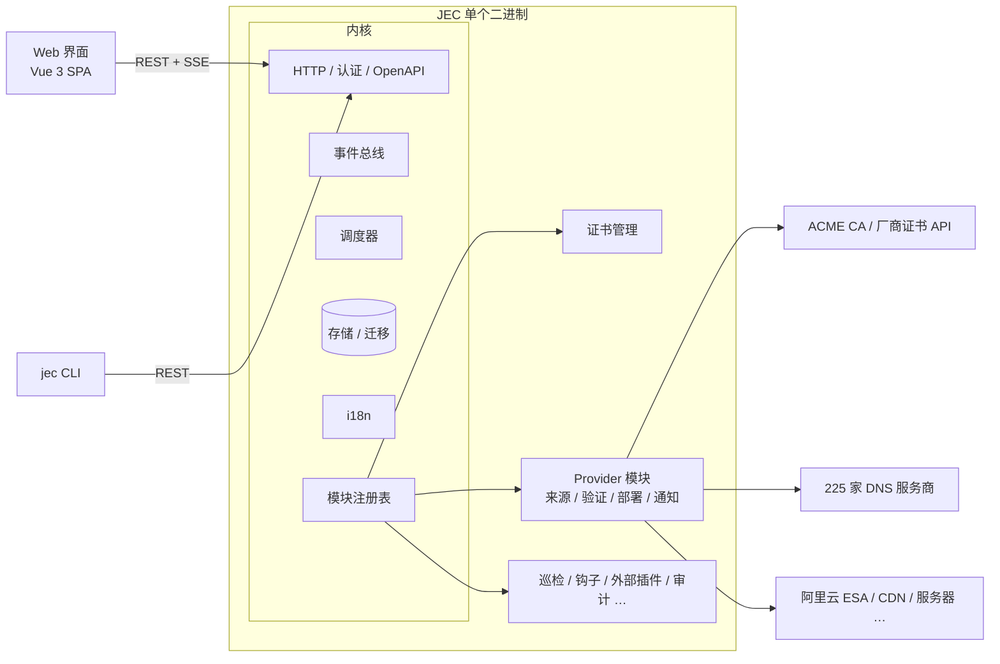
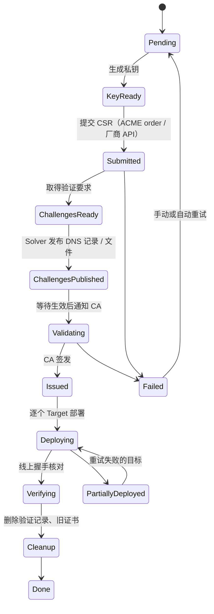

# Just Enough Certs（JEC）规划

> Just enough certs to keep your site green.

自托管的 SSL/TLS 证书管理面板：从各种来源**获取**证书，自动完成**域名验证**，**部署**到 CDN / 服务器 / 云产品，并在到期前**自动续期**。名字致敬 Minecraft 的 JEI（Just Enough Items）。

- 仓库：`github.com/XMZO/JustEnoughCerts`
- 程序 / 命令：`jec`
- 镜像：`ghcr.io/xmzo/justenoughcerts`（GHCR 要求全小写）
- 协议：MIT

---

## 1. 背景

CA/Browser Forum 的 SC-081 提案把证书最长有效期逐年缩短：2026-03-15 起 **200 天**，2027-03-15 起 **100 天**，2029-03-15 起 **47 天**，域名验证结果的复用期也同步缩短。手动换证书会越来越不现实。

现有工具的空白：

- acme.sh、certbot、Certimate 等基本只管 **ACME** 证书。付费证书如果要走 CA 或经销商的专有 API 重签，就没有现成工具。
- 各家 CA 和经销商的自动化工具（例如 Namecheap 的 SSL Manager、SSL.com 的 SSL Manager）都是私有的，只服务自家证书，而且大多只能装到本机的 nginx/apache，**推不到 CDN 这类云产品**。

业界真正通用的自动化标准是 **ACME（RFC 8555）+ EAB**：CA 给出 ACME 地址、Key ID 和 HMAC 密钥，任何 ACME 客户端都能用。免费 CA 和越来越多的商业 CA 都已支持。

所以 JEC 的定位是**通用**的证书管理面板：

- 证书来源以 **ACME + EAB** 和**手动上传 / 导入**为主，覆盖绝大多数 CA；
- 各家的专有 API 只是可选模块，彼此地位相同；
- “证书从哪来”“怎么验证域名”“部署到哪去”三件事拆开，每一块都能自由组合。

**第一个验收场景**：

> 付费证书 → 通过 DNS API 自动完成域名验证 → 部署到 CDN → 确认生效后删除旧证书 → 每个有效期周期自动重复。

首个测试环境是作者自己的：Namecheap 证书 + DNSPod + 阿里云 ESA（国内站）。

## 2. 目标与非目标

**目标**

- **所有功能模块化、可插拔**（见 4.2）：内核只保留最基础的部分，其余功能都是独立模块，增加或删除一个功能不影响其他部分。
- 来源、验证、部署、通知四类都做成**可插拔的 Provider**，新增一种来源或目标不需要改核心代码，也不需要改前端。
- **尽量覆盖市面上的证书和 DNS 服务商**（见 5.3）：证书来源以通用的 ACME + EAB 为主，支持 ACME 的 CA 都能直接用；DNS 服务商借助 lego 一次覆盖 225 家。
- **国际化严格独立**（见第 7 节）：每种语言一个文件，代码里不写死任何界面文字；先实现简体中文和英文；测试设 i18n 门禁。
- **好看、能在各种屏幕上用**的 Web 界面：手机、平板、桌面都能顺畅操作，支持深色模式。
- **一个 `docker-compose.yml` 就能部署**，也提供原生二进制文件。
- **镜像尽可能小**，但不阉割功能，也不用 UPX 这类牺牲运行性能的压缩（见 8.3）。
- 打 tag 后**自动构建发布**：Linux x86_64/ARM64 原生二进制，以及 ghcr.io 多架构镜像。
- 流程**可中断、可恢复**：任何一步失败或程序重启，都能从断点继续，不会重复扣费或重复签发。
- **安全默认**：密钥加密存储，首次初始化需要令牌，不收集任何遥测数据。

**非目标（至少 1.0 之前不做）**

- 不做 CA。私有 CA、内网证书留到以后再考虑。
- 不做多租户 SaaS，定位是单个用户或小团队自己部署。
- 不替代 DNS 托管面板，只增删验证需要的记录。

## 3. 核心概念

| 概念 | 说明 | 例子 |
|---|---|---|
| **Module**（模块） | 一个可以独立启用、停用、删除的功能单元 | 证书管理、巡检、审计日志、阿里云 ESA 部署 |
| **Certificate**（证书） | 一张逻辑证书：域名列表、密钥类型、来源、部署目标、续期策略。对应一份付费证书订阅或一组 ACME 域名 | `example.com, www.example.com` |
| **Issuance**（签发记录） | 某一次签发或重签的完整过程，有自己的状态和日志 | 2026-10 那次 200 天重签 |
| **Source**（证书来源） | 从哪里拿证书 | ACME（含 EAB）、手动上传、厂商专有 API |
| **Solver**（验证执行器） | 完成域名验证（DCV） | DNSPod、阿里云 DNS、Cloudflare DNS、HTTP 文件 |
| **Target**（部署目标） | 证书装到哪里 | 阿里云 ESA、本地文件 + 重载命令、SSH、Webhook |
| **Credential**（凭据） | 各家平台的访问密钥，加密存储，可被多个 Provider 引用 | 阿里云 RAM 子账号 AK |
| **Notifier**（通知渠道） | 成功、失败、即将过期时发通知 | Telegram、邮件、Webhook、Server酱、Bark、钉钉/飞书/企业微信 |
| **Policy**（策略） | 什么时候续期、失败后怎么重试、部署顺序 | 到期前 30 天续期，指数退避重试 |
| **Monitor**（巡检） | 定期连到线上地址做 TLS 握手，核对实际返回的证书 | 发现 CDN 还在用旧证书就告警 |

## 4. 总体架构



### 4.1 技术选型

| 部分 | 选择 | 理由 |
|---|---|---|
| 后端语言 | **Go** | lego（ACME + 225 家 DNS）、Namecheap 官方 SDK、各家云平台的 SDK 都是 Go；标准库自带 x509；单个静态二进制，交叉编译方便 |
| HTTP | `chi` 路由 + `huma` | huma 能从 Go 代码直接生成 OpenAPI 文档，前端类型和 CLI 都可以由此生成 |
| 数据库 | **SQLite** | 不需要额外服务；数据访问层留接口，以后可以加 PostgreSQL。驱动用纯 Go 的 `ncruces/go-sqlite3`（M0 实测后选定，见 8.3） |
| 迁移 | `goose` | 启动时自动迁移；每个模块带自己的迁移文件，随二进制嵌入 |
| ACME | `go-acme/lego` v5 | 支持 EAB 和自定义 CA，DNS 服务商最全 |
| 通用 DNS 记录增删 | `libdns` 生态 + 自己实现 | lego 只会加 ACME 用的 TXT 记录；付费证书要加任意 CNAME/TXT，需要单独一层（见 5.3.2） |
| 国际化 | 独立的 `i18n` 模块 + 每种语言一个 JSON 文件 | 前后端共用同一份翻译文件，见第 7 节 |
| 日志 | 标准库 `log/slog` | 结构化日志；每次签发的日志单独存库，界面上可以实时看 |
| 前端 | **Vue 3**（已定）+ TypeScript + Vite + Tailwind CSS + shadcn-vue + vue-i18n | 见第 6 节；构建产物通过 `go:embed` 打进二进制 |
| 打包发布 | GoReleaser + Docker Buildx | 见第 9 节 |

### 4.2 功能模块化（可插拔）

**原则：内核尽量小，其余一切都是模块。**

- **内核只包含**：配置、存储与迁移框架、认证与权限、事件总线、调度器、模块注册表、i18n、HTTP 框架。
- **其余都是模块**：证书管理、每一个 Provider（阿里云 ESA、DNSPod、Namecheap……各自是一个模块）、通知、巡检、钩子、外部插件、导入导出、API 令牌、两步验证、OIDC、审计日志、备份恢复等。

**每个模块是一个自包含的目录**，自带：

- 后端代码和数据库迁移；
- API 路由和权限点；
- 设置项的 Schema（界面自动生成设置表单）；
- 前端页面、菜单项、总览卡片；
- 自己的翻译 key 命名空间（翻译文字本身仍集中在语言文件里，见第 7 节）；
- 测试和文档。

**模块接口草图**：

```go
type Module interface {
    // ID、版本、依赖哪些模块、权限点、菜单项、设置项 Schema
    Manifest() Manifest
    // 本模块的数据库迁移
    Migrations() fs.FS
    // 注册 API 路由、Provider、事件订阅、定时任务
    Register(r *Registry) error
}
```

**模块之间不直接互相调用**，只通过内核提供的接口和事件总线通信，例如证书模块发出 `certificate.issued` 事件，通知模块和部署模块各自订阅。CI 用依赖规则检查（如 `go-arch-lint`）禁止模块之间互相 import，保证删掉任何一个模块，其他模块都还能编译。

**三种增删方式**：

1. **编译时**：每个模块对应一个 build tag 和一行注册代码。删除模块就是删掉它的目录和那一行。官方发布的版本包含全部模块。
2. **运行时**：在设置页里启用或停用模块。停用后它的 API、菜单、定时任务都不再加载，数据保留，重新启用就能恢复。
3. **前端按需加载**：后端的 `/api/v1/manifest` 返回已启用的模块清单，前端据此动态加载页面。每个模块单独打包，没启用的模块不会被下载。

**模块脚手架**：`make new-module name=xxx` 生成模块模板，包括目录结构、注册代码、翻译 key 占位、测试和文档骨架。

### 4.3 签发状态机

每次签发都是一条持久化在数据库里的状态机。每一步都设计成**幂等**的：外部接口调用前先记录意图，调用后记录结果，重启后能判断该重试还是该跳过。



### 4.4 调度

- 内置调度器，不依赖系统 cron。默认每小时扫描一次，找出需要续期、需要重试、需要巡检的证书。
- 每张证书一把锁，避免并发签发同一张证书；全局并发数可以配置。
- 重试使用指数退避加随机抖动，并尊重对方返回的 `Retry-After`。
- 会产生费用或不可逆的操作（购买、续费、吊销）**永远不自动重试**，只发通知等人工确认。

## 5. 可插拔 Provider 设计

Provider 是模块的一种：每个 Provider 都是一个独立模块，按 4.2 的方式增删。

### 5.1 接口草图

```go
// 每个 Provider 都能描述自己：名字、图标、配置项的 JSON Schema。
// 前端根据 Schema 自动生成表单，所以新增 Provider 不需要写前端代码。
// 名字、字段标签、帮助说明都只写翻译 key，不写文字本身（见第 7 节）。
type Descriptor struct {
    ID           string          // "aliyun-esa"
    Kind         Kind            // Source / Solver / Target / Notifier
    NameKey      i18n.Key        // "provider.aliyun_esa.name"
    Icon         string
    ConfigSchema json.RawMessage // 由 Go 结构体 + 标签生成，标签里是翻译 key
    Experimental bool
}

type Source interface {
    Describe() Descriptor
    // 提交 CSR，返回来源侧的订单/证书引用
    Submit(ctx context.Context, req SubmitRequest) (OrderRef, error)
    // 取得需要完成的域名验证（DNS / HTTP / Email）
    Challenges(ctx context.Context, ref OrderRef) ([]Challenge, error)
    // 通知来源“验证已就绪”
    ConfirmChallenge(ctx context.Context, ref OrderRef, ch Challenge) error
    // 查询状态；签发后返回证书链
    Poll(ctx context.Context, ref OrderRef) (OrderStatus, *Bundle, error)
}

type Solver interface {
    Describe() Descriptor
    Present(ctx context.Context, ch Challenge) (Cleanup, error)
    // 从公共 DNS 或外网确认已生效，避免过早通知 CA
    Verify(ctx context.Context, ch Challenge) error
}

type Target interface {
    Describe() Descriptor
    // 先上传新证书（不删旧的），返回目标侧的证书 ID
    Deploy(ctx context.Context, b Bundle, opt DeployOptions) (DeployedRef, error)
    // 确认线上已生效
    Verify(ctx context.Context, ref DeployedRef) error
    // 生效后清理旧证书；目标有数量上限时，由核心决定先删还是先传
    Prune(ctx context.Context, keep DeployedRef) error
    Capacity(ctx context.Context) (used, limit int, err error)
}
```

### 5.2 三层扩展方式

1. **内置 Provider**：用 Go 写，编译进二进制，覆盖常用平台。
2. **外部插件（exec 协议）**：任何语言写的可执行文件，通过 stdin/stdout 交换带版本号的 JSON。`describe` 动作返回 Schema 和插件自带的翻译，界面就能出现对应表单。不用重新编译 JEC，就能接入自家内部系统。
3. **钩子（Hooks）**：在 `before_issue`、`after_issue`、`after_deploy`、`on_failure` 等节点执行脚本或内置动作（HTTP 请求、SSH 命令、写文件、重启 Docker 容器）。证书文件路径、域名等通过环境变量传入，模板语法是 Go 的 `text/template`。

### 5.3 服务商支持范围

“阶段”一栏对应第 13 节的路线图。列表之外的平台，可以通过外部插件或钩子接入。

#### 5.3.1 证书来源（SSL）

**推荐顺序**：CA 支持 ACME 就用 ACME；不支持时用它的专有 API 模块；都没有就手动上传，由 JEC 负责部署和到期提醒。

| 类别 | 服务商 | 接入方式 | 阶段 |
|---|---|---|---|
| **通用：ACME 免费证书** | Let's Encrypt、ZeroSSL、Google Trust Services、SSL.com、Actalis | ACME（部分需要 EAB 凭据） | M1 |
| **通用：ACME 商业证书** | Sectigo、DigiCert、GlobalSign、HARICA、TrustAsia（亚洲诚信）等提供 ACME 的 CA，以及经销商提供的 ACME（如 Namecheap，官方计划 2026 年 11–12 月上线） | 自定义 ACME 地址 + EAB，**任何支持 ACME 的 CA 都能接**，逐家验证后列入兼容表 | M1 |
| **通用：手动上传 / 导入** | 任何 CA 的证书（PEM / PFX）；扫描 acme.sh、certbot 的目录 | 只读导入，避免和原工具冲突 | M1 |
| 厂商专有 API（可选模块） | Namecheap 官方 API（`ssl.reissue` / `ssl.getInfo` / `ssl.activate`） | 官方 API，需满足开通条件和 IP 白名单 | M2 |
| 厂商专有 API（可选模块） | 阿里云数字证书管理服务、腾讯云 SSL 证书 | 云 API：申请免费证书、拉取已购证书 | M3 |
| 厂商专有 API（可选模块） | ZeroSSL REST API、GoGetSSL、TheSSLStore、DigiCert CertCentral 等 | 各自的 API，按需求排期 | 以后 |
| 实验性 | Namecheap / Spaceship 的 SSL Manager 后端（仅适用于这两家的证书） | 非公开接口，默认关闭，界面标注“可能随时失效” | 以后 |

#### 5.3.2 DNS 服务商（域名验证）

DNS 验证分成两种能力，实现方式不同：

**① ACME DNS-01（添加 `_acme-challenge` TXT 记录）**：直接复用 lego，**225 家服务商全部可用**（lego v5.5，2026-10 统计）。界面按地区分组展示，常用的放前面：

- **国内**：阿里云 DNS、阿里云 ESA、腾讯云 / DNSPod、腾讯云 EdgeOne、华为云、百度智能云、京东云、火山引擎、西部数码、新网、DNS.LA、雨云、UCloud、时代互联
- **国际**：Cloudflare、AWS Route 53、Google Cloud DNS、Azure DNS、DigitalOcean、Linode、Vultr、Hetzner、OVH、Gandi、GoDaddy、Namecheap、Spaceship、Porkbun、Name.com、NameSilo、Dynadot、deSEC、DuckDNS、Netlify、Vercel、Bunny、NS1 等
- **自建 / 通用**：PowerDNS、RFC 2136 动态更新（BIND 等）、acme-dns、HTTP 请求、执行外部脚本、手动模式

**② 任意记录增删（厂商 API 验证用）**：付费证书走厂商专有 API 时，DNS 验证通常要加 CNAME 或 TXT，例如 Sectigo 系证书的 `_<哈希>.example.com CNAME <哈希>.sectigo.com`，而 lego 的接口只能加 ACME 的 TXT 记录。所以这部分单独做一层“DNS 记录管理”：

- 优先复用 **libdns** 生态（Caddy 使用的通用 DNS 记录接口，支持任意记录类型）。首批：DNSPod / 腾讯云、阿里云 DNS、Cloudflare、AWS Route 53、华为云、火山引擎、西部数码，libdns 都已有实现。
- 其余服务商按需求补；暂时补不到的用**手动模式**：界面显示要加的记录，加好后点“已添加”，JEC 用公共 DNS 核实后继续。
- 注意：付费证书的验证记录名由 CSR 计算得出，每次重签都会变，所以不能像 ACME 那样把记录永久 CNAME 委派到别处。

**③ CNAME 委派（仅 ACME）**：把 `_acme-challenge.example.com` 永久 CNAME 到一个有 API 的域，以后签发都在那个域里操作。这样即使域名所在的 DNS 没有 API，也能全自动。

#### 5.3.3 部署目标

| 类别 | 平台 | 阶段 |
|---|---|---|
| CDN / 边缘 | **阿里云 ESA**（M1）；阿里云 CDN / DCDN、腾讯云 EdgeOne、腾讯云 CDN、华为云 CDN、百度智能云 CDN、火山引擎 CDN、七牛云、又拍云、AWS CloudFront、Cloudflare（自定义证书需付费套餐） | M1 / M3 |
| 负载均衡 / 证书库 | 阿里云 SLB / ALB、阿里云证书服务、腾讯云 CLB、腾讯云 SSL 证书、AWS ACM | M3 |
| 对象存储 | 阿里云 OSS、腾讯云 COS 的自定义域名 HTTPS | M3 |
| 服务器 | 本地文件 + 执行命令（nginx、caddy、haproxy 等）；SSH / SFTP 上传 + 远程命令；Docker 容器（通过挂载的 Docker API 发信号或重启，不需要 docker 命令行）；Kubernetes Secret | M1（本地、SSH）/ M3 |
| 面板与应用 | 1Panel、宝塔、Nginx Proxy Manager、群晖 DSM、Proxmox VE、Caddy 管理 API | M3 |
| 通用 | Webhook、外部插件 | M1 |

#### 5.3.4 通知渠道

| 阶段 | 渠道 |
|---|---|
| M1 | Telegram、SMTP 邮件、通用 Webhook |
| M3 | Server酱、Bark、钉钉、飞书、企业微信、ntfy、Gotify |

### 5.4 阿里云 ESA 目标的注意点（来自实际调研）

- 国内站接入点是 `esa.cn-hangzhou.aliyuncs.com`，国际站是 `esa.ap-southeast-1.aliyuncs.com`，配置里可选。
- 免费版每个站点最多只能放 **2 张**自定义证书。部署前先查容量：有空位就“先传后删”；满了就先删最旧的那张不在用的。
- 同一域名有多张证书能匹配时，ESA 优先返回**最后配置**的那张，所以上传后通常立刻生效，但仍要握手验证一次。
- 文档里给出所需 RAM 权限的最小模板（`esa:ListSites`、`esa:ListCertificates`、`esa:SetCertificate`、`esa:DeleteCertificate`），DNSPod 同理。

## 6. Web 界面

### 6.1 页面

- **总览**：即将过期、续期中、失败的数量；未来 90 天的到期时间线；最近的签发动态。各模块可以往总览里注册自己的卡片。
- **证书**：列表（搜索、按状态和来源筛选）→ 详情（证书链、SAN、指纹、有效期、签发历史、各部署目标状态、下载）。
- **签发记录**：每一次签发的状态机进度和实时日志（通过 SSE 推送）。
- **来源 / 验证 / 部署 / 通知**：Provider 实例的配置，表单由 Schema 自动生成，带“测试连接”按钮。服务商列表支持搜索，按地区和类别分组。
- **凭据**：集中管理，显示被哪些 Provider 引用；保存后不再明文显示。
- **模块**：查看、启用、停用模块，显示模块之间的依赖关系。
- **设置**：账号、语言、两步验证、API 令牌、备份与恢复、外观、检查更新（可关闭）。

菜单和页面由已启用的模块决定，停用的模块不出现在界面上。

### 6.2 美观与适配

- **断点**：小于 640px 用底部标签栏（总览、证书、签发记录、更多），配置和系统页面放在“更多”里；640–1024px 用可折叠侧栏；大于 1024px 用常驻侧栏。
- **密度优先，不靠折叠和分页**：手机上表格换成紧凑列表，需要处理的证书整行显示原因，正常的证书排成两列小格；记录类列表用时间范围筛选代替分页。详见 `docs/design/`。
- 点击区域不小于 44px；支持深色、浅色、跟随系统；主题色可自定义。
- 字体：系统字体栈，中文依次回退到 PingFang SC、Microsoft YaHei、Noto Sans SC；图标用 Lucide。
- 剩余天数用颜色区分（绿 / 黄 / 红），同时配文字和图标，不只靠颜色传达信息。
- 布局按“英文比中文长 30%–40%”预留空间，按钮和标签不写死宽度（第 7 节的伪语言测试会检查）。
- 可选 PWA：能添加到手机桌面。
- 小彩蛋：像素风的锁形 Logo；可选的“方块风”主题，向 JEI 致敬。

### 6.3 前端技术栈（已定）

**Vue 3** + TypeScript + Vite + Tailwind CSS + shadcn-vue（基于 Reka UI 的无样式组件，样式完全可控），路由用 Vue Router，状态用 Pinia，数据请求用 TanStack Query，国际化用 vue-i18n，API 类型由后端 OpenAPI 文档自动生成。

M0 落地时的做法（`web/`）：

- **版本**：TypeScript 先停在 6.0，因为 typescript-eslint 和 openapi-typescript 还不支持 7.0（原生编译器）。Dependabot 不升 TypeScript 的大版本。
- **按需引入**：shadcn-vue（Reka UI）和 Pinia 在第一次真正用到时再加；登录页和初始化向导用不到。
- **API 类型**：`go run ./tools/openapi` 把带全部模块的 OpenAPI 文档写到 `web/openapi.json`，`pnpm -C web gen:api` 用 openapi-typescript 生成 `src/api/schema.d.ts`，请求用 openapi-fetch。CI 检查两个文件都是最新的。
- **设计 token**：样式直接 import `docs/design/system/tokens.css`，只有这一份。Tailwind 的 `@theme` 里只保留 token 对应的颜色和字号，用不了默认调色板。颜色用 `@theme inline` 映射，切换 `data-theme` 时立即生效。
- **代码检查**：ESLint 用 `eslint-plugin-vue` 的 essential 规则（排版交给编辑器），加 `@intlify/vue-i18n` 的 `no-raw-text` 和 `no-missing-keys`。
- **嵌进二进制**：Go 用 `//go:embed all:dist` 嵌入 `web/dist`。服务端行为：
  - 把 `index.html` 里的 `<base href>` 改成 base 路径，同一份构建在根路径和子路径下都能用；
  - 非文件路径一律返回 `index.html`，交给前端路由；
  - `assets/` 下带哈希的文件按 `immutable` 缓存；
  - 按 `Accept-Encoding` 直接发预压缩的 br / gz 文件，每种编码有各自的 ETag；
  - 页面带 CSP（只允许本站脚本、样式和 API）、`X-Frame-Options: DENY`、`nosniff`。
  - 没构建前端时，`web/dist` 里只有 `.gitkeep`，服务启动时打印一条警告，API 照常工作。

### 6.4 前端体积

- 不打包网页字体，全部用系统字体。
- 图标按需引入，只打包实际用到的。
- 按页面和模块拆分代码，首次打开只加载登录页和总览。
- 语言文件按需加载，只下载当前使用的语言。
- 不引入大型图表库，到期时间线用手写 SVG。
- 构建时预先生成 brotli 和 gzip 压缩版本，按浏览器支持直接返回，服务端不用实时压缩。
- 预算：首屏 JS 压缩后不超过 150KB，CI 里检查（`pnpm -C web size`，按 gzip 计，结果写进 CI 摘要）。M0 的登录页约 77KB，大头是 Vue、路由、TanStack Query、vue-i18n 和 FormatJS 的公共包。

## 7. 国际化（i18n）

### 7.1 原则

- **i18n 是一个独立模块**，所有翻译文字都放在 `i18n/locales/` 下，**每种语言一个文件**：`zh-CN.json`、`en-US.json`。
- **代码里不写死任何会显示给用户的文字**，前端、后端、Provider、通知、邮件、签发日志都一样，只引用翻译 key。
- **前后端共用同一份语言文件**：后端通过 `go:embed` 嵌入，前端构建时直接引用，不维护两套。
- **先实现简体中文和英文**。英文作为兜底语言：其他语言缺少某个 key 时显示英文。
- **增加一种语言只需新增一个文件**：复制 `en-US.json` 改名为 `ja-JP.json` 之类，翻译后提交 PR。程序会自动发现新语言并出现在语言选择里，不需要改任何代码。

### 7.2 文件格式

- JSON，按模块分组嵌套，key 采用“模块.页面.含义”的形式，例如 `certs.list.empty`、`provider.aliyun_esa.field.site_id.label`。
- 文件开头有一个 `_meta` 段：语言的本地名称（如“简体中文”）、文字方向（为以后支持阿拉伯语等从右到左的语言预留）、翻译完成度。
- 消息语法采用 ICU MessageFormat 的子集：命名占位符 `{domain}`、复数 `plural`、条件选择 `select`。前端 vue-i18n 配自定义消息编译器，后端用同一套规则的 Go 实现，保证同一句话在两边解析结果一致。M0 选定：
  - 后端：`i18n` 包自己实现这个子集的解析和格式化，复数规则和 `#` 的数字格式用 `golang.org/x/text`。
  - 前端：用 FormatJS 的 `intl-messageformat` 做 vue-i18n 的消息编译器（开 `ignoreTag`）。
  - Go 的解析器比 FormatJS 严格（例如不支持 `{n, number}`、`offset`、`selectordinal`），门禁用它校验，所以能通过门禁的消息在两边结果一致。
  - 撇号按 ICU 的 DOUBLE_OPTIONAL 规则：`don't` 不用转义，`'{'` 表示字面的 `{`，`''` 表示一个撇号。
  - x/text 的 CLDR 数据比浏览器旧（例如法语没有表示百万的 `many`）。浏览器选到消息里没有的类别时，FormatJS 会回退到 `other`，和后端结果相同。
- 日期、时间、数字、文件大小的格式**不写进翻译文件**，交给浏览器的 `Intl` 和 Go 的 `golang.org/x/text` 按语言自动格式化。

### 7.3 各处文字怎么处理

| 场景 | 做法 |
|---|---|
| 前端界面 | 模板和脚本里只用 `t('key')`；key 有 TypeScript 类型，写错或不存在的 key 编译就报错 |
| 后端 API 错误 | 只返回错误码和参数，例如 `{"code": "certs.error.domain_invalid", "params": {"domain": "…"}}`，由前端按用户的语言显示；请求校验失败时另有 `fields`，逐项给出出错的位置（如 `body.domains[1]`）和错误码。服务器内部错误的细节只写进日志，不返回给客户端 |
| Provider 和模块的描述 | 名字、字段标签、帮助说明在 Schema 里只写 key（见 5.1） |
| 签发日志 | 数据库里存 key 和参数，查看时按查看者的语言显示；切换语言后旧日志也会跟着变 |
| 通知和邮件 | 后端用同一份语言文件渲染；每个通知渠道可以单独设置语言 |
| 外部插件 | 插件在 `describe` 里自带自己的翻译，不需要改主程序的语言文件 |
| 开发者日志 | 只输出到标准输出、不在界面上显示的诊断日志，使用固定的英文事件名和结构化字段，不算界面文字 |

- **类型安全的 key**：构建时根据 `en-US.json` 自动生成 Go 常量和 TypeScript 类型。代码只能引用生成出来的 key，删掉一个 key，所有引用它的地方都会编译失败。
- **语言选择**：默认跟随浏览器的语言设置，用户可以在设置里切换，选择会保存到账号。

### 7.4 i18n 门禁（测试和 CI 必须全部通过）

在 CI 里单独作为一个检查项，本地用 `make i18n-check` 可以先跑一遍，任何一条不通过，PR 就不能合并：

1. **完整性**：`zh-CN` 和 `en-US` 必须覆盖全部 key，一个都不能少；其他语言允许缺少（会回退到英文），但不允许出现基准文件里没有的 key。
2. **一致性**：每条翻译的占位符名称和用法（普通、复数、选择）、选择分支必须和英文一致；复数分支必须正好是该语言整数会用到的类别（英文 one/other，中文只有 other），可以另加 `=0` 这类精确值；ICU 语法必须能正确解析；不允许空字符串。
3. **引用检查**：代码里用到、但语言文件里没有的 key → 失败；语言文件里有、但代码里已经不用的 key → 失败。删掉一个模块后，它留下的翻译会被这一条查出来。
4. **硬编码检查**：
   - 前端：开启 `@intlify/eslint-plugin-vue-i18n` 的规则，禁止模板里出现裸文本（`no-raw-text`），并检查缺失和未使用的 key。
   - 后端：所有面向用户的出口（API 错误、通知、Schema 描述、签发日志）只接受翻译 key 类型（`i18n.Key`），不接受普通字符串。自写的 `go/analysis` 检查器 `tools/i18nlint` 堵住剩下的口子：在 `i18n` 包和测试之外，用字符串字面量、无类型常量或类型转换得到的 `i18n.Key` 都算失败。
   - 全仓库扫描：中日韩文字只允许出现在 `i18n/locales/` 和测试数据里，出现在其他地方即失败。
5. **伪语言测试**：测试时自动生成一种伪语言，给每条文字加上首尾标记并加长 40%。用 Playwright 在手机和桌面两种宽度下打开所有页面：
   - 页面上出现没有标记的文字，说明有硬编码，测试失败；
   - 文字溢出、被截断或重叠，说明布局没有为长文本留空间，测试失败。
6. **格式**：key 命名符合“模块.页面.含义”规范，文件按 key 排序、没有重复。`make i18n-fix` 可以自动排序和格式化。

## 8. 部署

### 8.1 单文件 docker-compose.yml

```yaml
services:
  jec:
    image: ghcr.io/xmzo/justenoughcerts:latest
    container_name: jec
    restart: unless-stopped
    # 可选：指定运行用户，方便和挂载目录的权限对上（默认 65532:65532）
    # user: "1000:1000"
    ports:
      - "8080:8080"
    environment:
      TZ: Asia/Shanghai
      # 可选：不填时首次启动自动生成并保存到 /data/secret.key
      # JEC_SECRET_KEY: "换成 32 字节以上的随机字符串"
      # 可选：放在反向代理后面、或挂在子路径下时设置
      # JEC_BASE_URL: "https://certs.example.com"
      # 可选：界面和通知的默认语言（不设置时跟随浏览器）
      # JEC_DEFAULT_LOCALE: "zh-CN"
    volumes:
      - ./data:/data
      # 可选：需要“重启 / 通知其他容器”时挂载
      # - /var/run/docker.sock:/var/run/docker.sock
    healthcheck:
      test: ["CMD", "/jec", "healthcheck"]
      interval: 30s
      timeout: 5s
      retries: 3
```

启动：`docker compose up -d`。首次打开网页会进入初始化向导，需要输入日志里打印的**一次性初始化令牌**（`docker logs jec` 可见），防止服务刚暴露在公网时被别人抢先注册管理员。

### 8.2 镜像

- **基础镜像是 `scratch`（空镜像）**：镜像里只有 `/jec` 这一个程序和空的 `/data` 目录，没有操作系统文件。
- **CA 根证书和时区数据嵌进程序**（`golang.org/x/crypto/x509roots/fallback`、`time/tzdata`），所以不需要系统里的证书和时区文件。需要信任自定义 CA 时，挂载文件并设置 `SSL_CERT_FILE` 即可。
- **钩子不依赖系统 shell**：程序内嵌纯 Go 的 POSIX shell 解释器（`mvdan.cc/sh`），再加上内置动作（HTTP 请求、SSH 命令、写文件、Docker 容器发信号或重启），容器里不装 sh 和 curl 也能用全部钩子功能。确实需要额外命令行工具的，可以基于本镜像 `FROM` 一层自己加，或者改用原生二进制。
- **健康检查**用 `jec healthcheck` 子命令，不依赖 curl 或 wget。
- 默认以 `65532:65532` 非 root 用户运行；可以在 compose 里用 `user:` 指定，跟挂载目录的属主对上。
- 所有数据都在 `/data`：数据库、加密密钥、日志。备份这一个目录就够了。

### 8.3 体积控制（不用 UPX）

**目标**：镜像大小 ≈ 程序本身大小，而且**不阉割任何功能**，官方发布的镜像始终包含全部模块和服务商。

**参考基准**：lego v5.5.2 带全部 225 家 DNS 服务商，官方 Linux 压缩包 amd64 为 20.2MB、arm64 为 18.3MB。JEC 包含 lego 的全部服务商，所以镜像压缩后预计也在 20MB 出头这个量级。M0 实测后定下具体预算，之后每次发版都要检查。

**手段**：

- **编译参数**：`CGO_ENABLED=0`、`-trimpath`、`-ldflags "-s -w"`（去掉符号表和调试信息）。这些只影响程序文件大小，不影响运行性能。
- **依赖控制**：体积大头是各家云平台的 SDK。规则：
  1. 和 lego 共用同一份依赖，不重复引入第二套。
  2. 官方 SDK 太重时，自己用轻量的签名实现直接调 HTTP API：阿里云 V3 签名、腾讯云 TC3、AWS SigV4 各写一份，供所有 Provider 共用。
  3. CI 用 `go-size-analyzer` 输出每个依赖占多少体积，超过预算就让构建失败，防止体积慢慢涨上去。
- **SQLite 驱动**：选 `ncruces/go-sqlite3`。2026-10 用 `modernc.org/sqlite` v1.60.1 和 `ncruces/go-sqlite3` v0.35.6（都内置 SQLite 3.53.4）实测，linux/amd64，WAL 模式：
  - 体积：在同一个程序上，modernc 增加 4.6MB（gzip 后 2.0MB），ncruces 增加 5.4MB（gzip 后 2.5MB）。
  - 性能：单线程插入、主键查询 ncruces 快 5%–10%，范围查询持平；8 读 1 写并发时，ncruces 读快约 2.2 倍、写快约 3.6 倍。
  - 内存峰值：modernc 约 22MiB，ncruces 约 25MiB。
  - 选 ncruces 的理由：并发余量大（调度器、SSE、界面请求同时访问）；SQLite 跑在隔离的 wasm 内存里，C 代码的内存错误不会破坏 Go 的内存。代价是镜像多约 0.5MB。两者的数据库文件格式相同，以后要换驱动只改 import。
- **前端**：见 6.4。
- **镜像层压缩**：buildx 输出时用 gzip 最高压缩级别（`compression-level=9`、`force-compression=true`），只增加构建时间，不影响运行。为了兼容旧版 Docker，不用 zstd 压缩层。

**为什么不用 UPX**：

- 程序每次启动都要先在内存里解压，启动变慢。
- 解压后的代码无法在多个进程间共享内存页，内存占用变大。
- 容易被杀毒软件误报。
- 镜像层本来就是 gzip 压缩后传输的，UPX 对下载体积的帮助很小。

**可选**：自己编译时，可以用 build tag 只保留需要的模块和服务商（见 4.2），得到更小的程序，适合路由器这类存储很小的设备。官方发布的版本不做这种裁剪。

### 8.4 原生二进制

- `jec serve` 启动服务；`jec service install` 注册为 systemd 服务。
- 数据目录、端口、Base URL、默认语言都可以用命令行参数、环境变量（`JEC_*`）或 `config.yaml` 配置。优先级：命令行参数 > 环境变量 > 配置文件 > 默认值。

## 9. CI/CD（GitHub Actions）

### 9.1 `ci.yml`：每次推送和 PR

- Go：`golangci-lint`、`go test -race`、`govulncheck`。
- 前端：类型检查、ESLint、单元测试、构建。
- **i18n 门禁**：7.4 的全部检查，单独作为一个必须通过的检查项。
- **模块依赖检查**：禁止模块之间互相 import；逐个去掉单个模块后仍能编译（抽样或定期全量跑）。
- **体积检查**：输出程序体积、各依赖的体积占比、前端首屏 JS 大小，超过预算就失败，并在 PR 里评论和 main 分支的对比。
- 用 `ubuntu-24.04-arm` 原生 ARM 运行器（公开仓库免费）再跑一遍测试，确保 ARM 上行为一致。

### 9.2 `release.yml`：推送 `v*.*.*` 标签时

1. 构建一次前端，作为产物传给后续步骤。
2. **GoReleaser** 交叉编译原生二进制（参数见 8.3，通过 ldflags 注入版本号）：

   | 系统 | x86_64 | ARM64 | 其他 |
   |---|---|---|---|
   | Linux | ✅ | ✅ | armv7（树莓派等，可选） |
   | macOS | ✅ | ✅ | 顺手附带 |

   打包格式：`.tar.gz`，另附 `checksums.txt`、SBOM（syft 生成），并用 cosign 无密钥签名。
3. **ghcr.io 多架构镜像**：`FROM scratch`，直接复制上一步编译好的对应架构程序，不在 QEMU 模拟环境里编译，所以快且稳定。
   - 平台：`linux/amd64`、`linux/arm64`（armv7 可选）。
   - 标签：`1.2.3`、`1.2`、`1`、`latest`。预发布版本（如 `v1.3.0-beta.1`）只打 `beta` 和完整版本号，不动 `latest`。
   - 镜像层用 gzip 最高级别压缩；附带构建来源证明（provenance attestation）。
4. 根据 Conventional Commits 自动生成更新日志，创建 GitHub Release，并在说明里写上本次的镜像和程序体积。

### 9.3 其他

- Renovate 或 Dependabot 自动更新依赖。
- 版本号遵循 SemVer；`jec version` 显示版本号、提交哈希和构建时间。

## 10. 安全

- **凭据和私钥加密存储**：AES-256-GCM，主密钥来自 `JEC_SECRET_KEY` 或数据目录里的密钥文件。界面上不回显已保存的密钥，下载私钥前需要重新输入密码。
- **登录**：本地账号，密码用 argon2id 哈希（RFC 9106 第二组推荐参数：64 MiB、3 轮、4 线程，同时最多算 2 个），支持 TOTP 两步验证；以后支持 OIDC 单点登录。
  - 会话是随机令牌，库里只存 SHA-256，有效期 30 天。Cookie 设 `HttpOnly`、`SameSite=Lax`；base URL 是 https 时再加 `Secure`（纯 HTTP 访问时浏览器不收 Secure Cookie，局域网直连会登不上）。
  - CSRF 防护用 Go 标准库的 `http.CrossOriginProtection`，按 `Sec-Fetch-Site` 和 `Origin` 拒绝跨站的写请求；base URL 的 origin 被信任，反向代理改写 Host 时也能通过。
  - 登录和初始化按客户端 IP 限速：连续失败 5 次锁定 15 分钟（与设计稿的提示一致，次数和时长作为参数传给文案）；成功一次或停 15 分钟不再失败，就重新计数。
  - 忘记密码时在服务器上运行 `jec reset-password`（Docker 里是 `docker exec -it jec /jec reset-password`），新密码生效后该账号的所有会话都会退出。
  - 所有 API 默认要求登录，只有初始化和登录接口在 OpenAPI 里标成公开。
- **API 令牌**：可以按权限范围生成，用于 CLI 和自动化。
- **审计日志**：谁在什么时候改了什么、下载了哪个私钥。
- **安全响应头**：CSP、HSTS（由用户选择是否开启）等。
- **Webhook 防 SSRF**：默认禁止请求内网地址，可配置白名单。
- **Docker API**：只有用户主动挂载 `docker.sock` 并在界面里开启后才会使用，且只允许对指定容器发信号或重启。
- **模块权限**：每个模块声明自己需要的权限点，停用的模块不暴露任何 API。
- **最小权限**：文档里给每个云平台提供最小权限策略模板。
- **不收集遥测**；检查更新可以关闭。
- **非官方接口隔离**：Namecheap / Spaceship SSL Manager 后端这类非公开接口，放在实验性模块里，默认关闭，界面上明确标注“可能随时失效”。

## 11. 兼容性与自定义清单

- **模块**：按需启用、停用或在编译时去掉，见 4.2。
- **服务商**：见 5.3；列表之外的平台用外部插件或钩子接入。
- **语言**：新增一个语言文件即可，见第 7 节。
- **配置三选一或混用**：网页界面、环境变量、`config.yaml`；证书和 Provider 配置可以导出导入为 YAML，方便迁移和用 Git 管理。
- **密钥类型**：RSA 2048/3072/4096，ECDSA P-256/P-384；可以每张证书单独设置。
- **证书格式**：PEM（证书 / 完整链 / 私钥分开或合并）、PFX/PKCS#12、JKS。
- **文件部署**：路径、文件名模板、属主、权限、写入后执行的命令都可配置，因此兼容 nginx、caddy、haproxy 等任何读文件的程序。
- **导入现有证书**：支持手动上传，也支持扫描 acme.sh、certbot 的目录导入（只读，避免冲突）。
- **命名模板**：部署到 CDN 时的证书名可自定义，例如 `jec-{{.Domain}}-{{.NotAfter | date "20060102"}}`。
- **网络**：每个 Provider 可以单独设置 HTTP 代理；验证 DNS 是否生效时可以指定公共解析服务器；支持 IPv6。
- **反向代理**：支持挂在子路径下（`JEC_BASE_URL`），支持信任代理头（可配置）。
- **平台**：Linux、macOS 各自的 x86_64 和 ARM64。
- **时区**：可以设置，日志统一使用 UTC 时间戳，界面按用户时区显示。

## 12. 仓库结构

```text
JustEnoughCerts/
├── cmd/jec/                    # 程序入口（serve / healthcheck / service / version …）
├── i18n/                       # 国际化模块（Go 包，同时被前端引用）
│   ├── locales/
│   │   ├── zh-CN.json          # 简体中文
│   │   └── en-US.json          # 英文（基准与兜底语言）
│   ├── i18n.go                 # 加载、回退、消息格式化
│   └── keys_gen.go             # 由 en-US.json 自动生成的 key 常量
├── internal/
│   ├── kernel/                 # 内核：配置、存储、认证、事件总线、调度器、模块注册表
│   ├── modules/                # 功能模块（每个目录一个模块，可单独删除）
│   │   ├── certs/              # 证书管理与签发状态机
│   │   ├── monitor/            # 线上巡检
│   │   ├── hooks/              # 钩子：内嵌 shell 解释器与内置动作
│   │   ├── plugins/            # exec 外部插件协议
│   │   ├── audit/              # 审计日志
│   │   ├── backup/             # 备份与恢复
│   │   └── …
│   ├── providers/              # Provider 模块（每个服务商一个目录）
│   │   ├── source/             # acme, manual, namecheap, aliyun_cas, tencent_ssl, spaceship_sslmanager(实验) …
│   │   ├── solver/             # lego 适配层、dnsrecord、http、email、manual
│   │   ├── target/             # aliyun_esa, local, ssh, docker, webhook …
│   │   └── notify/             # telegram, smtp, webhook …
│   └── lib/                    # 模块共用的工具库（不含业务逻辑）
│       ├── cryptox/            # 私钥、CSR、PEM/PFX 处理，加密存储
│       ├── cloudsign/          # 阿里云 V3、腾讯云 TC3、AWS SigV4 等轻量签名
│       └── dnsrecord/          # 任意 DNS 记录增删（libdns 适配 + 自己实现）
├── web/
│   └── src/
│       ├── core/               # 前端内核：布局、路由、请求、i18n 加载
│       └── modules/            # 与后端模块一一对应的页面，按需加载
├── tools/
│   ├── i18n/                   # i18n 门禁、语言文件格式化、key 常量生成（check / fix / gen）
│   ├── i18nlint/               # 检查代码里的 key 都来自生成的常量
│   └── new-module/             # 模块脚手架
├── deploy/
│   ├── docker-compose.yml
│   └── systemd/jec.service
├── docs/                       # 使用文档、模块与 Provider 开发指南、翻译指南、最小权限模板、服务商兼容表
├── .github/workflows/          # ci.yml, release.yml
├── .goreleaser.yaml
├── Dockerfile
├── Makefile
├── LICENSE                     # MIT
└── README.md
```

## 13. 路线图

| 阶段 | 内容 | 完成标准 |
|---|---|---|
| **M0 骨架** | 仓库、CI、发布流水线、`scratch` 镜像、体积检查；内核与模块注册表、模块脚手架；**i18n 模块和全部门禁**（从第一行界面文字开始就不允许硬编码）；空的前端、登录和初始化向导（中英文）；SQLite（含驱动选型实测） | 打一个 `v0.0.1` 标签，能自动产出全部二进制和镜像，`docker compose up` 能打开中英文登录页，i18n 门禁和体积检查在 CI 里生效 |
| **M1 最小可用** | 证书模块、状态机、调度器；手动上传和导入；ACME（任意 CA + EAB）+ lego 的 225 家 DNS；阿里云 ESA、本地文件、SSH、Webhook 部署；Telegram、邮件、Webhook 通知；总览和证书页 | 用免费证书完整跑通“签发 → 部署到 ESA → 删除旧证书 → 到期自动续” |
| **M2 厂商 API 与付费证书** | 厂商专有 API 来源的通用框架，第一个实现是 Namecheap 官方 API（重签 + CNAME 验证）；DNS 记录管理层（DNSPod、阿里云 DNS、Cloudflare 等）和手动模式；导入已有的付费证书；逐家验证商业 CA 的 ACME + EAB（含 Namecheap ACME 上线后） | 第 1 节的验收场景全自动跑通一个周期 |
| **M3 扩展** | 国内云平台证书来源；5.3.3 里的更多部署目标和面板；更多通知渠道；外部插件、钩子、YAML 导入导出；线上巡检；运行时启用 / 停用模块的界面 | 不改核心代码，写一个外部插件接入新平台；停用任意模块后其余功能正常 |
| **M4 打磨** | 两步验证、OIDC、审计日志、PWA、文档站、翻译指南、服务商兼容表 | 发布 `v1.0.0` |
| **以后** | Namecheap / Spaceship SSL Manager 后端（实验性）、其他厂商证书 API、更多语言（社区贡献）、多用户和角色、PostgreSQL、私有 CA | 按需求排期 |

先做 M0，是为了尽早把“打标签 → 自动发布”这条链路跑通，同时让模块化和 i18n 门禁从第一天就生效，之后每个功能都能随时发版试用。

## 14. 待定事项

- [x] 前端框架：Vue 3。
- [x] SQLite 驱动：`ncruces/go-sqlite3`（实测数据见 8.3）。
- [x] ICU 消息格式的前后端实现：后端自己实现子集，前端用 FormatJS（见 7.2）。
- [ ] 镜像和程序的体积预算：M0 实测后写进 CI。
- [ ] 除 SQLite 外，何时支持 PostgreSQL。
- [ ] 文档语言：倾向中英双语（界面语言已定为跟随浏览器，可手动切换）。
- [ ] 各厂商 API 的开通门槛要在文档里写清楚（例如 Namecheap 需要 20 个域名，或账户余额 / 近两年消费达 $50，并设置 IP 白名单），并提示优先使用 ACME + EAB 或手动上传。
