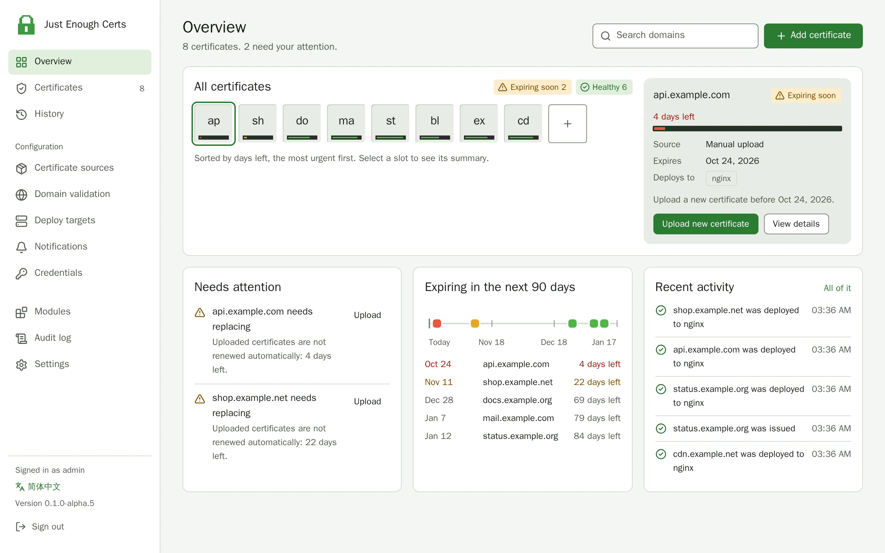

# Just Enough Certs

*Just enough certs to keep your site green.*

[简体中文](README.zh-CN.md) · [Documentation](https://getjec.dev/)

Just Enough Certs (JEC) is a self-hosted SSL/TLS certificate manager. It
obtains certificates from a range of sources, completes domain validation
automatically, deploys the certificates to CDNs and servers, and renews
them before they expire. Its name and visual style pay homage to the
Minecraft mod JEI.

> [!WARNING]
> JEC is in early development and has no stable release yet. The test
> releases (0.1.0-alpha.x, image tag `beta`) provide the features listed
> below. Deployment to Alibaba Cloud ESA, Namecheap SSL Manager and
> Cloudflare edge answers have been verified with a real account; types
> tagged "Untested" in the web UI were tested only with a fake and may not
> work. See the roadmap in [PLAN.md](PLAN.md) (in Chinese).

<picture>
  <source media="(prefers-color-scheme: dark)" srcset="docs/site/public/preview/overview-en-US-dark.webp">
  
</picture>

## Features

- **Certificate sources**: any ACME certificate authority, including
  External Account Binding and profiles, for six-day certificates and
  certificates of IP addresses (ZeroSSL's EAB is fetched by itself); PEM
  and PFX uploads, or many files another tool exported at once, with the
  chain completed; the certificates certbot
  or acme.sh renews on the same machine; the certificate services of
  Alibaba Cloud and Tencent Cloud; a private CA of your own; Namecheap SSL
  Manager (experimental).
- **Domain validation**: the 221 DNS providers of
  [lego](https://github.com/go-acme/lego), manual records and CNAME
  delegation; HTTP validation through website directories, answered by
  JEC itself, or answered at the edge of Alibaba Cloud ESA or Cloudflare.
- **Deploy targets**: 31 types, including Alibaba Cloud (ESA, CDN, OSS,
  load balancers), Tencent Cloud (CDN, EdgeOne), Huawei Cloud (CDN, ELB),
  Cloudflare, AWS (Certificate Manager, CloudFront), Gcore, BaoTa, 1Panel,
  Nginx Proxy Manager, Synology DSM, Proxmox VE, Caddy, local directories,
  SSH servers, Docker containers, Kubernetes and webhooks.
- **Renewal**: renewal windows with a daily check time, ACME Renewal
  Information (ARI), retries with backoff, online checks of the
  certificate each domain serves, and checks that the CA did not revoke
  it; the private key can be kept across renewals.
- **Expiry watch**: the certificates of sites JEC does not manage, and
  the registrations of the domains of your certificates and sites (RDAP,
  WHOIS).
- **Notifications**: 14 channels, such as email, Telegram, DingTalk,
  Feishu, WeCom, Discord, Slack, Bark, ntfy, webhooks and scripts, each
  with its own events and language, and a weekly digest; a calendar feed
  of the ends and renewals; metrics for Prometheus, and a heartbeat for a
  monitoring service.
- **Security**: encrypted secrets, two-factor authentication, OpenID
  Connect single sign-on, API tokens, an audit log, daily backups, and
  revocation of issued certificates at their CA.
- **Lightweight**: a single static binary or a small container image, with
  data in SQLite, or PostgreSQL; every feature outside the kernel is a
  module, and plugins can be written in any language.

## Quick start

```sh
mkdir jec && cd jec
curl -fsSLO https://raw.githubusercontent.com/XMZO/JustEnoughCerts/main/deploy/docker-compose.yml
mkdir -p data && sudo chown 65532:65532 data
docker compose up -d
docker logs jec 2>&1 | grep setup_token
```

JEC listens on `127.0.0.1:8080` of the server only: serve it over HTTPS
through a reverse proxy, as
[Reverse proxy and CDN](https://getjec.dev/operations/reverse-proxy)
describes, or, for a first look, run
`ssh -N -L 8080:127.0.0.1:8080 <user>@<host>` on your own computer and
open `http://localhost:8080`. Enter the setup token from the log and
create the administrator account; until the first stable release, the
compose file runs the newest test release, the image tag `beta`.
[Getting started](https://getjec.dev/guide/getting-started)
continues with the first certificate.

## Documentation

| Section | Contents |
|---|---|
| [Guide](https://getjec.dev/guide/introduction) | Introduction, getting started, installation and upgrades, concepts |
| [Usage](https://getjec.dev/usage/certificates) | Certificates, certificate sources, domain validation, deploy targets, renewal, notifications |
| [Operations](https://getjec.dev/operations/configuration) | Configuration, reverse proxy and CDN, data and backups, accounts and security, the configuration file, verifying releases |
| [Reference](https://getjec.dev/reference/providers) | Providers and their test coverage, the API |
| [Development](https://getjec.dev/development/contributing) | Contributing, plugins, translation, testing with real accounts |

The pages of the documentation are in [docs/](docs); [PLAN.md](PLAN.md)
describes the architecture and the roadmap.

## License

[MIT](LICENSE)
