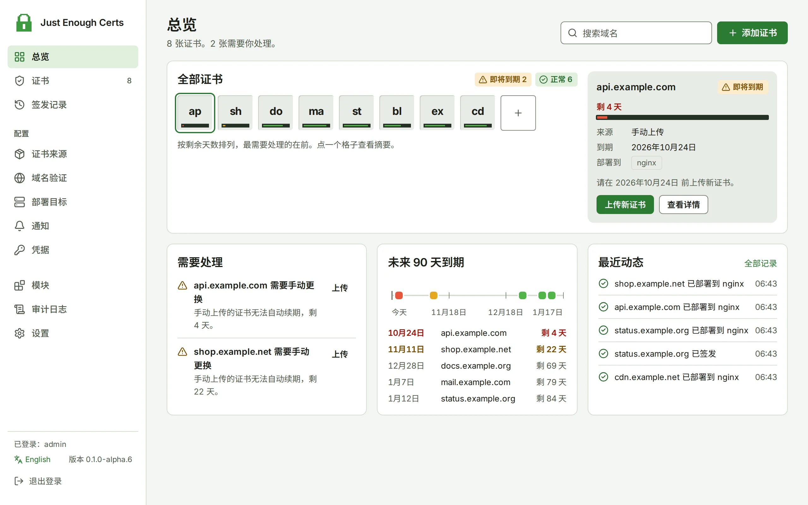

# Just Enough Certs

*Just enough certs to keep your site green.*

[English](README.md) · [在线文档](https://getjec.dev/zh-CN/)

Just Enough Certs（JEC）是一款自托管的 SSL/TLS 证书管理面板，负责从各类来源获取证书、自动完成域名验证、将证书部署到 CDN 与服务器，并在到期前自动续期。项目名称与视觉风格致敬 Minecraft 模组 JEI。

> [!WARNING]
> JEC 仍处于早期开发阶段，尚未发布正式版。测试版为 0.1.0-alpha.x（镜像标签 `beta`），已实现下文所列功能。阿里云 ESA 部署、Namecheap SSL Manager 与 Cloudflare 边缘应答已经过真实账号验证；界面上标有“未实测”的类型仅用替身测试，可能无法生效。路线图见 [PLAN.md](PLAN.md)。

<picture>
  <source media="(prefers-color-scheme: dark)" srcset="docs/site/public/preview/overview-zh-CN-dark.webp">
  
</picture>

## 功能

- **证书来源**：任意 ACME 证书颁发机构（支持 External Account Binding）；上传 PEM 或 PFX 文件；本机 certbot、acme.sh 续期的证书；阿里云与腾讯云的证书服务；自己的私有 CA；Namecheap SSL Manager（实验性）。
- **域名验证**：[lego](https://github.com/go-acme/lego) 支持的 221 家 DNS 服务商、手动添加记录与 CNAME 委派；HTTP 验证可写入网站目录，或由 JEC 自身、阿里云 ESA 或 Cloudflare 边缘应答。
- **部署目标**：31 种，包括阿里云（ESA、CDN、OSS、负载均衡）、腾讯云（CDN、EdgeOne）、华为云（CDN、ELB）、Cloudflare、AWS（Certificate Manager、CloudFront）、Gcore、宝塔面板、1Panel、Nginx Proxy Manager、群晖 DSM、Proxmox VE、Caddy、本地目录、SSH 服务器、Docker 容器、Kubernetes 与 Webhook。
- **续期**：续期窗口与每日检查时间、ACME 续期信息（ARI）、失败按退避重试，并核对各域名实际提供的证书。
- **通知**：14 种渠道，如邮件、Telegram、钉钉、飞书、企业微信、Discord、Slack、Bark、ntfy、Webhook 与脚本，可分别设置事件与语言，并可每周发送概况；证书到期与续期的日历订阅；Prometheus 指标。
- **安全**：密钥加密存储、两步验证、OpenID Connect 单点登录、API 令牌、审计日志与每日自动备份，可在证书颁发机构吊销已签发的证书。
- **轻量**：单个静态二进制文件或小体积容器镜像，数据存储于 SQLite（也可使用 PostgreSQL）；内核以外的功能均为模块，插件可用任意语言编写。

## 快速开始

```sh
mkdir jec && cd jec
curl -fsSLO https://raw.githubusercontent.com/XMZO/JustEnoughCerts/main/deploy/docker-compose.yml
mkdir -p data && sudo chown 65532:65532 data
docker compose up -d
docker logs jec 2>&1 | grep setup_token
```

JEC 仅监听服务器本机的 `127.0.0.1:8080`：按[反向代理与 CDN](https://getjec.dev/zh-CN/operations/reverse-proxy)经反向代理以 HTTPS 访问；或先试用时，在自己的电脑上执行 `ssh -N -L 8080:127.0.0.1:8080 <用户>@<主机>`，再打开 `http://localhost:8080`。填写日志中的初始化令牌并创建管理员账号。正式版发布前，该文件使用最新测试版（镜像标签 `beta`）。签发第一张证书的步骤见[快速开始](https://getjec.dev/zh-CN/guide/getting-started)。

## 文档

| 部分 | 内容 |
|---|---|
| [指南](https://getjec.dev/zh-CN/guide/introduction) | 介绍、快速开始、安装与升级、核心概念 |
| [使用](https://getjec.dev/zh-CN/usage/certificates) | 证书、证书来源、域名验证、部署目标、续期、通知 |
| [运维](https://getjec.dev/zh-CN/operations/configuration) | 配置参考、反向代理与 CDN、数据与备份、账号与安全、配置导入导出、校验发布文件 |
| [参考](https://getjec.dev/zh-CN/reference/providers) | 服务商支持与测试情况、API |
| [开发](https://getjec.dev/zh-CN/development/contributing) | 参与开发、插件、翻译指南、真实账号测试 |

文档页面位于 [docs/](docs)；架构与路线图见 [PLAN.md](PLAN.md)。

## 许可证

[MIT](LICENSE)
